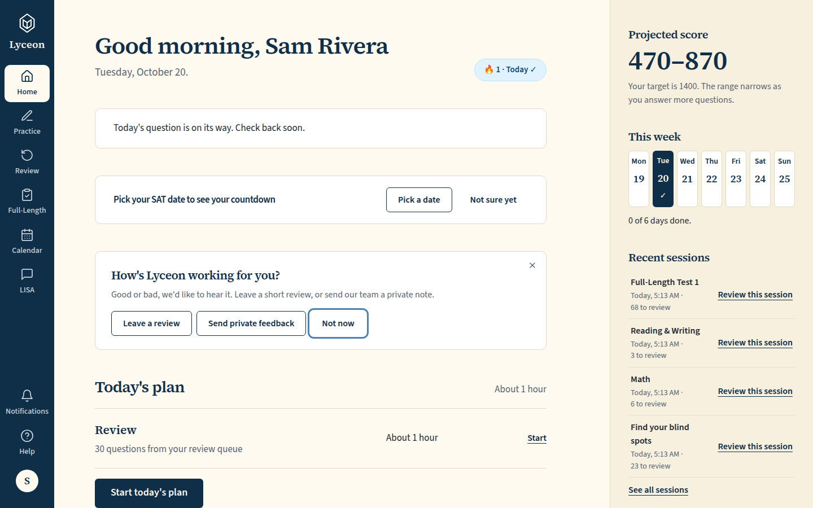
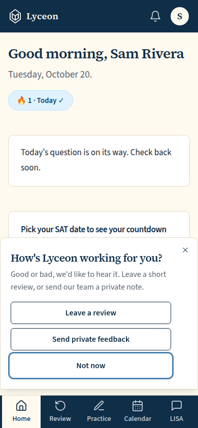
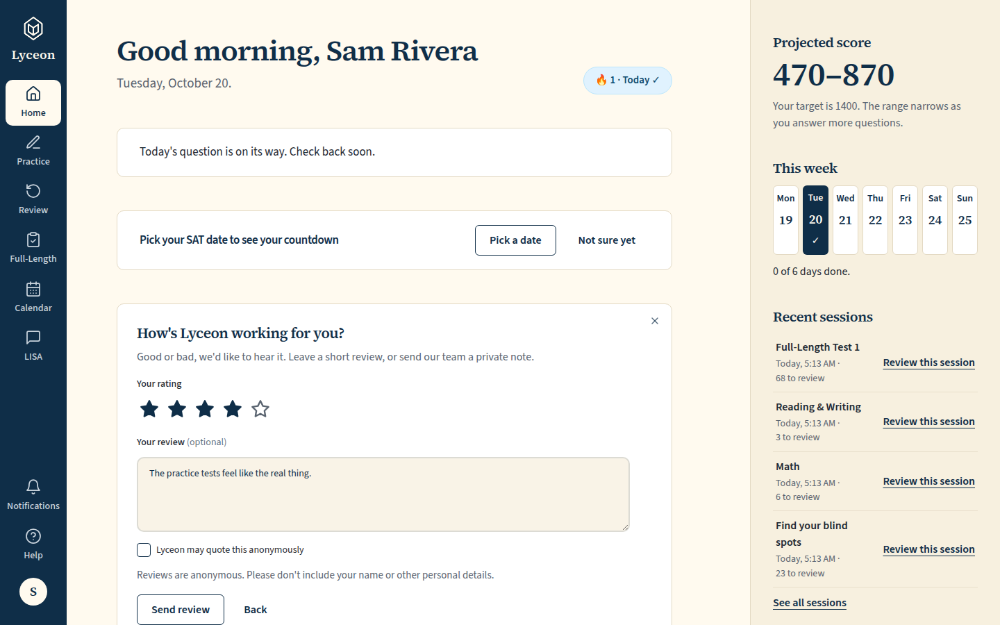
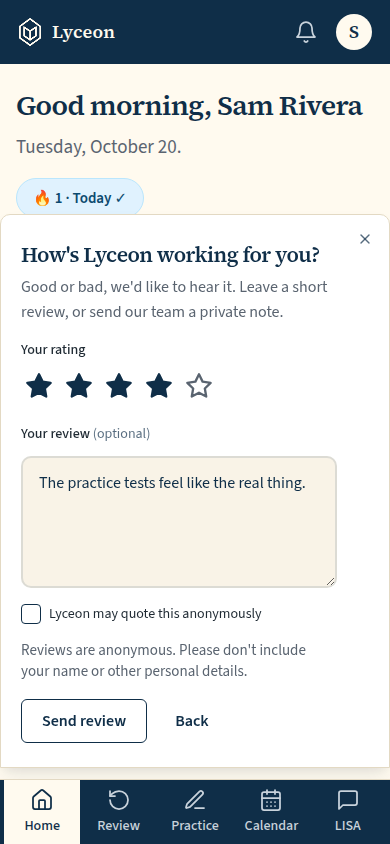
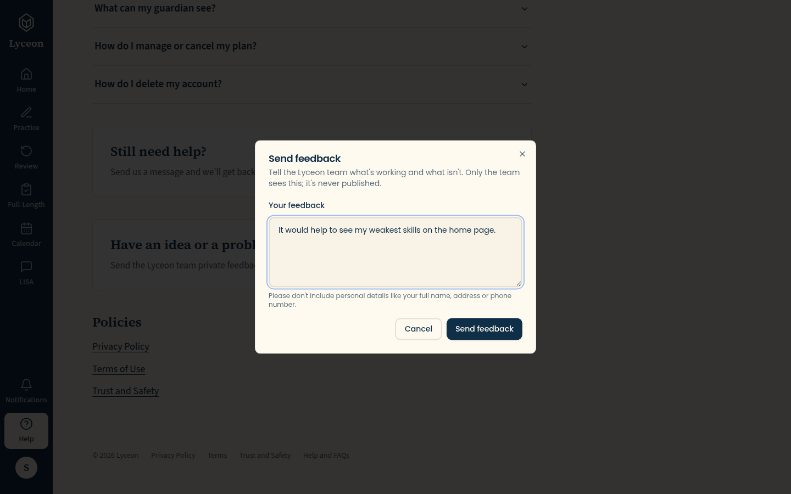
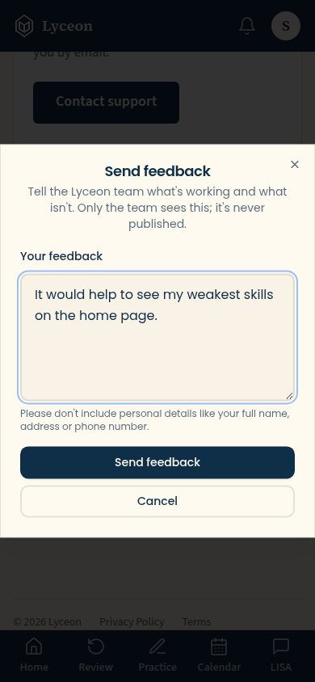
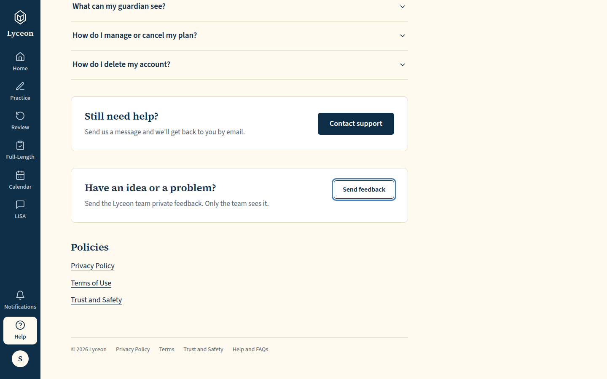
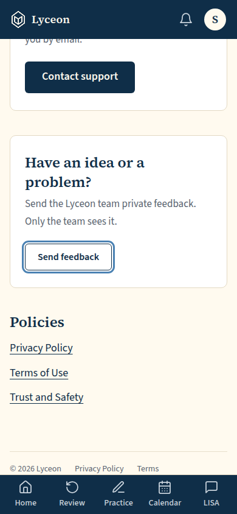
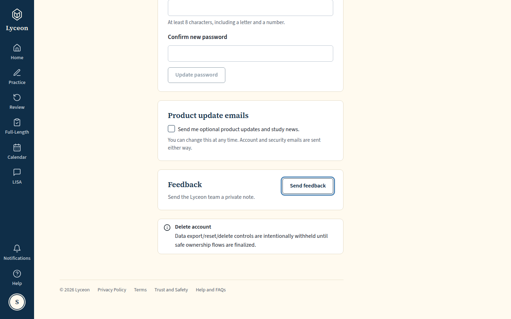
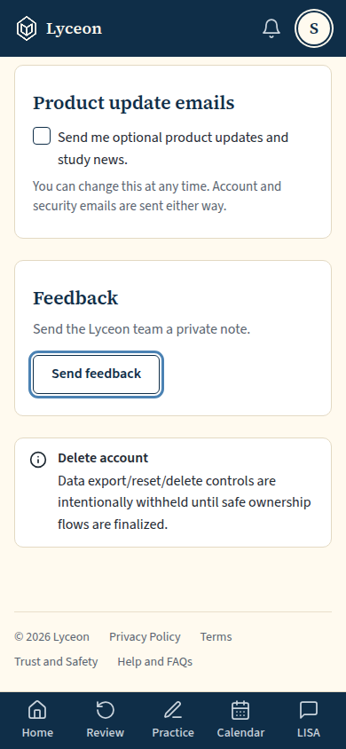

# SEO Wave 2 Q5/Q6: review prompt, review form, private feedback, Settings opt-in (light, 1440 and 390)

Generated 2026-10-20T05:14:13.769Z by `pnpm exec tsx tests/e2e/student-harness/capture.ts Q6` (see `tests/e2e/student-harness/README.md`). Built = a production build of the real client (`vite preview`, or the dev server with STUDENT_HARNESS_CLIENT=dev) against the student harness (real routers over a local Postgres built from this repo's migrations; personas seeded through the real practice routes). Prototype = the signed-off `docs/plans/student-ui/design/prototype/*.dc.html`, rendered locally.

Conditions, read before comparing:
- Viewport screenshots (not full page) unless the shot says full page: desktop 1440x900, phone 390x844, and any extra size a shot names.
- The prototypes are a fixed 1440x900 canvas with no phone layout; phone rows show the desktop prototype.
- Dark is requested through the app's own per-device setting; the theme column records what the page rendered.
- No external requests: the built app's Google Fonts (Inter, Poppins) are blocked, so legacy page bodies fall back to system faces; Source Sans 3 / Source Serif 4 are self-hosted and load for both sides.
- Prototype data is illustrative; built data is the seeded personas' real payloads.

## The review ask on Home: "How's Lyceon working for you?" with Leave a review, Send private feedback, Not now and a close button — a card below today's question on desktop, a bottom sheet on the phone. 13–17 wording, no Trustpilot (the student is 17).

Persona: `paid`. Route: `/dashboard`.
Cookie banner already answered (the real `lyceon_consent` cookie, analytics rejected, current banner version).
No review-ask state before each capture (the persona's `product_review_prompt_state` and `product_reviews` rows are deleted from the harness database), and the persona meets the usage trigger there (account dated 8 days back, completed practice sessions up to 3, the Getting started checklist dismissed), so the real trigger and cadence show the ask in every viewport and theme.
Step: focus `{"desktop":"[data-testid=\"review-prompt-not-now\"]","mobile":"[data-testid=\"review-prompt-not-now\"]"}` (no typing).
Prototype: none. New SEO Wave 2 surface; no signed-off prototype. Built with the student tokens (DESIGN.md §1).

| Viewport | Theme (as rendered) | Built | Prototype |
|---|---|---|---|
| desktop | light |  `/dashboard`, 144 KB, horizontal overflow 0px | none |
| mobile | light |  `/dashboard`, 54 KB, horizontal overflow 0px | none |

## Leave a review: a 1–5 rating, optional text, and the unticked 'Lyceon may quote this anonymously'

Persona: `paid`. Route: `/dashboard`.
Cookie banner already answered (the real `lyceon_consent` cookie, analytics rejected, current banner version).
No review-ask state before each capture (the persona's `product_review_prompt_state` and `product_reviews` rows are deleted from the harness database), and the persona meets the usage trigger there (account dated 8 days back, completed practice sessions up to 3, the Getting started checklist dismissed), so the real trigger and cadence show the ask in every viewport and theme.
Step: click `{"desktop":"[data-testid=\"review-prompt-leave-review\"]","mobile":"[data-testid=\"review-prompt-leave-review\"]"}`.
Step: click `{"desktop":"[data-testid=\"review-rating-4\"]","mobile":"[data-testid=\"review-rating-4\"]"}`.
Step: type `The practice tests feel like the real thing.` into `{"desktop":"[data-testid=\"review-text\"]","mobile":"[data-testid=\"review-text\"]"}`.
Step: focus `{"desktop":"[data-testid=\"review-submit\"]","mobile":"[data-testid=\"review-submit\"]"}` (no typing).
Must then show `[data-testid="review-quote-permission"]` (the capture fails otherwise).
Prototype: none. New SEO Wave 2 surface; no signed-off prototype. Built with the student tokens (DESIGN.md §1).

| Viewport | Theme (as rendered) | Built | Prototype |
|---|---|---|---|
| desktop | light |  `/dashboard`, 141 KB, horizontal overflow 0px | none |
| mobile | light |  `/dashboard`, 54 KB, horizontal overflow 0px | none |

## Private feedback, opened from Help

Persona: `paid`. Route: `/help`.
Cookie banner already answered (the real `lyceon_consent` cookie, analytics rejected, current banner version).
Step: click `{"desktop":"[data-testid=\"feedback-open-help\"]","mobile":"[data-testid=\"feedback-open-help\"]"}`.
Step: type `It would help to see my weakest skills on the home page.` into `{"desktop":"[data-testid=\"feedback-text\"]","mobile":"[data-testid=\"feedback-text\"]"}`.
Must then show `[data-testid="feedback-dialog"]` (the capture fails otherwise).
Prototype: none. New SEO Wave 2 surface; no signed-off prototype. Built with the student tokens (DESIGN.md §1).

| Viewport | Theme (as rendered) | Built | Prototype |
|---|---|---|---|
| desktop | light |  `/help`, 87 KB, horizontal overflow 0px | none |
| mobile | light |  `/help`, 45 KB, horizontal overflow 0px | none |

## Help: the private-feedback box between Contact support and the Policies

Persona: `paid`. Route: `/help`.
Cookie banner already answered (the real `lyceon_consent` cookie, analytics rejected, current banner version).
Step: focus `{"desktop":"[data-testid=\"feedback-open-help\"]","mobile":"[data-testid=\"feedback-open-help\"]"}` (no typing).
Prototype: none. New SEO Wave 2 surface; no signed-off prototype. Built with the student tokens (DESIGN.md §1).

| Viewport | Theme (as rendered) | Built | Prototype |
|---|---|---|---|
| desktop | light |  `/help`, 75 KB, horizontal overflow 0px | none |
| mobile | light |  `/help`, 42 KB, horizontal overflow 0px | none |

## Settings → Account: Product update emails (the opt-in toggle) and Feedback, above Delete account

Persona: `paid`. Route: `/profile?tab=account`.
Cookie banner already answered (the real `lyceon_consent` cookie, analytics rejected, current banner version).
Step: focus `{"desktop":"[data-testid=\"feedback-open-settings\"]","mobile":"[data-testid=\"feedback-open-settings\"]"}` (no typing).
Prototype: none. New SEO Wave 2 surface; no signed-off prototype. Built with the student tokens (DESIGN.md §1).

| Viewport | Theme (as rendered) | Built | Prototype |
|---|---|---|---|
| desktop | light |  `/profile`, 75 KB, horizontal overflow 0px | none |
| mobile | light |  `/profile`, 52 KB, horizontal overflow 0px | none |

## Run facts

- Seeded ids: `{"free":{"completedPracticeSessionId":"70460f0d-0cc5-4da9-835c-6535c555d406","openPracticeSessionId":"59482821-bca0-4812-8441-e2dd40a1d0fb","openReviewSessionId":null,"diagnosticSessionId":null,"scoredExamSessionId":null,"inProgressExamSessionId":null,"lisaConversationId":null,"answered":13},"paid":{"completedPracticeSessionId":"995dcabe-df31-4da0-9e2a-ac4ec299406f","openPracticeSessionId":"afcb76a3-d097-40ef-9231-32eb594dcb83","openReviewSessionId":null,"diagnosticSessionId":"73bcdf6d-bed2-4e58-a9e5-26c1a7fab5d9","scoredExamSessionId":"85cd42ec-2580-49b6-9583-74d07aa63b69","inProgressExamSessionId":"502b17e0-b999-4b64-8081-a1e0ff6e47ad","lisaConversationId":null,"answered":178}}`
- Endpoints the pages asked for that the harness does not serve (answered 404): none
- Desmos (QA2-B, opt-in `STUDENT_HARNESS_DESMOS=1`): not loaded (a local-only run; the calculator shows its unavailable line)
- External hosts blocked: none
