# F-72: the unanswered cookie banner on /dashboard and /calendar — above the phone tab bar at 390, and clear of the calendar sheet's buttons; light and dark, 1440 and 390

Generated 2026-10-21T05:16:53.855Z by `pnpm exec tsx tests/e2e/student-harness/capture.ts COOKIE-BANNER` (see `tests/e2e/student-harness/README.md`). Built = a production build of the real client (`vite preview`, or the dev server with STUDENT_HARNESS_CLIENT=dev) against the student harness (real routers over a local Postgres built from this repo's migrations; personas seeded through the real practice routes). Prototype = the signed-off `docs/plans/student-ui/design/prototype/*.dc.html`, rendered locally.

Conditions, read before comparing:
- Viewport screenshots (not full page) unless the shot says full page: desktop 1440x900, phone 390x844, and any extra size a shot names.
- The prototypes are a fixed 1440x900 canvas with no phone layout; phone rows show the desktop prototype.
- Dark is requested through the app's own per-device setting; the theme column records what the page rendered.
- No external requests: the built app's Google Fonts (Inter, Poppins) are blocked, so legacy page bodies fall back to system faces; Source Sans 3 / Source Serif 4 are self-hosted and load for both sides.
- Prototype data is illustrative; built data is the seeded personas' real payloads.

## /dashboard, banner unanswered: at 390 it sits above the tab bar (no overlap)

Persona: `paid`. Route: `/dashboard`.
Must then show `[data-testid="cookie-banner"]` (the capture fails otherwise).
Prototype: none. The cookie banner is the SEO vertical's site-wide surface (Doc 10 §9.11); no student prototype draws it.

| Viewport | Theme (as rendered) | Built | Prototype |
|---|---|---|---|
| desktop | light | 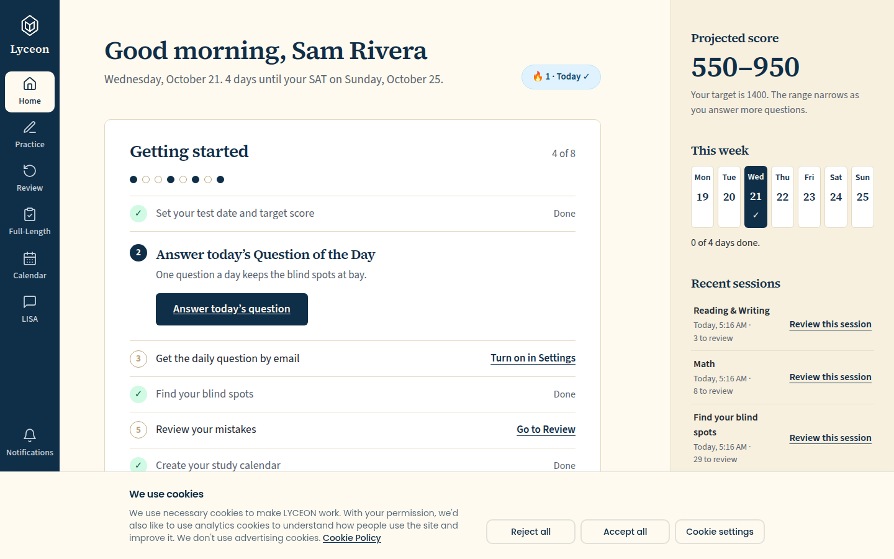 `/dashboard`, 165 KB, horizontal overflow 0px | none |
| desktop | dark | 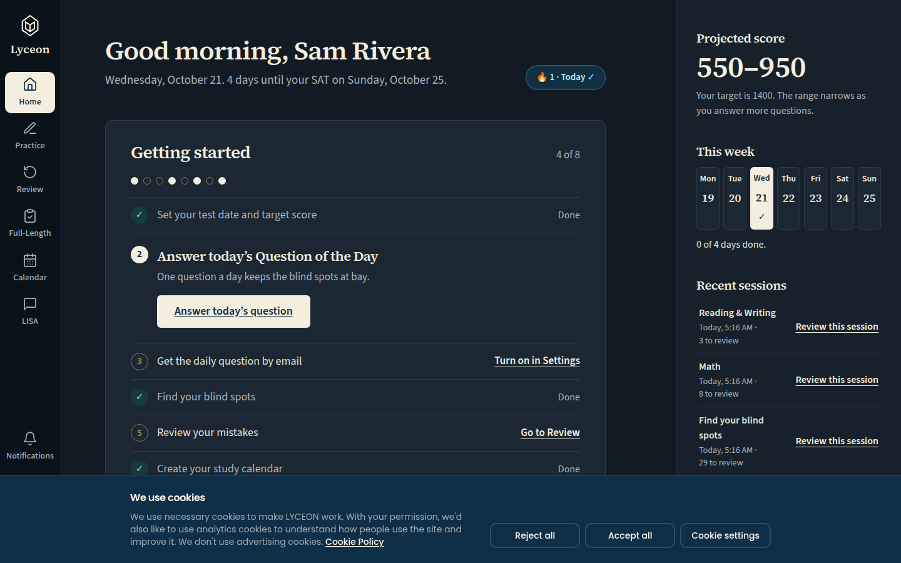 `/dashboard`, 166 KB, horizontal overflow 0px | none |
| mobile | light | 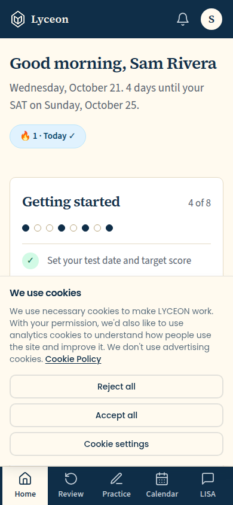 `/dashboard`, 65 KB, horizontal overflow 0px | none |
| mobile | dark | 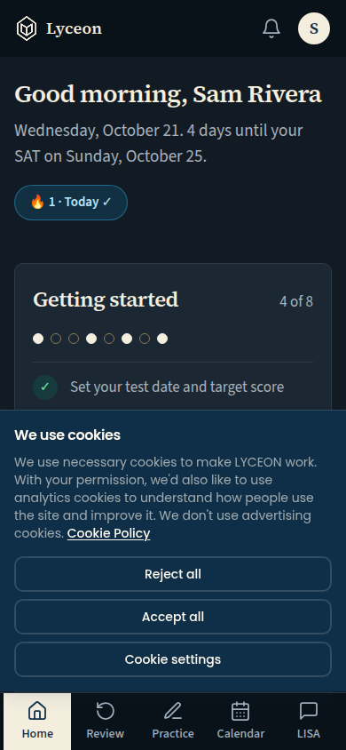 `/dashboard`, 65 KB, horizontal overflow 0px | none |

## /calendar, banner unanswered: at 390 it sits above the tab bar (no overlap)

Persona: `paid`. Route: `/calendar`.
Must then show `[data-testid="cookie-banner"]` (the capture fails otherwise).
Prototype: none. The cookie banner is the SEO vertical's site-wide surface (Doc 10 §9.11); no student prototype draws it.

| Viewport | Theme (as rendered) | Built | Prototype |
|---|---|---|---|
| desktop | light | 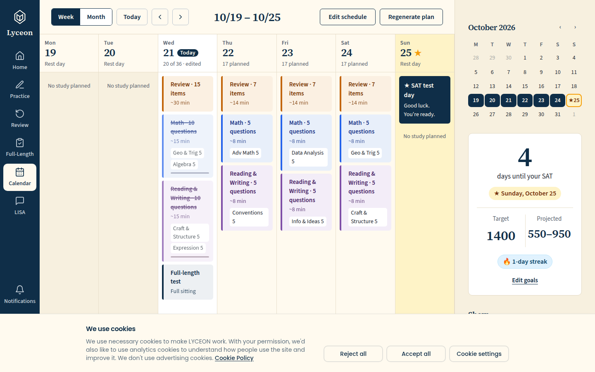 `/calendar`, 162 KB, horizontal overflow 0px | none |
| desktop | dark | 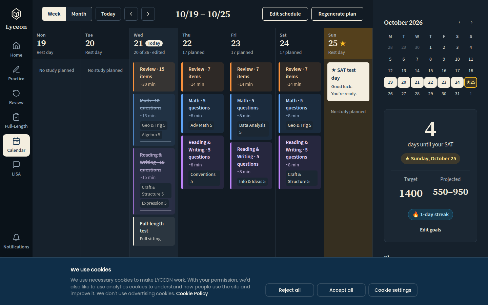 `/calendar`, 164 KB, horizontal overflow 0px | none |
| mobile | light | 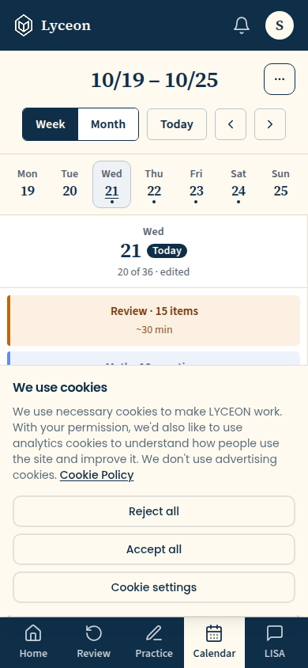 `/calendar`, 55 KB, horizontal overflow 0px | none |
| mobile | dark | 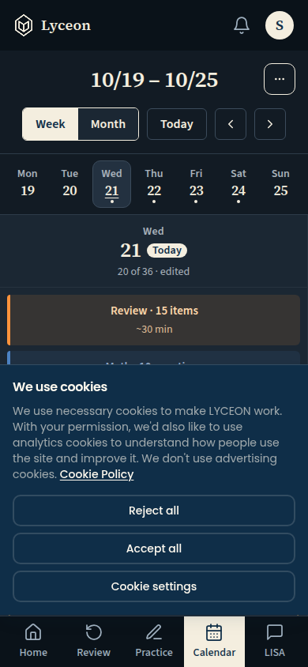 `/calendar`, 56 KB, horizontal overflow 0px | none |

## /calendar with a block's sheet open, banner unanswered: the sheet's Remove button is not covered (the banner steps aside while a sheet is open)

Persona: `paid`. Route: `/calendar`.
Step: click `{"desktop":"button.block.rev","mobile":"button.block.rev"}`.
Must then show `[data-testid="calendar-block-sheet"]` (the capture fails otherwise).
Prototype: none. The cookie banner is the SEO vertical's site-wide surface (Doc 10 §9.11); no student prototype draws it.

| Viewport | Theme (as rendered) | Built | Prototype |
|---|---|---|---|
| desktop | light | 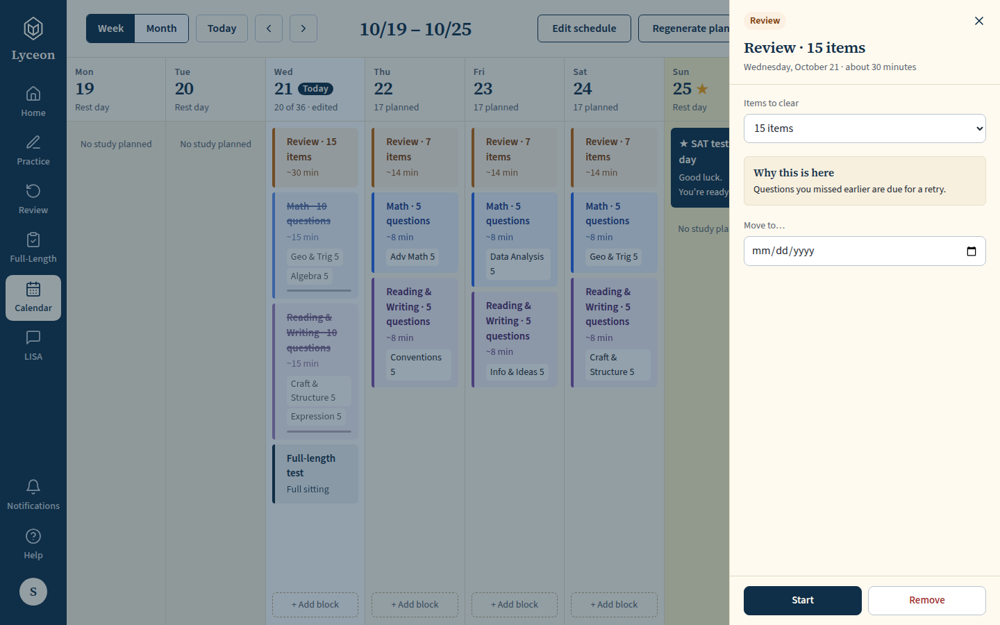 `/calendar`, 134 KB, horizontal overflow 0px | none |
| desktop | dark | 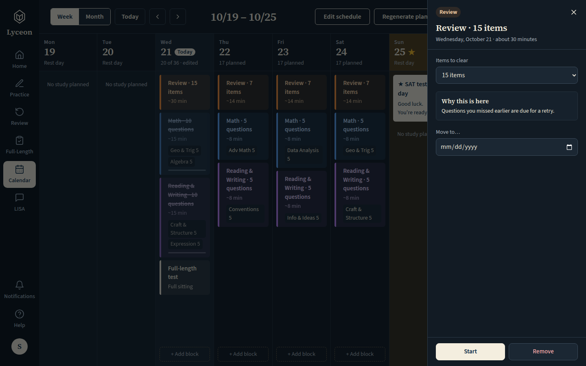 `/calendar`, 131 KB, horizontal overflow 0px | none |
| mobile | light | 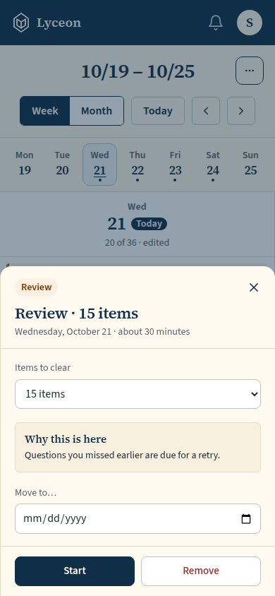 `/calendar`, 45 KB, horizontal overflow 0px | none |
| mobile | dark | 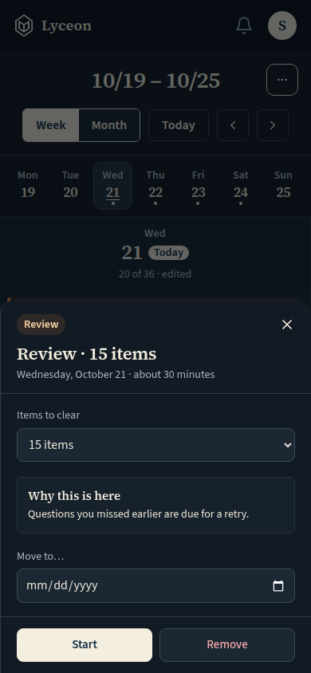 `/calendar`, 45 KB, horizontal overflow 0px | none |

## Run facts

- Seeded ids: `{"free":{"completedPracticeSessionId":"d2773b1d-00a3-47a8-8ae7-1733b35ce31a","openPracticeSessionId":"9c719111-6976-4d16-b4c4-141e804ec9f3","openReviewSessionId":null,"diagnosticSessionId":null,"scoredExamSessionId":null,"inProgressExamSessionId":null,"lisaConversationId":null,"answered":13},"paid":{"completedPracticeSessionId":"8dde045d-6c4b-4b1b-b3f8-501014f3f81e","openPracticeSessionId":"a1ca0a3e-5e03-405a-a88a-8d62719bd921","openReviewSessionId":null,"diagnosticSessionId":"0db6b387-b679-4543-9552-336f8a9444ef","scoredExamSessionId":null,"inProgressExamSessionId":null,"lisaConversationId":null,"answered":53}}`
- Endpoints the pages asked for that the harness does not serve (answered 404): none
- Desmos (QA2-B, opt-in `STUDENT_HARNESS_DESMOS=1`): not loaded (a local-only run; the calculator shows its unavailable line)
- External hosts blocked: none
