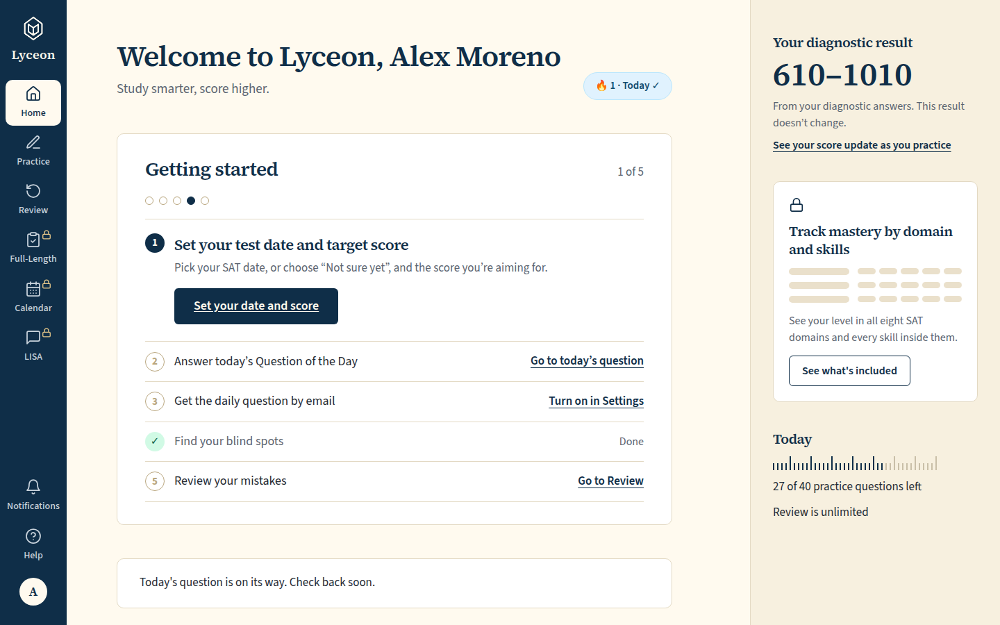
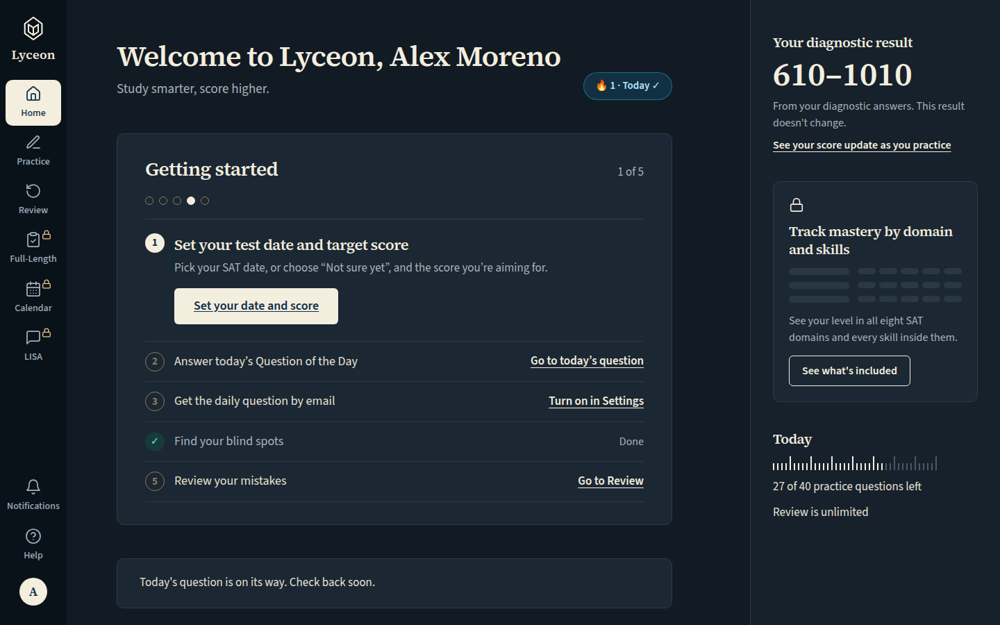
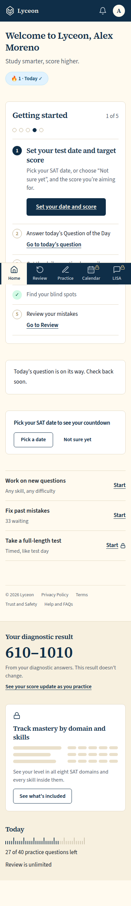
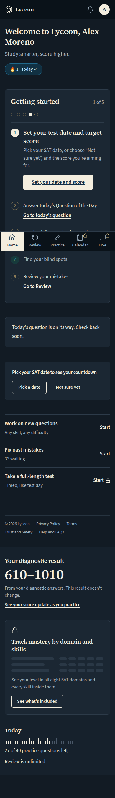
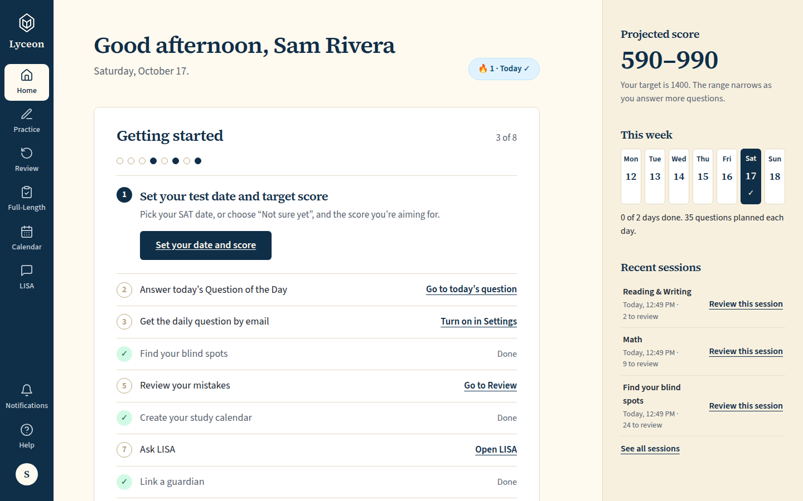
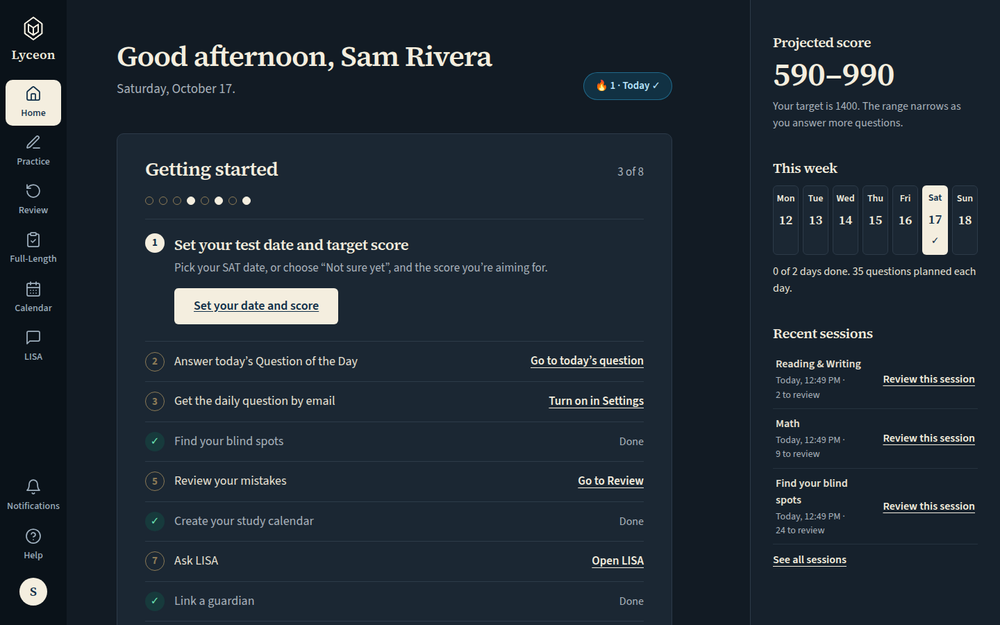
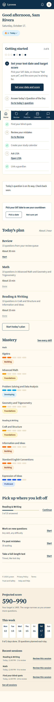
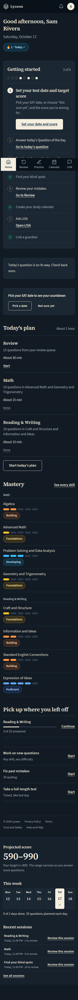

# Home projection panel: free = 'Your diagnostic result', paid = live 'Projected score' (light and dark, 1440 and 390)

Generated 2026-10-17T12:49:35.572Z by `pnpm exec tsx tests/e2e/student-harness/capture.ts DIAGNOSTIC-PROJECTION` (see `tests/e2e/student-harness/README.md`). Built = a production build of the real client (`vite preview`, or the dev server with STUDENT_HARNESS_CLIENT=dev) against the student harness (real routers over a local Postgres built from this repo's migrations; personas seeded through the real practice routes). Prototype = the signed-off `docs/plans/student-ui/design/prototype/*.dc.html`, rendered locally.

Conditions, read before comparing:
- Viewport screenshots (not full page) unless the shot says full page: desktop 1440x900, phone 390x844, and any extra size a shot names.
- The prototypes are a fixed 1440x900 canvas with no phone layout; phone rows show the desktop prototype.
- Dark is requested through the app's own per-device setting; the theme column records what the page rendered.
- No external requests: the built app's Google Fonts (Inter, Poppins) are blocked, so legacy page bodies fall back to system faces; Source Sans 3 / Source Serif 4 are self-hosted and load for both sides.
- Prototype data is illustrative; built data is the seeded personas' real payloads.

## Home, free, after the diagnostic: the panel says 'Your diagnostic result', the stored band, 'From your diagnostic answers. This result doesn't change.' and the upgrade link for the live projection

Persona: `free`. Route: `/dashboard`.
Diagnostic completed before the capture through the real routes (start, /next, /answer x40), so the stored diagnostic projection is the real completion path's (SCL-236).
Full page: the whole document, not just the viewport.
Prototype: none. NOT PROTOTYPED: 'Your diagnostic result' is new with SCL-235 (owner ruling, Karl, 2026-10-16); it reuses the panel's existing heading, band and muted line, and the panel link style for the upgrade.

| Viewport | Theme (as rendered) | Built | Prototype |
|---|---|---|---|
| desktop | light |  `/dashboard`, 140 KB, horizontal overflow 0px | none |
| desktop | dark |  `/dashboard`, 142 KB, horizontal overflow 0px | none |
| mobile | light |  `/dashboard`, 151 KB, horizontal overflow 0px | none |
| mobile | dark |  `/dashboard`, 154 KB, horizontal overflow 0px | none |

## Home, paid: the panel is unchanged — 'Projected score', the live band, no diagnostic label and no upgrade link

Persona: `paid`. Route: `/dashboard`.
Full page: the whole document, not just the viewport.
Prototype: none. NOT PROTOTYPED: 'Your diagnostic result' is new with SCL-235 (owner ruling, Karl, 2026-10-16); it reuses the panel's existing heading, band and muted line, and the panel link style for the upgrade.

| Viewport | Theme (as rendered) | Built | Prototype |
|---|---|---|---|
| desktop | light |  `/dashboard`, 153 KB, horizontal overflow 0px | none |
| desktop | dark |  `/dashboard`, 154 KB, horizontal overflow 0px | none |
| mobile | light |  `/dashboard`, 276 KB, horizontal overflow 0px | none |
| mobile | dark |  `/dashboard`, 281 KB, horizontal overflow 0px | none |

## Run facts

- Seeded ids: `{"free":{"completedPracticeSessionId":"24fe46ef-51c7-4ba5-8077-4571bd1b1ad2","openPracticeSessionId":"2574fdf5-de76-46ff-b52e-cf70a9cf0554","openReviewSessionId":null,"diagnosticSessionId":null,"scoredExamSessionId":null,"inProgressExamSessionId":null,"lisaConversationId":null,"answered":13},"paid":{"completedPracticeSessionId":"fa40a04c-0e68-47b2-b055-a2c7ce41e983","openPracticeSessionId":"20d74aac-cdb4-4337-aa3f-7df1029e0063","openReviewSessionId":null,"diagnosticSessionId":"4f3a1e1c-9934-4582-9783-b1cd1fffbe5d","scoredExamSessionId":null,"inProgressExamSessionId":null,"lisaConversationId":null,"answered":53}}`
- Endpoints the pages asked for that the harness does not serve (answered 404): none
- Desmos (QA2-B, opt-in `STUDENT_HARNESS_DESMOS=1`): not loaded (a local-only run; the calculator shows its unavailable line)
- External hosts blocked: none
