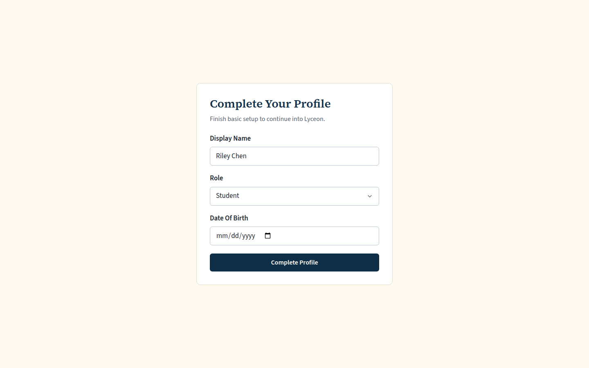
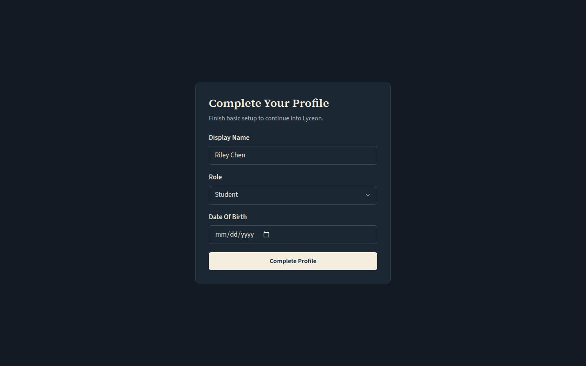
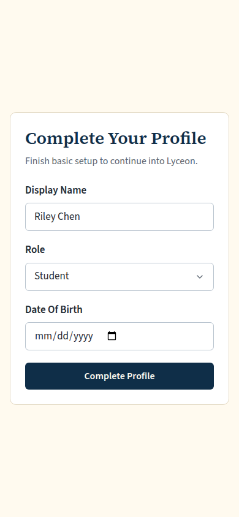
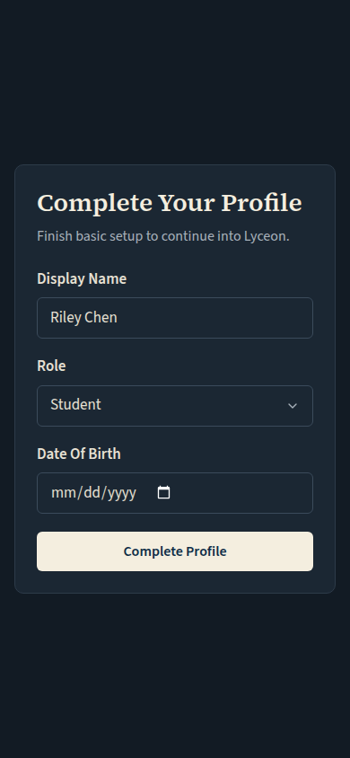
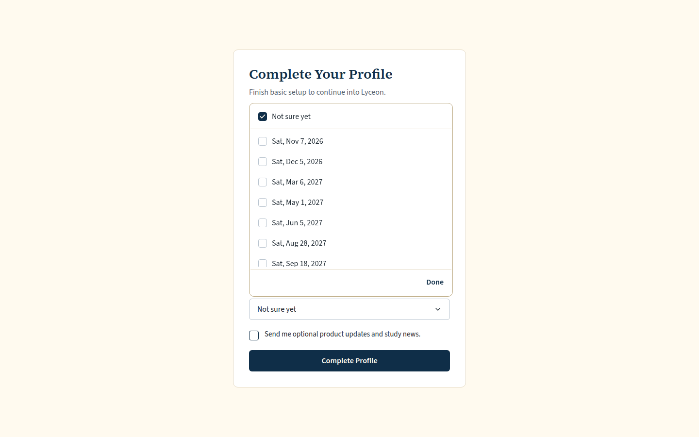
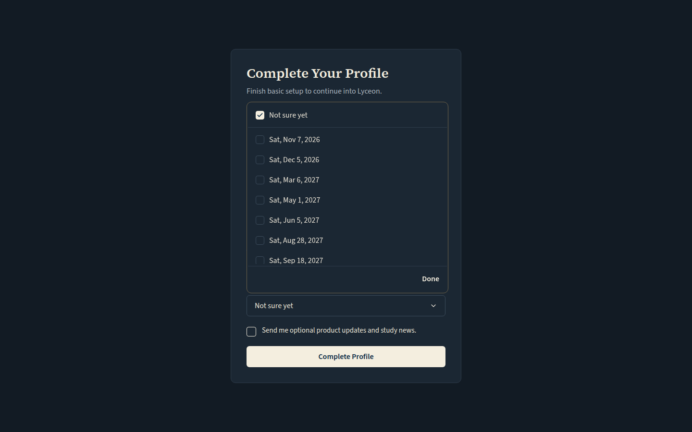
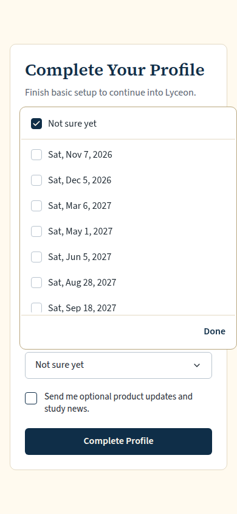
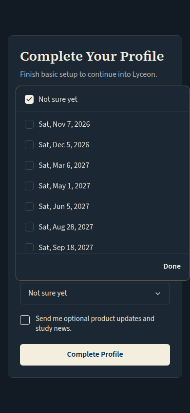

# First-run activation fixes: onboarding's empty date of birth, and the SAT-date picker's helper line and Done (light and dark, 1440 and 390)

Generated 2026-10-13T09:02:24.907Z by `pnpm exec tsx tests/e2e/student-harness/capture.ts FIRST-RUN-ONBOARDING` (see `tests/e2e/student-harness/README.md`). Built = a production build of the real client (`vite preview`, or the dev server with STUDENT_HARNESS_CLIENT=dev) against the student harness (real routers over a local Postgres built from this repo's migrations; personas seeded through the real practice routes). Prototype = the signed-off `docs/plans/student-ui/design/prototype/*.dc.html`, rendered locally.

Conditions, read before comparing:
- Viewport screenshots (not full page) unless the shot says full page: desktop 1440x900, phone 390x844, and any extra size a shot names.
- The prototypes are a fixed 1440x900 canvas with no phone layout; phone rows show the desktop prototype.
- Dark is requested through the app's own per-device setting; the theme column records what the page rendered.
- No external requests: the built app's Google Fonts (Inter, Poppins) are blocked, so legacy page bodies fall back to system faces; Source Sans 3 / Source Serif 4 are self-hosted and load for both sides.
- Prototype data is illustrative; built data is the seeded personas' real payloads.

## Onboarding: the date of birth starts empty; no SAT question until a date is entered

Persona: `onboarding`. Route: `/profile/complete`.
Must then show no `[data-testid="onboarding-sat-dates"]` (the capture fails otherwise).
Full page: the whole document, not just the viewport.
Prototype: none. NOT PROTOTYPED: new in the first-run activation brief (Karl, 2026-10-13), built to DESIGN.md §5; these screenshots go to Karl before merge.

| Viewport | Theme (as rendered) | Built | Prototype |
|---|---|---|---|
| desktop | light |  `/profile/complete`, 29 KB, horizontal overflow 0px | none |
| desktop | dark |  `/profile/complete`, 30 KB, horizontal overflow 0px | none |
| mobile | light |  `/profile/complete`, 25 KB, horizontal overflow 0px | none |
| mobile | dark |  `/profile/complete`, 26 KB, horizontal overflow 0px | none |

## Onboarding, a 13+ date entered: 'When's your SAT?' with 'Pick every date you might take', the menu open, Done on screen

Persona: `onboarding`. Route: `/profile/complete`.
Must then show `[data-testid="onboarding-sat-dates-done"]` wholly inside the viewport (the capture fails otherwise).
Step: type `2009-05-01` into `{"desktop":"[data-testid=\"input-date-of-birth\"]","mobile":"[data-testid=\"input-date-of-birth\"]"}`.
Step: click `{"desktop":"[data-testid=\"onboarding-sat-dates-trigger\"]","mobile":"[data-testid=\"onboarding-sat-dates-trigger\"]"}`.
Prototype: none. NOT PROTOTYPED: new in the first-run activation brief (Karl, 2026-10-13), built to DESIGN.md §5; these screenshots go to Karl before merge.

| Viewport | Theme (as rendered) | Built | Prototype |
|---|---|---|---|
| desktop | light |  `/profile/complete`, 44 KB, horizontal overflow 0px | none |
| desktop | dark |  `/profile/complete`, 45 KB, horizontal overflow 0px | none |
| mobile | light |  `/profile/complete`, 38 KB, horizontal overflow 0px | none |
| mobile | dark |  `/profile/complete`, 39 KB, horizontal overflow 0px | none |

## Run facts

- Seeded ids: `{"free":{"completedPracticeSessionId":"1c27ae20-8f55-4eb0-88f1-956b7300d4e7","openPracticeSessionId":"482b93b3-f3b0-4d32-8891-740cf4a07264","openReviewSessionId":null,"diagnosticSessionId":null,"scoredExamSessionId":null,"inProgressExamSessionId":null,"lisaConversationId":null,"answered":13},"paid":{"completedPracticeSessionId":"08d4de9d-6421-4421-94ce-abef0160943d","openPracticeSessionId":"7078b65b-a694-4f75-b8dd-419fcd587e0e","openReviewSessionId":null,"diagnosticSessionId":"16f87c58-fe91-4810-b04a-34e1e0f4c2c8","scoredExamSessionId":null,"inProgressExamSessionId":null,"lisaConversationId":null,"answered":53}}`
- Endpoints the pages asked for that the harness does not serve (answered 404): none
- Desmos (QA2-B, opt-in `STUDENT_HARNESS_DESMOS=1`): not loaded (a local-only run; the calculator shows its unavailable line)
- External hosts blocked: none
