# First-run activation fixes: session summaries, Home, in-shell error screen, QOTD prompt, sign-in (light and dark, 1440 and 390)

Generated 2026-10-15T05:47:18.039Z by `pnpm exec tsx tests/e2e/student-harness/capture.ts FIRST-RUN` (see `tests/e2e/student-harness/README.md`). Built = a production build of the real client (`vite preview`, or the dev server with STUDENT_HARNESS_CLIENT=dev) against the student harness (real routers over a local Postgres built from this repo's migrations; personas seeded through the real practice routes). Prototype = the signed-off `docs/plans/student-ui/design/prototype/*.dc.html`, rendered locally.

Conditions, read before comparing:
- Viewport screenshots (not full page) unless the shot says full page: desktop 1440x900, phone 390x844, and any extra size a shot names.
- The prototypes are a fixed 1440x900 canvas with no phone layout; phone rows show the desktop prototype.
- Dark is requested through the app's own per-device setting; the theme column records what the page rendered.
- No external requests: the built app's Google Fonts (Inter, Poppins) are blocked, so legacy page bodies fall back to system faces; Source Sans 3 / Source Serif 4 are self-hosted and load for both sides.
- Prototype data is illustrative; built data is the seeded personas' real payloads.

## Practice session summary: score with skips, streak kept, sent to review, the recorded mastery change if any; Review misses (primary) and Another 5

Persona: `paid`. Route: `/practice/session/{session}`.
Fresh session per capture (real create route, ended after the shot): `practice {"sections":["M"],"target_question_count":5}`.
Full page: the whole document, not just the viewport.
Prototype: none. NOT PROTOTYPED: new in the first-run activation brief (Karl, 2026-10-13), built to DESIGN.md §5; these screenshots go to Karl before merge.

| Viewport | Theme (as rendered) | Built | Prototype |
|---|---|---|---|
| desktop | light | 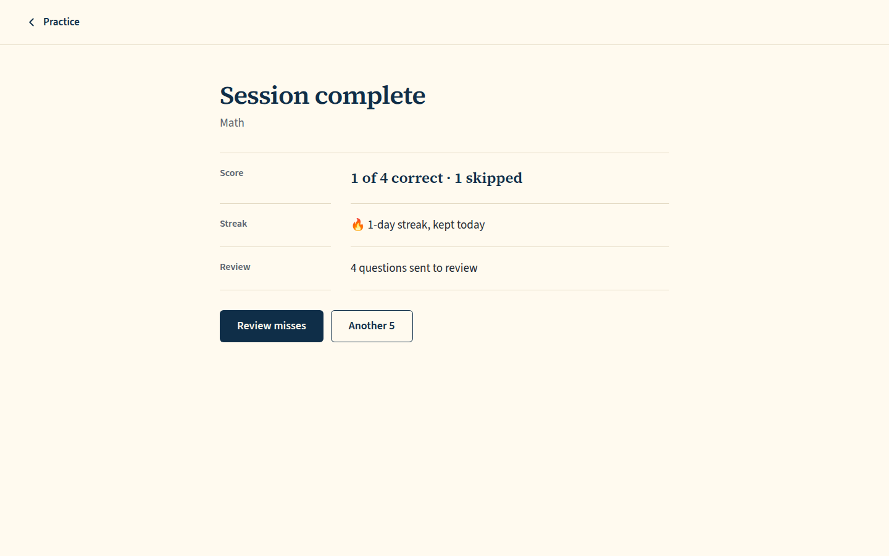 `/practice/session/0f523880-9e88-458c-aab3-5138eda4c527`, 36 KB, horizontal overflow 0px | none |
| desktop | dark | 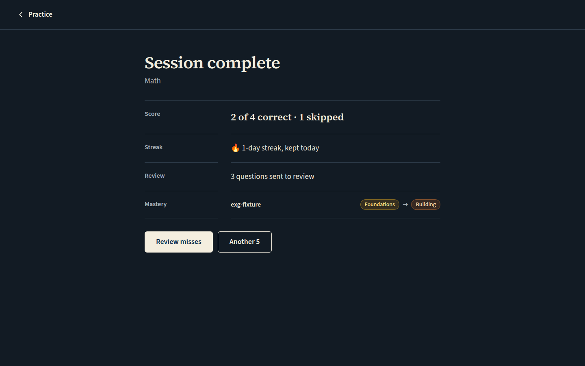 `/practice/session/b7fcb63a-f6ea-43f2-9903-5a46608ad387`, 44 KB, horizontal overflow 0px | none |
| mobile | light | 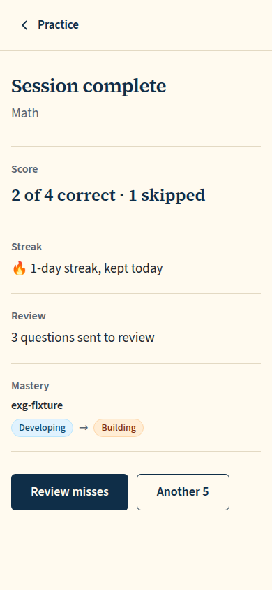 `/practice/session/023c5a46-a11f-4ae9-bc05-4d2201faa917`, 36 KB, horizontal overflow 0px | none |
| mobile | dark | 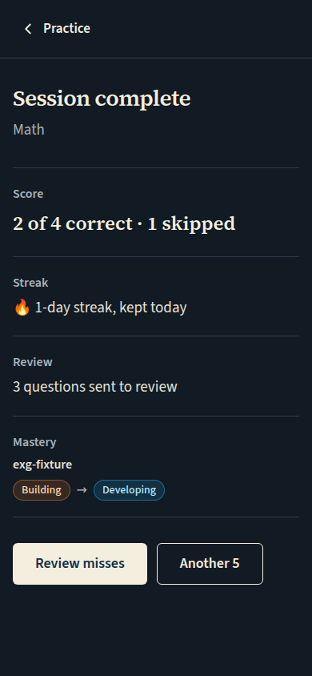 `/practice/session/d44d16ca-9a3f-416f-954a-d0419208d35f`, 36 KB, horizontal overflow 0px | none |

## Practice session summary, free: the muted locked line 'Track how this moves your mastery — included with paid plans' (a link to the plans page) in place of a mastery change

Persona: `free`. Route: `/practice/session/{session}`.
Fresh session per capture (real create route, ended after the shot): `practice {"sections":["M"],"target_question_count":5}`.
Today's free quota unused before each capture (the persona's practice answers and skips from the last day are dated a day earlier in the harness database).
Full page: the whole document, not just the viewport.
Prototype: none. NOT PROTOTYPED: owner ruling (Karl, 2026-10-15, on #1233, item 3), built to DESIGN.md §5; these screenshots go to Karl before merge.

| Viewport | Theme (as rendered) | Built | Prototype |
|---|---|---|---|
| desktop | light | 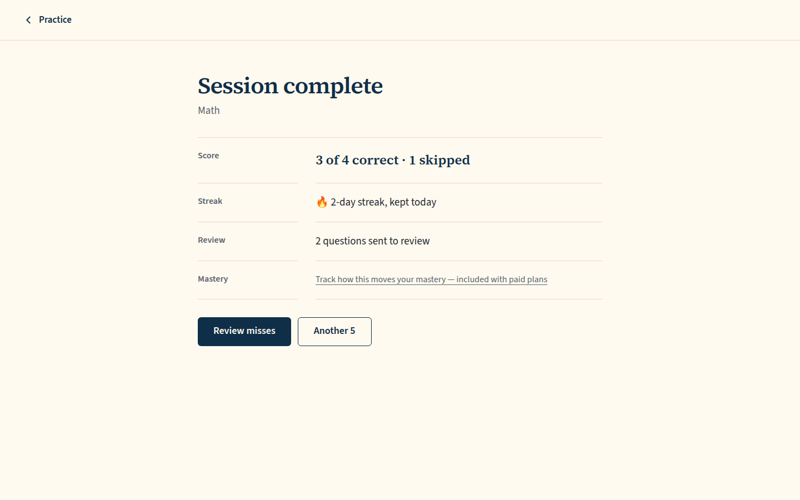 `/practice/session/5765fcaa-e3d5-4c51-98ae-1b0ebf651bbc`, 44 KB, horizontal overflow 0px | none |
| desktop | dark | 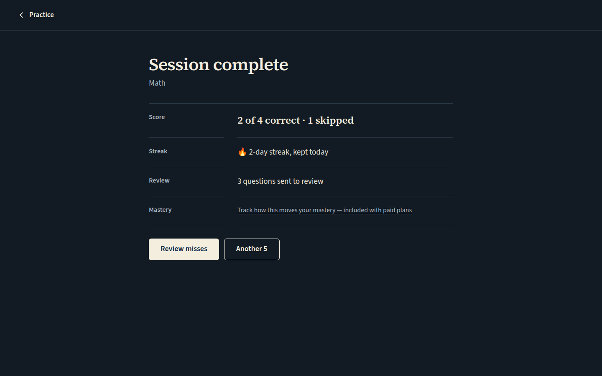 `/practice/session/25a22d72-3f82-4538-ba15-c372cd7601c8`, 44 KB, horizontal overflow 0px | none |
| mobile | light | 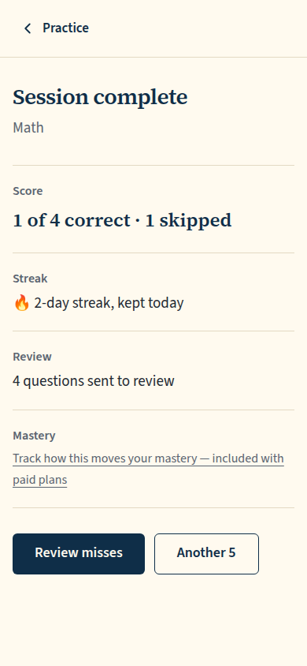 `/practice/session/cfc948d0-e0fb-4f64-8c44-e5046e739db9`, 36 KB, horizontal overflow 0px | none |
| mobile | dark | 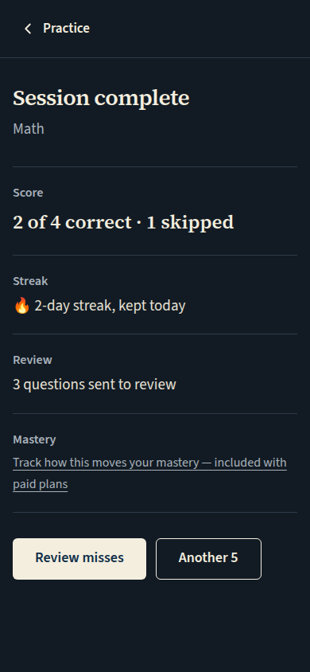 `/practice/session/7aa63e3c-fed1-423e-8e89-b929a490f7e8`, 37 KB, horizontal overflow 0px | none |

## Review session summary: the same pattern ('back in your review queue')

Persona: `paid`. Route: `/review/session/{session}`.
Fresh session per capture (real create route, ended after the shot): `review {"mode":"filter","filters":{"sections":["RW"]},"target_count":3}`.
Full page: the whole document, not just the viewport.
Prototype: none. NOT PROTOTYPED: new in the first-run activation brief (Karl, 2026-10-13), built to DESIGN.md §5; these screenshots go to Karl before merge.

| Viewport | Theme (as rendered) | Built | Prototype |
|---|---|---|---|
| desktop | light | 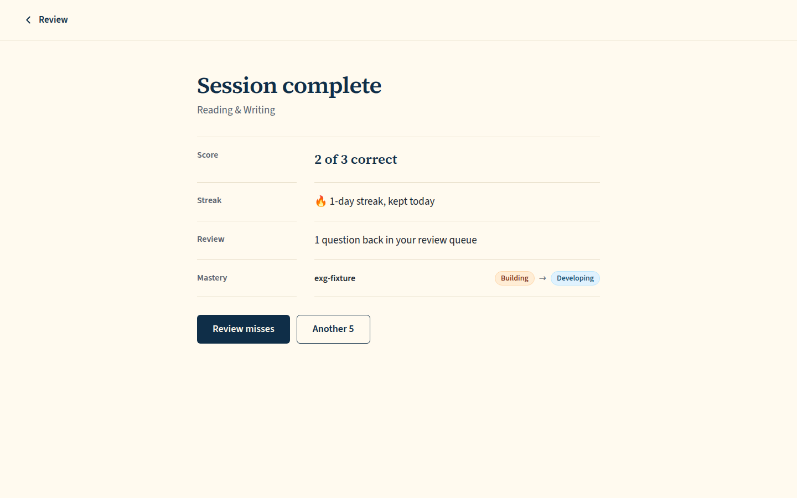 `/review/session/34ebfd28-0518-45e7-bf41-c7fa8661aa8b`, 44 KB, horizontal overflow 0px | none |
| desktop | dark | 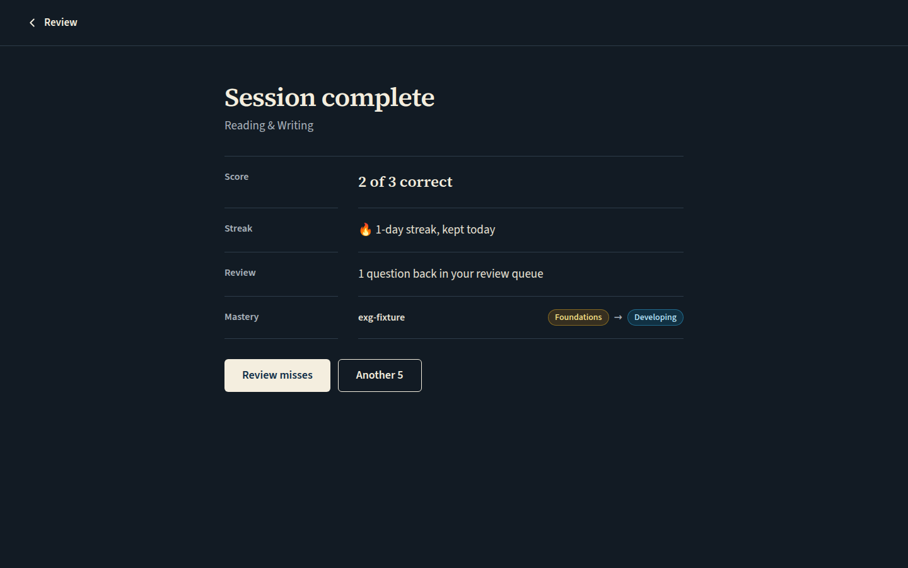 `/review/session/a8ede68e-e51f-4ef5-a3af-06087b0c5e9f`, 45 KB, horizontal overflow 0px | none |
| mobile | light | 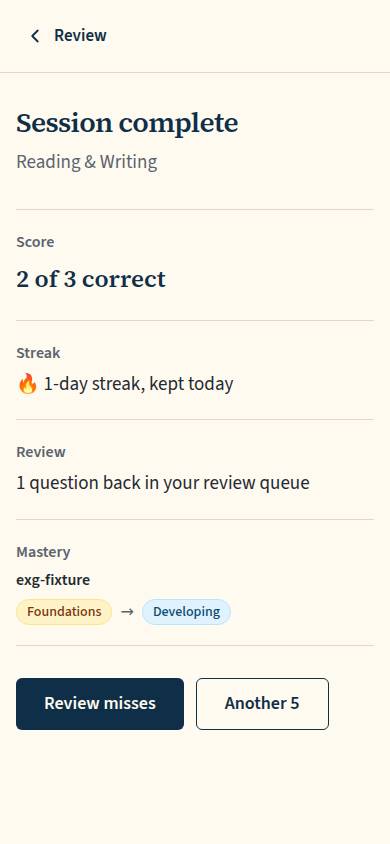 `/review/session/ef1c1d4d-aa40-4d5f-8337-7f7e34878371`, 31 KB, horizontal overflow 0px | none |
| mobile | dark | 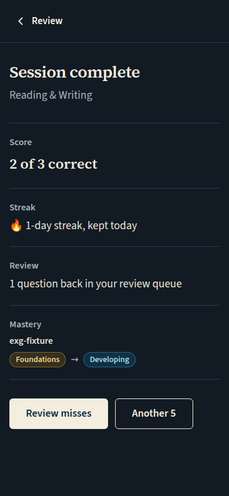 `/review/session/7e5faa79-6fba-495f-9e5b-60d01cd0ab46`, 37 KB, horizontal overflow 0px | none |

## Home, paid: the QOTD card in place, today's plan rows as text links ('Start today's plan' the one filled button), 'This week' ticks

Persona: `paid`. Route: `/dashboard`.
Today's question unanswered before each capture (scheduled if missing; the persona's answer, qotd session and email-prompt state deleted).
Full page: the whole document, not just the viewport.
Prototype: none. NOT PROTOTYPED: new in the first-run activation brief (Karl, 2026-10-13), built to DESIGN.md §5; these screenshots go to Karl before merge.

| Viewport | Theme (as rendered) | Built | Prototype |
|---|---|---|---|
| desktop | light | 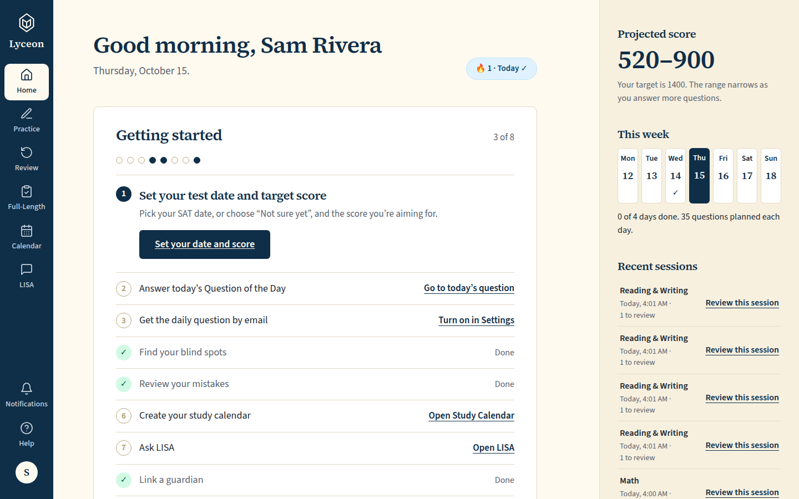 `/dashboard`, 162 KB, horizontal overflow 0px | none |
| desktop | dark | 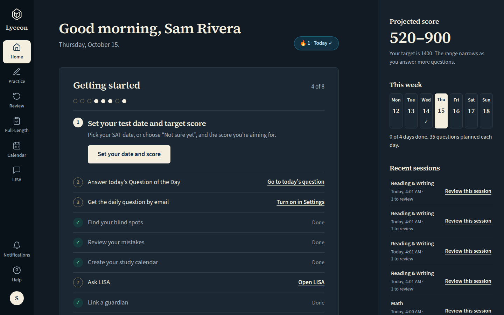 `/dashboard`, 160 KB, horizontal overflow 0px | none |
| mobile | light | 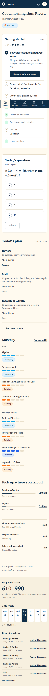 `/dashboard`, 301 KB, horizontal overflow 0px | none |
| mobile | dark | 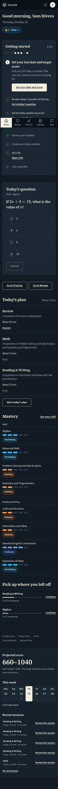 `/dashboard`, 306 KB, horizontal overflow 0px | none |

## Home, paid, scrolled to today's plan (the first row's link focused): each row acts through a text link, 'Start today's plan' the one filled button

Persona: `paid`. Route: `/dashboard`.
Step: focus `{"desktop":"[data-testid=\"home-plan-start\"]","mobile":"[data-testid=\"home-plan-start\"]"}` (no typing).
Must then show `[data-testid="home-start-plan"]` (the capture fails otherwise).
Prototype: none. NOT PROTOTYPED: new in the first-run activation brief (Karl, 2026-10-13), built to DESIGN.md §5; these screenshots go to Karl before merge.

| Viewport | Theme (as rendered) | Built | Prototype |
|---|---|---|---|
| desktop | light | 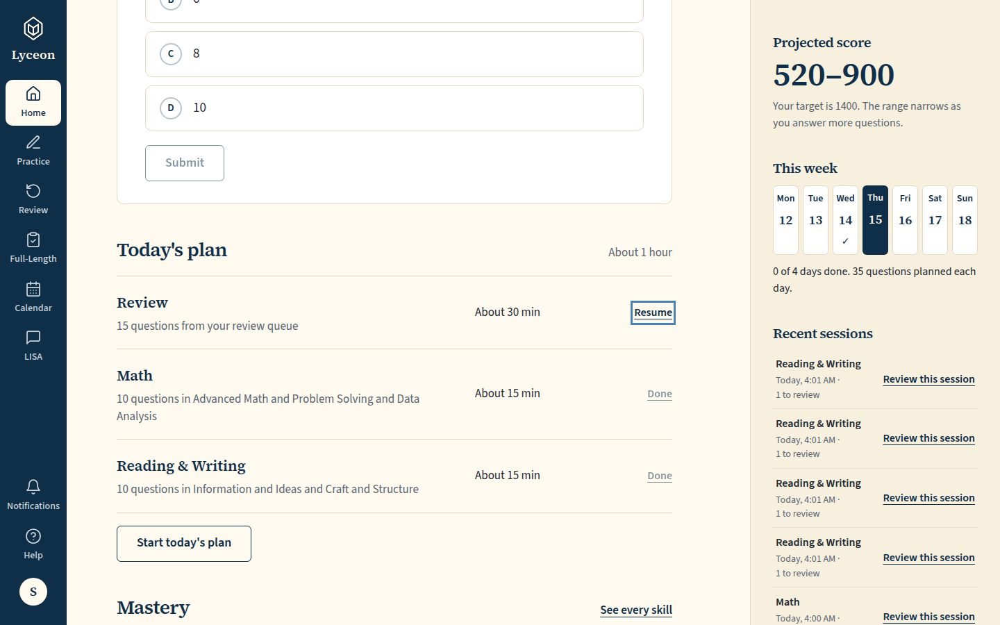 `/dashboard`, 136 KB, horizontal overflow 0px | none |
| desktop | dark | 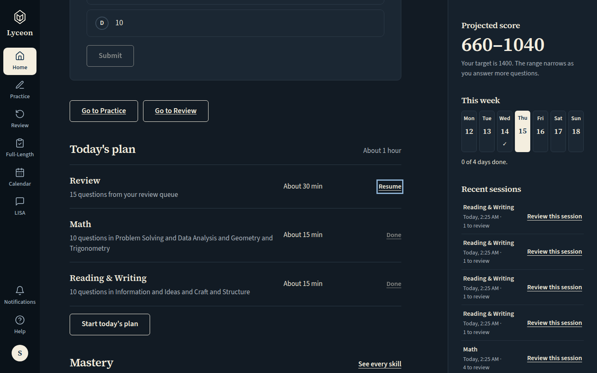 `/dashboard`, 136 KB, horizontal overflow 0px | none |
| mobile | light | 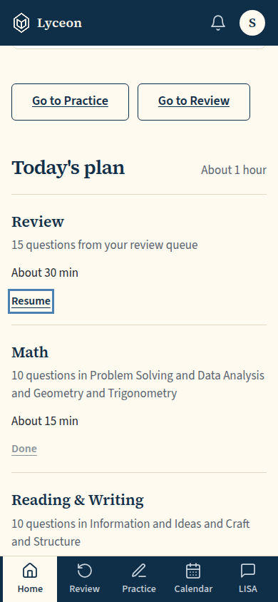 `/dashboard`, 49 KB, horizontal overflow 0px | none |
| mobile | dark | 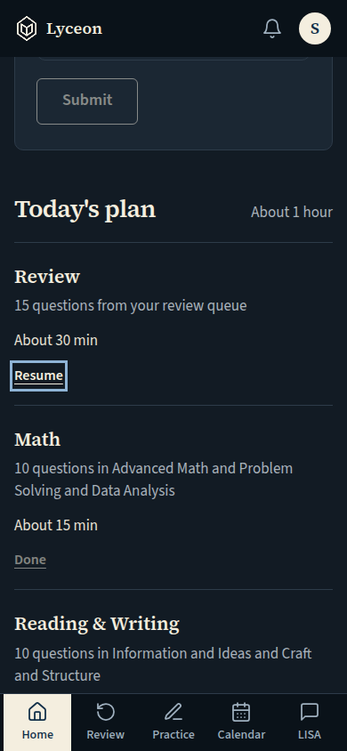 `/dashboard`, 48 KB, horizontal overflow 0px | none |

## Home, paid, scrolled to the bottom of the main column: 'Work on new questions', 'Fix past mistakes' ('{N} waiting') and 'Take a full-length test', three equal rows each with a 'Start' text link (wording: Karl, 2026-10-15); 'Start today's plan' stays the one filled button

Persona: `paid`. Route: `/dashboard`.
Must then show `[data-testid="home-entry-points"]` wholly inside the viewport (the capture fails otherwise).
Step: focus `{"desktop":"[data-testid=\"home-entry-full-length-action\"]","mobile":"[data-testid=\"home-entry-full-length-action\"]"}` (no typing).
Prototype: none. NOT PROTOTYPED: owner ruling (Karl, 2026-10-15, on #1233, 'Home: three equal entry points'), built to DESIGN.md §4 Home and §5; these screenshots go to Karl before merge.

| Viewport | Theme (as rendered) | Built | Prototype |
|---|---|---|---|
| desktop | light | 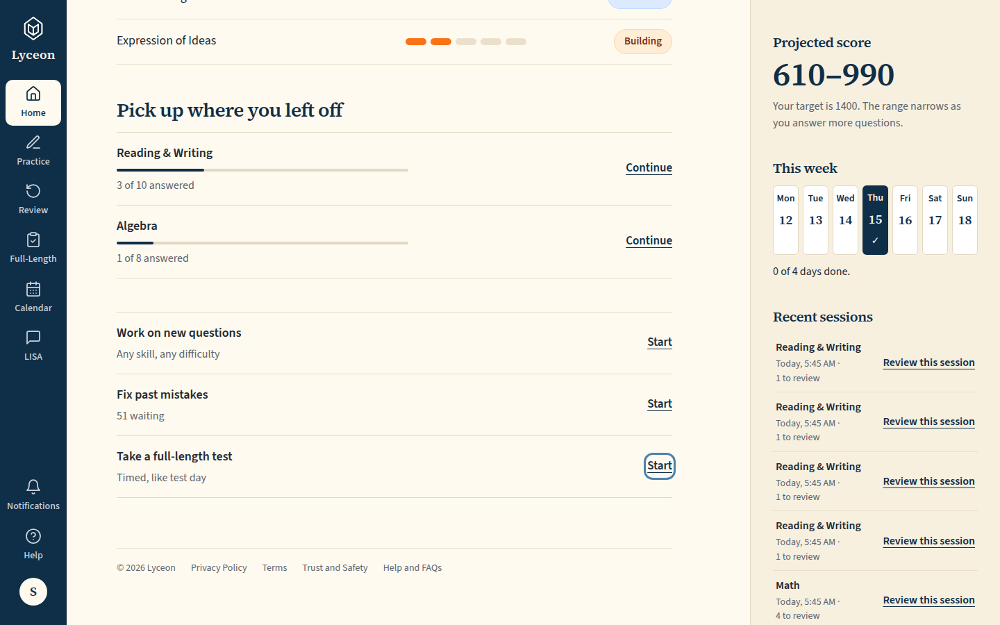 `/dashboard`, 129 KB, horizontal overflow 0px | none |
| desktop | dark | 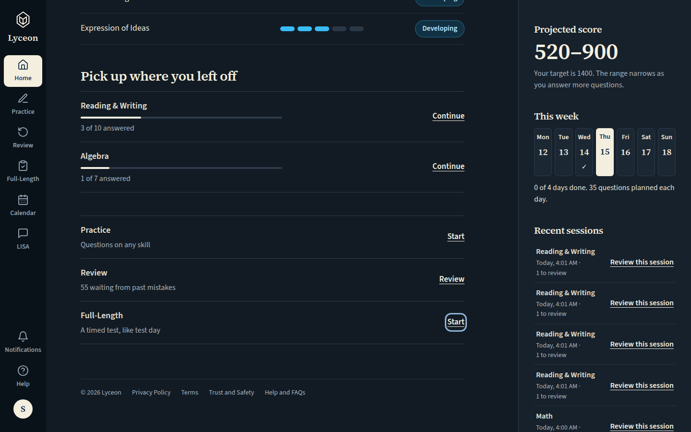 `/dashboard`, 130 KB, horizontal overflow 0px | none |
| mobile | light | 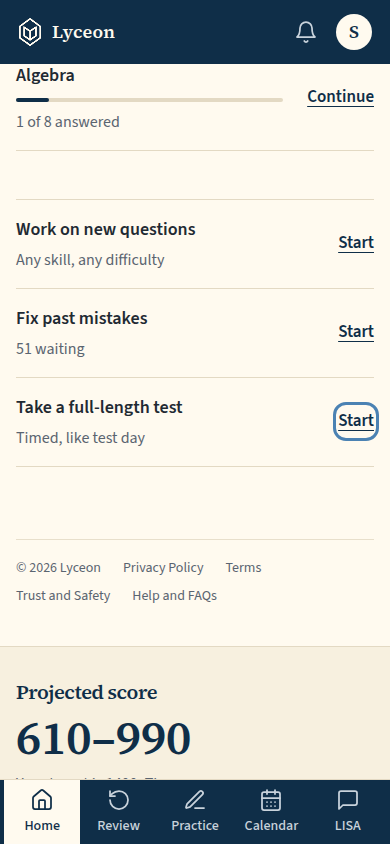 `/dashboard`, 46 KB, horizontal overflow 0px | none |
| mobile | dark | 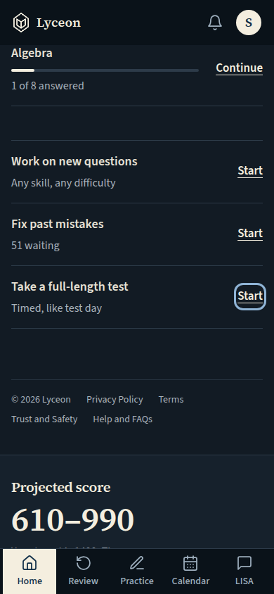 `/dashboard`, 46 KB, horizontal overflow 0px | none |

## Home, free, scrolled to the bottom of the main column: the same three rows, 'Take a full-length test' locked (its Start opens the upgrade modal)

Persona: `free`. Route: `/dashboard`.
Must then show `[data-testid="home-entry-full-length-lock"]` wholly inside the viewport (the capture fails otherwise).
Step: focus `{"desktop":"[data-testid=\"home-entry-full-length-action\"]","mobile":"[data-testid=\"home-entry-full-length-action\"]"}` (no typing).
Prototype: none. NOT PROTOTYPED: owner ruling (Karl, 2026-10-15, on #1233, 'Home: three equal entry points'), built to DESIGN.md §4 Home and §5; these screenshots go to Karl before merge.

| Viewport | Theme (as rendered) | Built | Prototype |
|---|---|---|---|
| desktop | light | 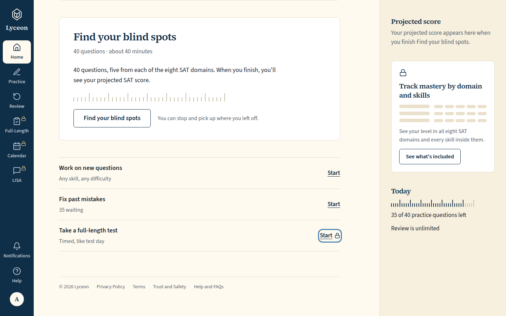 `/dashboard`, 112 KB, horizontal overflow 0px | none |
| desktop | dark | 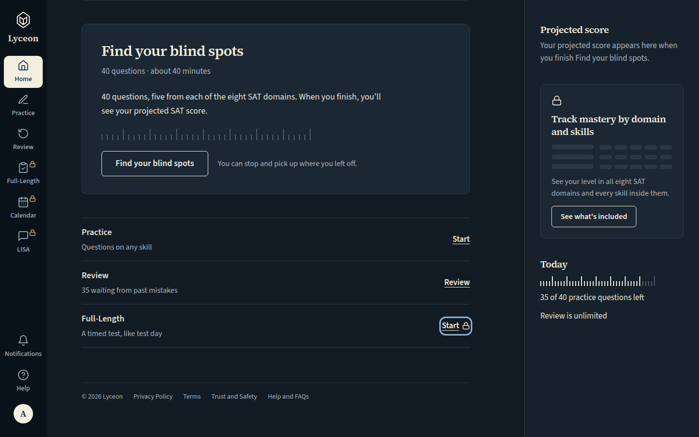 `/dashboard`, 113 KB, horizontal overflow 0px | none |
| mobile | light | 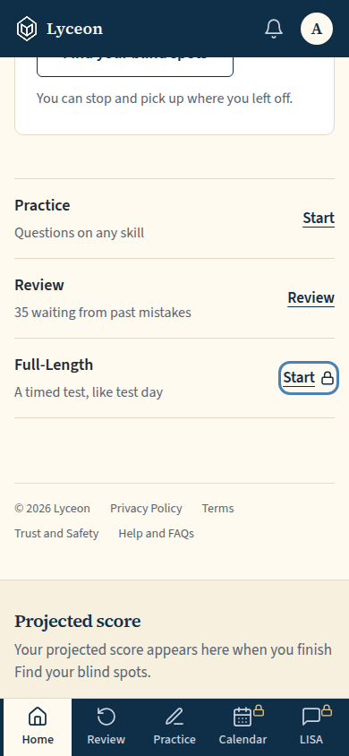 `/dashboard`, 50 KB, horizontal overflow 0px | none |
| mobile | dark | 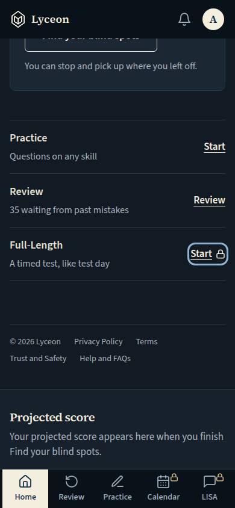 `/dashboard`, 49 KB, horizontal overflow 0px | none |

## Home, free: 'Take a full-length test' — its locked Start opens the upgrade modal in place (no navigation)

Persona: `free`. Route: `/dashboard`.
Step: click `{"desktop":"[data-testid=\"home-entry-full-length-action\"]","mobile":"[data-testid=\"home-entry-full-length-action\"]"}`.
Must then show `[data-testid="upgrade-modal"]` (the capture fails otherwise).
Click path: must land on a path matching `^/dashboard$` (the capture fails otherwise); the path it landed on is under each built shot.
Prototype: none. NOT PROTOTYPED: owner ruling (Karl, 2026-10-15, on #1233, 'Home: three equal entry points'), built to DESIGN.md §4 Home and §5; these screenshots go to Karl before merge.

| Viewport | Theme (as rendered) | Built | Prototype |
|---|---|---|---|
| desktop | light | 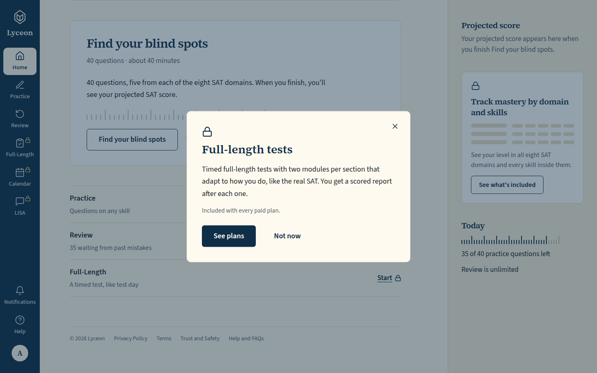 `/dashboard`, 128 KB, horizontal overflow 0px | none |
| desktop | dark | 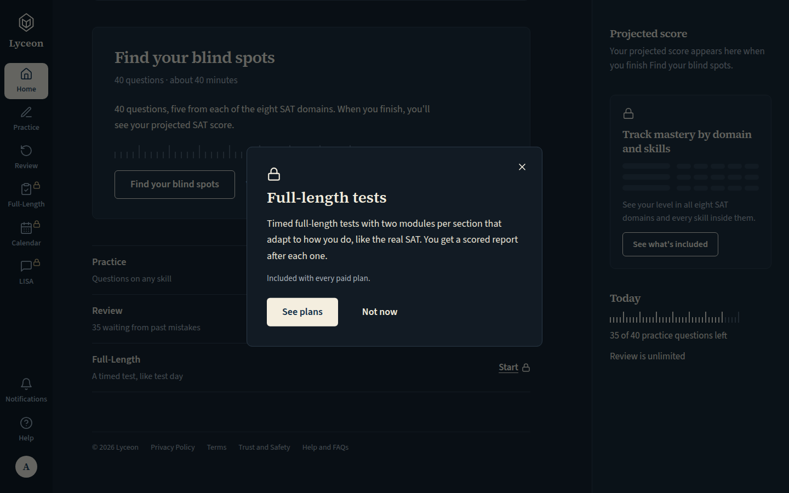 `/dashboard`, 125 KB, horizontal overflow 0px | none |
| mobile | light | 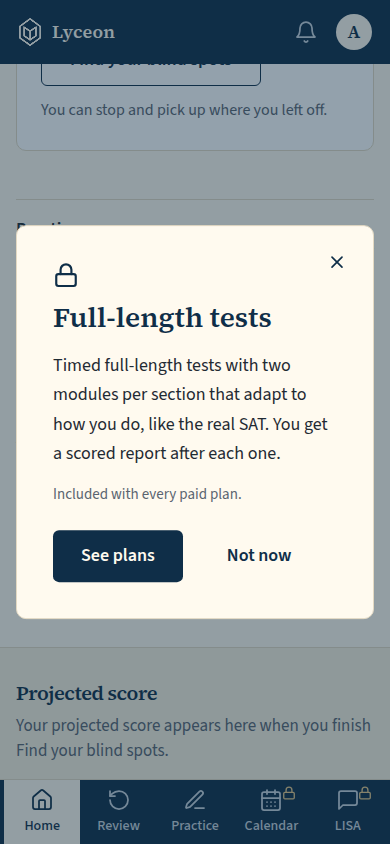 `/dashboard`, 53 KB, horizontal overflow 0px | none |
| mobile | dark | 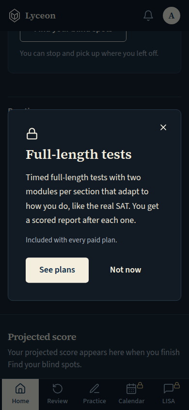 `/dashboard`, 52 KB, horizontal overflow 0px | none |

## A page's code chunk fails twice: one automatic reload, then the error screen inside the App shell (rail; tab bar on a phone)

Persona: `paid`. Route: `/mastery`.
Failed in the browser: requests whose path matches `^/assets/mastery-[^/]+\.js$` get a network error and never reach the server. The Mastery page's lazy chunk fails to load, as after a deploy replaces it; the first failure reloads once, the second shows the in-shell error screen.
Prototype: none. NOT PROTOTYPED: new in the first-run activation brief (Karl, 2026-10-13), built to DESIGN.md §5; these screenshots go to Karl before merge.

| Viewport | Theme (as rendered) | Built | Prototype |
|---|---|---|---|
| desktop | light | 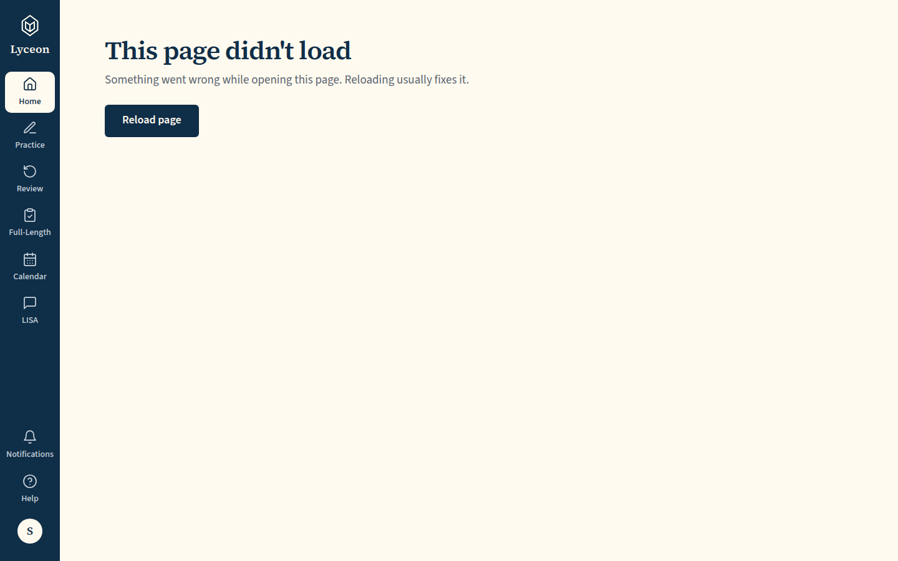 `/mastery`, 41 KB, horizontal overflow 0px | none |
| desktop | dark | 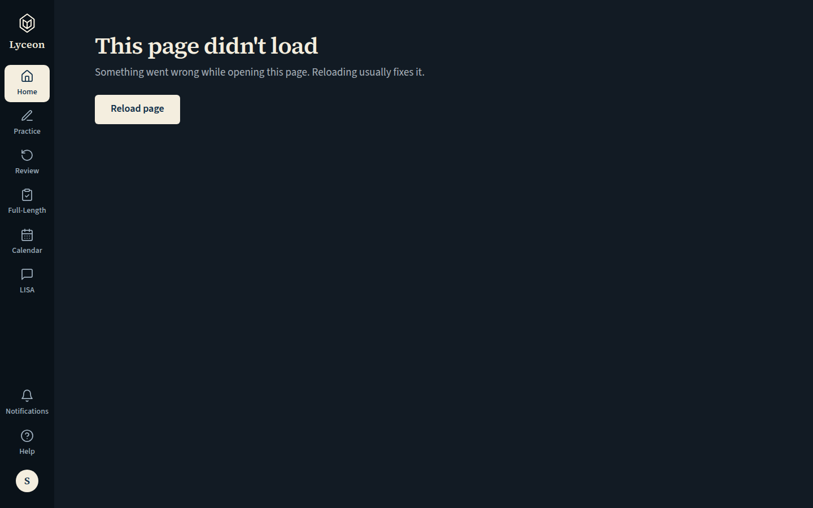 `/mastery`, 41 KB, horizontal overflow 0px | none |
| mobile | light | 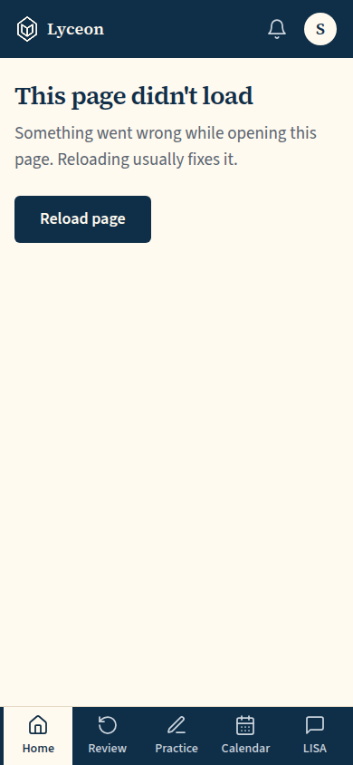 `/mastery`, 30 KB, horizontal overflow 0px | none |
| mobile | dark | 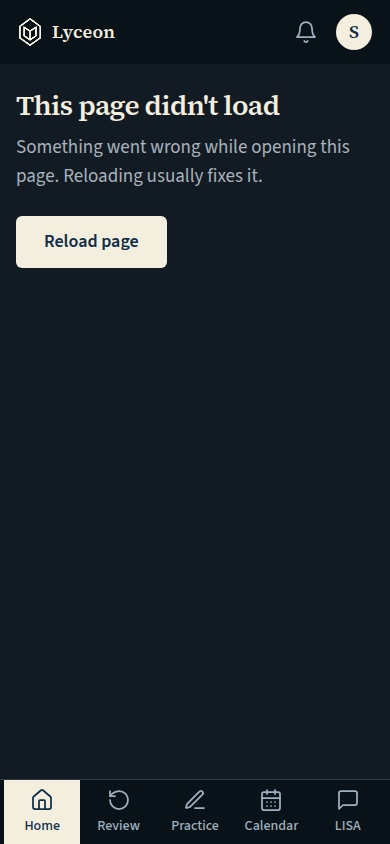 `/mastery`, 29 KB, horizontal overflow 0px | none |

## QOTD answered: the explanation with Done, and no email prompt over it

Persona: `paid`. Route: `/dashboard`.
Today's question unanswered before each capture (scheduled if missing; the persona's answer, qotd session and email-prompt state deleted).
Step: click `{"desktop":"[data-testid=\"home-qotd\"] [data-testid=\"runner-choice\"]","mobile":"[data-testid=\"home-qotd\"] [data-testid=\"runner-choice\"]"}`.
Step: click `{"desktop":"[data-testid=\"home-qotd-submit\"]","mobile":"[data-testid=\"home-qotd-submit\"]"}`.
Must then show `[data-testid="home-qotd-done"]` (the capture fails otherwise).
Must then show no `[data-testid="qotd-email-prompt"]` (the capture fails otherwise).
Prototype: none. NOT PROTOTYPED: new in the first-run activation brief (Karl, 2026-10-13), built to DESIGN.md §5; these screenshots go to Karl before merge.

| Viewport | Theme (as rendered) | Built | Prototype |
|---|---|---|---|
| desktop | light | 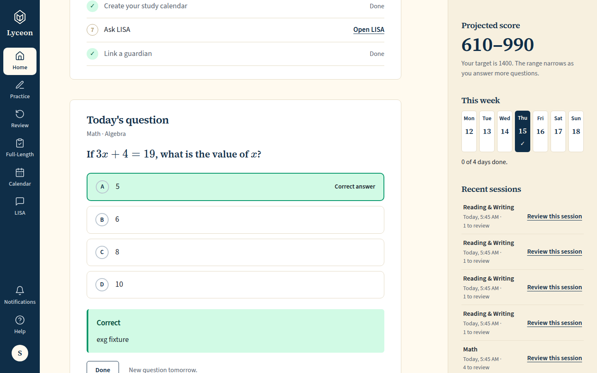 `/dashboard`, 127 KB, horizontal overflow 0px | none |
| desktop | dark | 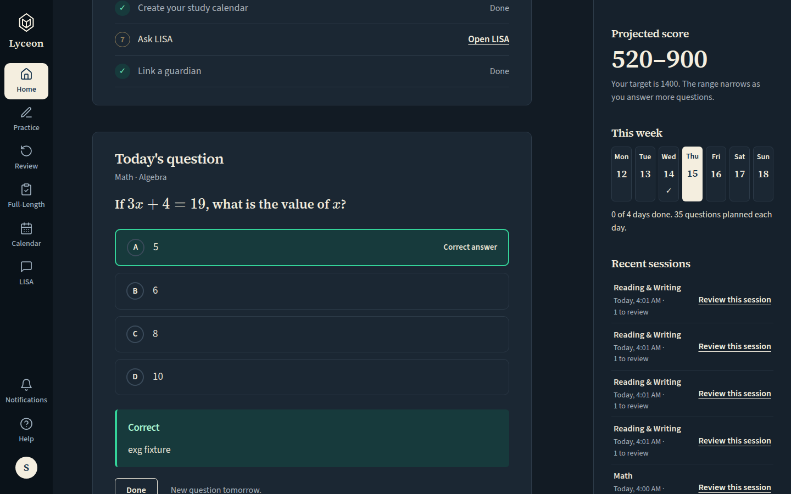 `/dashboard`, 128 KB, horizontal overflow 0px | none |
| mobile | light | 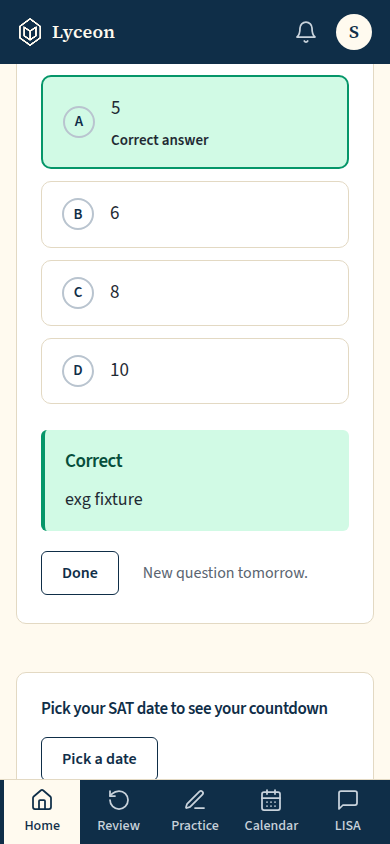 `/dashboard`, 41 KB, horizontal overflow 0px | none |
| mobile | dark | 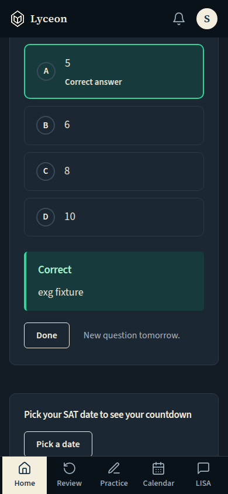 `/dashboard`, 41 KB, horizontal overflow 0px | none |

## QOTD: Done closes the explanation, then the email prompt opens

Persona: `paid`. Route: `/dashboard`.
Today's question unanswered before each capture (scheduled if missing; the persona's answer, qotd session and email-prompt state deleted).
Step: click `{"desktop":"[data-testid=\"home-qotd\"] [data-testid=\"runner-choice\"]","mobile":"[data-testid=\"home-qotd\"] [data-testid=\"runner-choice\"]"}`.
Step: click `{"desktop":"[data-testid=\"home-qotd-submit\"]","mobile":"[data-testid=\"home-qotd-submit\"]"}`.
Step: click `{"desktop":"[data-testid=\"home-qotd-done\"]","mobile":"[data-testid=\"home-qotd-done\"]"}`.
Must then show the text `Keep your streak alive 🔥` (the capture fails otherwise).
Prototype: none. NOT PROTOTYPED: new in the first-run activation brief (Karl, 2026-10-13), built to DESIGN.md §5; these screenshots go to Karl before merge.

| Viewport | Theme (as rendered) | Built | Prototype |
|---|---|---|---|
| desktop | light | 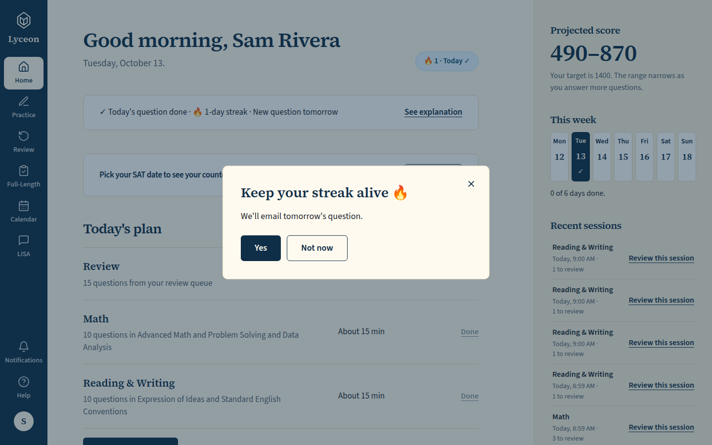 `/dashboard`, 153 KB, horizontal overflow 0px | none |
| desktop | dark | 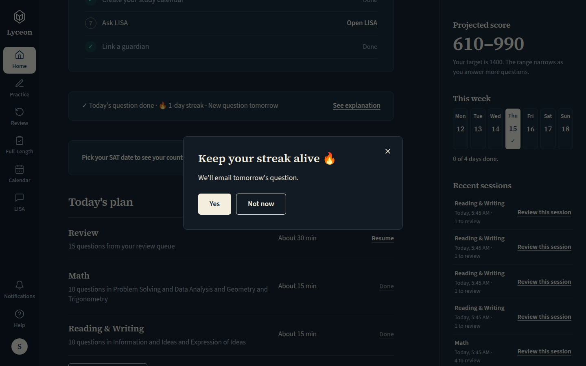 `/dashboard`, 148 KB, horizontal overflow 0px | none |
| mobile | light | 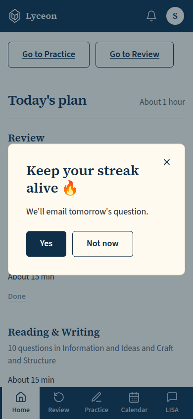 `/dashboard`, 52 KB, horizontal overflow 0px | none |
| mobile | dark | 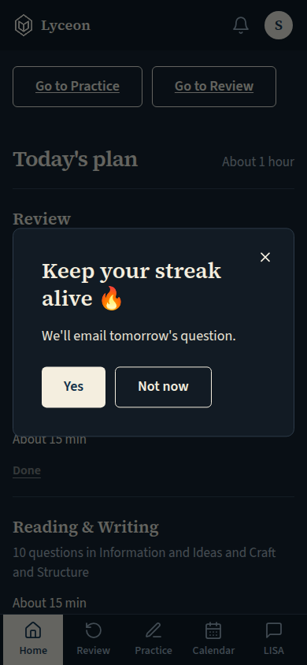 `/dashboard`, 51 KB, horizontal overflow 0px | none |

## QOTD answered earlier today and left before Done: the next Home visit opens the email prompt once, over the collapsed card

Persona: `paid`. Route: `/dashboard`.
Today's question unanswered before each capture (scheduled if missing; the persona's answer, qotd session and email-prompt state deleted).
Must then show the text `Keep your streak alive 🔥` (the capture fails otherwise).
Prototype: none. NOT PROTOTYPED: owner ruling (Karl, 2026-10-15, on #1233, item 2), built to DESIGN.md §5; these screenshots go to Karl before merge.

| Viewport | Theme (as rendered) | Built | Prototype |
|---|---|---|---|
| desktop | light | 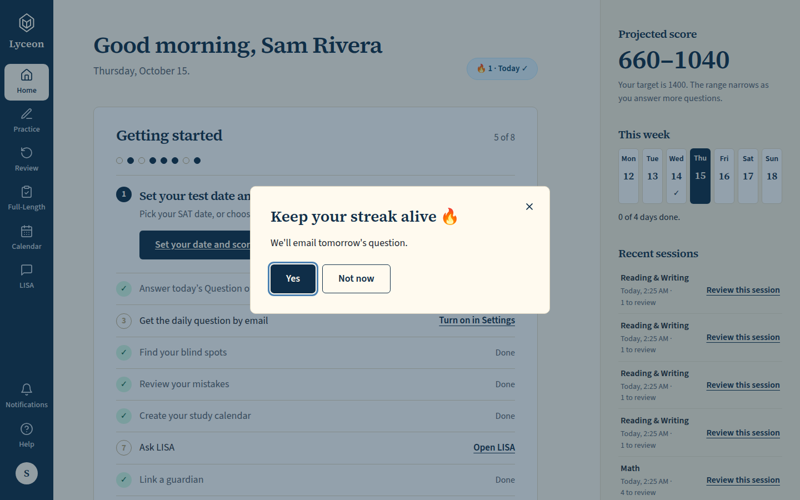 `/dashboard`, 159 KB, horizontal overflow 0px | none |
| desktop | dark | 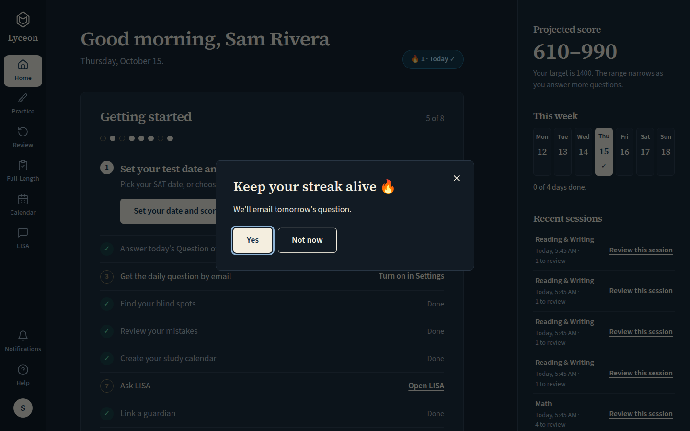 `/dashboard`, 153 KB, horizontal overflow 0px | none |
| mobile | light | 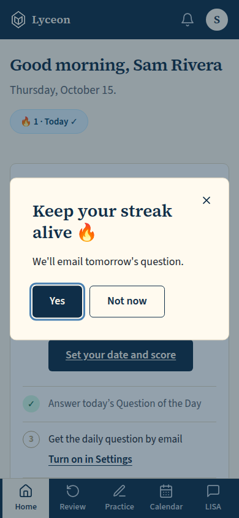 `/dashboard`, 54 KB, horizontal overflow 0px | none |
| mobile | dark | 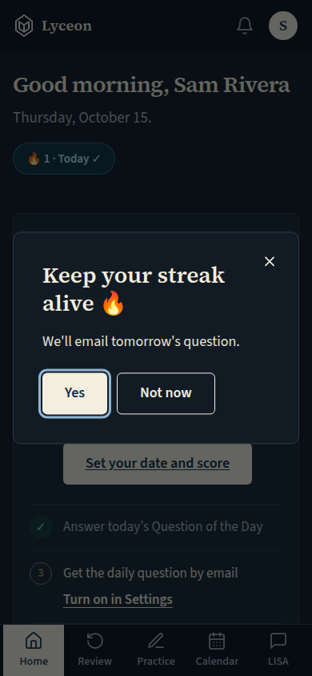 `/dashboard`, 53 KB, horizontal overflow 0px | none |

## Sign in: the Lyceon logo (a link to /) and the 'Password' placeholder

Persona: `signed-out`. Route: `/login`.
Cookie banner already answered (the real `lyceon_consent` cookie, analytics rejected, current banner version).
Prototype: none. NOT PROTOTYPED: new in the first-run activation brief (Karl, 2026-10-13), built to DESIGN.md §5; these screenshots go to Karl before merge.

| Viewport | Theme (as rendered) | Built | Prototype |
|---|---|---|---|
| desktop | light | 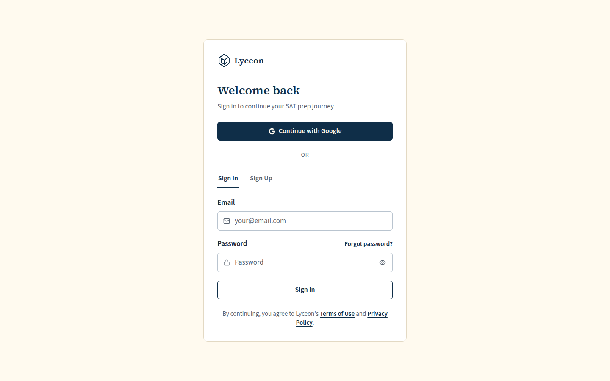 `/login`, 43 KB, horizontal overflow 0px | none |
| desktop | dark | 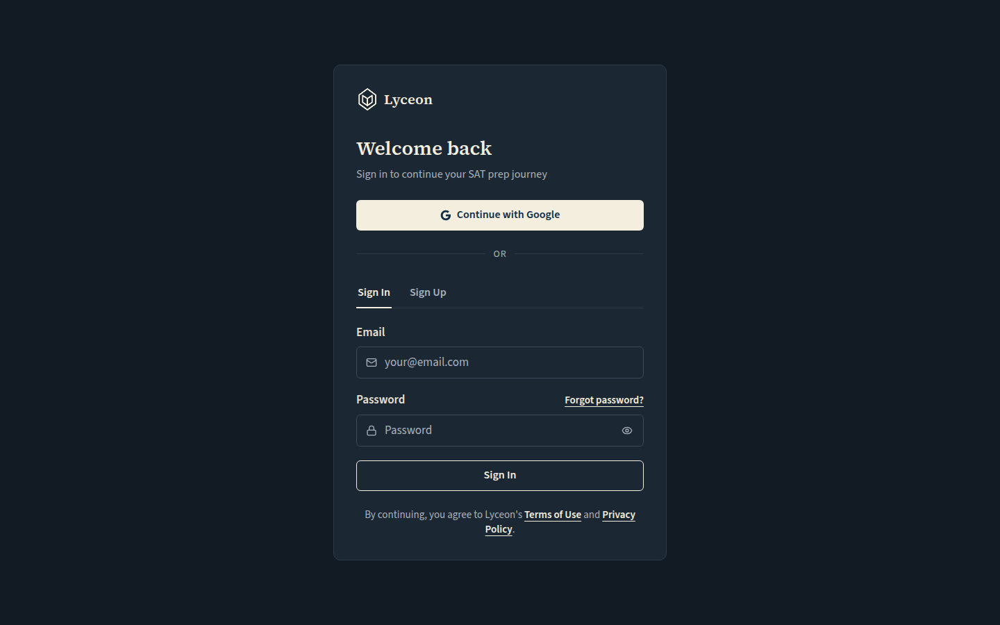 `/login`, 43 KB, horizontal overflow 0px | none |
| mobile | light |  `/login`, 37 KB, horizontal overflow 0px | none |
| mobile | dark |  `/login`, 38 KB, horizontal overflow 0px | none |

## Run facts

- Seeded ids: `{"free":{"completedPracticeSessionId":"f912ae05-4ce7-4e4e-bc4e-47fc0d5284a8","openPracticeSessionId":"eb65aea6-56da-4d82-b525-97ad5adedc23","openReviewSessionId":"bcca52b6-a8a0-480f-ad9a-fcf04e60c039","diagnosticSessionId":null,"scoredExamSessionId":null,"inProgressExamSessionId":null,"lisaConversationId":null,"answered":39},"paid":{"completedPracticeSessionId":"fc2d0f19-0dc6-4a2a-8d19-d91e1599016f","openPracticeSessionId":"e6b46a31-d7a8-439f-8679-1f8df2758c1e","openReviewSessionId":"cf649bdd-0d1c-46eb-b9c2-9dbb6ffc0e56","diagnosticSessionId":"fcefa52b-4eec-40c8-94c4-7ff866c440a7","scoredExamSessionId":null,"inProgressExamSessionId":null,"lisaConversationId":null,"answered":79}}`
- Endpoints the pages asked for that the harness does not serve (answered 404): none
- Desmos (QA2-B, opt-in `STUDENT_HARNESS_DESMOS=1`): not loaded (a local-only run; the calculator shows its unavailable line)
- External hosts blocked: none
