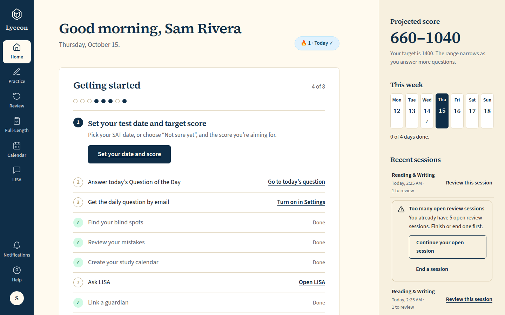
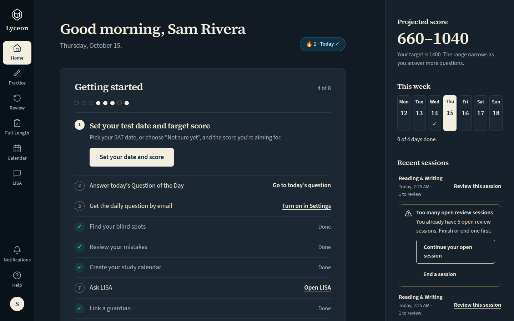
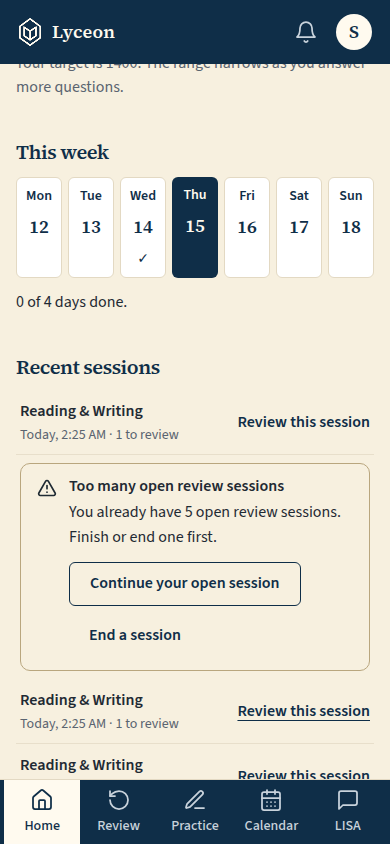
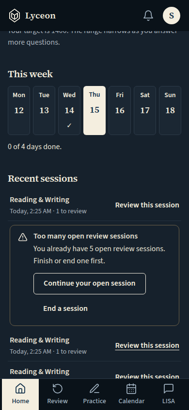

# First-run activation fixes: session summaries, Home, in-shell error screen, QOTD prompt, sign-in (light and dark, 1440 and 390)

Generated 2026-10-15T02:26:45.047Z by `pnpm exec tsx tests/e2e/student-harness/capture.ts FIRST-RUN` (see `tests/e2e/student-harness/README.md`). Built = a production build of the real client (`vite preview`, or the dev server with STUDENT_HARNESS_CLIENT=dev) against the student harness (real routers over a local Postgres built from this repo's migrations; personas seeded through the real practice routes). Prototype = the signed-off `docs/plans/student-ui/design/prototype/*.dc.html`, rendered locally.

Conditions, read before comparing:
- Viewport screenshots (not full page) unless the shot says full page: desktop 1440x900, phone 390x844, and any extra size a shot names.
- The prototypes are a fixed 1440x900 canvas with no phone layout; phone rows show the desktop prototype.
- Dark is requested through the app's own per-device setting; the theme column records what the page rendered.
- No external requests: the built app's Google Fonts (Inter, Poppins) are blocked, so legacy page bodies fall back to system faces; Source Sans 3 / Source Serif 4 are self-hosted and load for both sides.
- Prototype data is illustrative; built data is the seeded personas' real payloads.

## Practice session summary: score with skips, streak kept, sent to review, the recorded mastery change if any; Review misses (primary) and Another 5

Persona: `paid`. Route: `/practice/session/{session}`.
Fresh session per capture (real create route, ended after the shot): `practice {"sections":["M"],"target_question_count":5}`.
Full page: the whole document, not just the viewport.
Prototype: none. NOT PROTOTYPED: new in the first-run activation brief (Karl, 2026-10-13), built to DESIGN.md §5; these screenshots go to Karl before merge.

| Viewport | Theme (as rendered) | Built | Prototype |
|---|---|---|---|
| desktop | light |  `/practice/session/ee2a9ef2-f616-4e4b-88d6-1edcbebed3f3`, 43 KB, horizontal overflow 0px | none |
| desktop | dark |  `/practice/session/e762bdce-6b3a-40bb-aafe-d6e1f1aa5167`, 44 KB, horizontal overflow 0px | none |
| mobile | light |  `/practice/session/035a90c0-94bc-4b39-8648-f8f60f6c1a99`, 36 KB, horizontal overflow 0px | none |
| mobile | dark |  `/practice/session/a3aa909d-ba9f-44b9-9174-fedb7b1f0957`, 30 KB, horizontal overflow 0px | none |

## Practice session summary, free: the muted locked line 'Track how this moves your mastery — included with paid plans' (a link to the plans page) in place of a mastery change

Persona: `free`. Route: `/practice/session/{session}`.
Fresh session per capture (real create route, ended after the shot): `practice {"sections":["M"],"target_question_count":5}`.
Today's free quota unused before each capture (the persona's practice answers and skips from the last day are dated a day earlier in the harness database).
Full page: the whole document, not just the viewport.
Prototype: none. NOT PROTOTYPED: owner ruling (Karl, 2026-10-15, on #1233, item 3), built to DESIGN.md §5; these screenshots go to Karl before merge.

| Viewport | Theme (as rendered) | Built | Prototype |
|---|---|---|---|
| desktop | light |  `/practice/session/c3b5a521-d9ba-4d44-b790-ae454a639937`, 44 KB, horizontal overflow 0px | none |
| desktop | dark |  `/practice/session/f72b26dc-1a15-48ae-9e52-05076d5dc713`, 44 KB, horizontal overflow 0px | none |
| mobile | light |  `/practice/session/84d1912a-ea11-41f2-9efc-324efda123de`, 36 KB, horizontal overflow 0px | none |
| mobile | dark |  `/practice/session/eaa537d1-5f90-47f8-b872-d7b9afcfa959`, 37 KB, horizontal overflow 0px | none |

## Review session summary: the same pattern ('back in your review queue')

Persona: `paid`. Route: `/review/session/{session}`.
Fresh session per capture (real create route, ended after the shot): `review {"mode":"filter","filters":{"sections":["RW"]},"target_count":3}`.
Full page: the whole document, not just the viewport.
Prototype: none. NOT PROTOTYPED: new in the first-run activation brief (Karl, 2026-10-13), built to DESIGN.md §5; these screenshots go to Karl before merge.

| Viewport | Theme (as rendered) | Built | Prototype |
|---|---|---|---|
| desktop | light |  `/review/session/0b180ee2-4e65-444b-822f-8c3cda03e379`, 44 KB, horizontal overflow 0px | none |
| desktop | dark |  `/review/session/b180fcd6-51f3-4ea4-8c35-4961d043b30d`, 38 KB, horizontal overflow 0px | none |
| mobile | light |  `/review/session/6a371dd9-8571-40f3-af59-bd6c0d7bb317`, 31 KB, horizontal overflow 0px | none |
| mobile | dark |  `/review/session/406d5fe5-ec62-4e78-9a81-56a923830f40`, 37 KB, horizontal overflow 0px | none |

## Home, paid: the QOTD card in place, today's plan rows as text links ('Start today's plan' the one filled button), 'This week' ticks

Persona: `paid`. Route: `/dashboard`.
Today's question unanswered before each capture (scheduled if missing; the persona's answer, qotd session and email-prompt state deleted).
Full page: the whole document, not just the viewport.
Prototype: none. NOT PROTOTYPED: new in the first-run activation brief (Karl, 2026-10-13), built to DESIGN.md §5; these screenshots go to Karl before merge.

| Viewport | Theme (as rendered) | Built | Prototype |
|---|---|---|---|
| desktop | light |  `/dashboard`, 162 KB, horizontal overflow 0px | none |
| desktop | dark |  `/dashboard`, 160 KB, horizontal overflow 0px | none |
| mobile | light |  `/dashboard`, 289 KB, horizontal overflow 0px | none |
| mobile | dark |  `/dashboard`, 294 KB, horizontal overflow 0px | none |

## Home, paid, scrolled to today's plan (the first row's link focused): each row acts through a text link, 'Start today's plan' the one filled button

Persona: `paid`. Route: `/dashboard`.
Step: focus `{"desktop":"[data-testid=\"home-plan-start\"]","mobile":"[data-testid=\"home-plan-start\"]"}` (no typing).
Must then show `[data-testid="home-start-plan"]` (the capture fails otherwise).
Prototype: none. NOT PROTOTYPED: new in the first-run activation brief (Karl, 2026-10-13), built to DESIGN.md §5; these screenshots go to Karl before merge.

| Viewport | Theme (as rendered) | Built | Prototype |
|---|---|---|---|
| desktop | light |  `/dashboard`, 137 KB, horizontal overflow 0px | none |
| desktop | dark |  `/dashboard`, 137 KB, horizontal overflow 0px | none |
| mobile | light |  `/dashboard`, 51 KB, horizontal overflow 0px | none |
| mobile | dark |  `/dashboard`, 51 KB, horizontal overflow 0px | none |

## Home, paid, at the review cap: the notice's 'Continue your open session' wraps inside the panel

Persona: `paid`. Route: `/dashboard`.
At the review-session cap before each capture: queue review sessions are opened through the real `POST /api/review/sessions` until the server itself refuses one with `SESSION_LIMIT_EXCEEDED`; the ones opened are ended through the real terminate route after the shot.
Must then show `[data-testid="review-cap"]` wholly inside the viewport (the capture fails otherwise).
Step: click `{"desktop":"[data-testid=\"home-recent-review\"]","mobile":"[data-testid=\"home-recent-review\"]"}`.
Prototype: none. NOT PROTOTYPED: new in the first-run activation brief (Karl, 2026-10-13), built to DESIGN.md §5; these screenshots go to Karl before merge.

| Viewport | Theme (as rendered) | Built | Prototype |
|---|---|---|---|
| desktop | light |  `/dashboard`, 155 KB, horizontal overflow 0px | none |
| desktop | dark |  `/dashboard`, 156 KB, horizontal overflow 0px | none |
| mobile | light |  `/dashboard`, 58 KB, horizontal overflow 0px | none |
| mobile | dark |  `/dashboard`, 59 KB, horizontal overflow 0px | none |

## A page's code chunk fails twice: one automatic reload, then the error screen inside the App shell (rail; tab bar on a phone)

Persona: `paid`. Route: `/mastery`.
Failed in the browser: requests whose path matches `^/assets/mastery-[^/]+\.js$` get a network error and never reach the server. The Mastery page's lazy chunk fails to load, as after a deploy replaces it; the first failure reloads once, the second shows the in-shell error screen.
Prototype: none. NOT PROTOTYPED: new in the first-run activation brief (Karl, 2026-10-13), built to DESIGN.md §5; these screenshots go to Karl before merge.

| Viewport | Theme (as rendered) | Built | Prototype |
|---|---|---|---|
| desktop | light |  `/mastery`, 41 KB, horizontal overflow 0px | none |
| desktop | dark |  `/mastery`, 41 KB, horizontal overflow 0px | none |
| mobile | light |  `/mastery`, 30 KB, horizontal overflow 0px | none |
| mobile | dark |  `/mastery`, 29 KB, horizontal overflow 0px | none |

## QOTD answered: the explanation with Done, and no email prompt over it

Persona: `paid`. Route: `/dashboard`.
Today's question unanswered before each capture (scheduled if missing; the persona's answer, qotd session and email-prompt state deleted).
Step: click `{"desktop":"[data-testid=\"home-qotd\"] [data-testid=\"runner-choice\"]","mobile":"[data-testid=\"home-qotd\"] [data-testid=\"runner-choice\"]"}`.
Step: click `{"desktop":"[data-testid=\"home-qotd-submit\"]","mobile":"[data-testid=\"home-qotd-submit\"]"}`.
Must then show `[data-testid="home-qotd-done"]` (the capture fails otherwise).
Must then show no `[data-testid="qotd-email-prompt"]` (the capture fails otherwise).
Prototype: none. NOT PROTOTYPED: new in the first-run activation brief (Karl, 2026-10-13), built to DESIGN.md §5; these screenshots go to Karl before merge.

| Viewport | Theme (as rendered) | Built | Prototype |
|---|---|---|---|
| desktop | light |  `/dashboard`, 127 KB, horizontal overflow 0px | none |
| desktop | dark |  `/dashboard`, 127 KB, horizontal overflow 0px | none |
| mobile | light |  `/dashboard`, 41 KB, horizontal overflow 0px | none |
| mobile | dark |  `/dashboard`, 41 KB, horizontal overflow 0px | none |

## QOTD: Done closes the explanation, then the email prompt opens

Persona: `paid`. Route: `/dashboard`.
Today's question unanswered before each capture (scheduled if missing; the persona's answer, qotd session and email-prompt state deleted).
Step: click `{"desktop":"[data-testid=\"home-qotd\"] [data-testid=\"runner-choice\"]","mobile":"[data-testid=\"home-qotd\"] [data-testid=\"runner-choice\"]"}`.
Step: click `{"desktop":"[data-testid=\"home-qotd-submit\"]","mobile":"[data-testid=\"home-qotd-submit\"]"}`.
Step: click `{"desktop":"[data-testid=\"home-qotd-done\"]","mobile":"[data-testid=\"home-qotd-done\"]"}`.
Must then show the text `Keep your streak alive 🔥` (the capture fails otherwise).
Prototype: none. NOT PROTOTYPED: new in the first-run activation brief (Karl, 2026-10-13), built to DESIGN.md §5; these screenshots go to Karl before merge.

| Viewport | Theme (as rendered) | Built | Prototype |
|---|---|---|---|
| desktop | light |  `/dashboard`, 146 KB, horizontal overflow 0px | none |
| desktop | dark |  `/dashboard`, 141 KB, horizontal overflow 0px | none |
| mobile | light |  `/dashboard`, 51 KB, horizontal overflow 0px | none |
| mobile | dark |  `/dashboard`, 50 KB, horizontal overflow 0px | none |

## QOTD answered earlier today and left before Done: the next Home visit opens the email prompt once, over the collapsed card

Persona: `paid`. Route: `/dashboard`.
Today's question unanswered before each capture (scheduled if missing; the persona's answer, qotd session and email-prompt state deleted).
Must then show the text `Keep your streak alive 🔥` (the capture fails otherwise).
Prototype: none. NOT PROTOTYPED: owner ruling (Karl, 2026-10-15, on #1233, item 2), built to DESIGN.md §5; these screenshots go to Karl before merge.

| Viewport | Theme (as rendered) | Built | Prototype |
|---|---|---|---|
| desktop | light |  `/dashboard`, 158 KB, horizontal overflow 0px | none |
| desktop | dark |  `/dashboard`, 153 KB, horizontal overflow 0px | none |
| mobile | light |  `/dashboard`, 54 KB, horizontal overflow 0px | none |
| mobile | dark |  `/dashboard`, 53 KB, horizontal overflow 0px | none |

## Sign in: the Lyceon logo (a link to /) and the 'Password' placeholder

Persona: `signed-out`. Route: `/login`.
Cookie banner already answered (the real `lyceon_consent` cookie, analytics rejected, current banner version).
Prototype: none. NOT PROTOTYPED: new in the first-run activation brief (Karl, 2026-10-13), built to DESIGN.md §5; these screenshots go to Karl before merge.

| Viewport | Theme (as rendered) | Built | Prototype |
|---|---|---|---|
| desktop | light |  `/login`, 43 KB, horizontal overflow 0px | none |
| desktop | dark |  `/login`, 43 KB, horizontal overflow 0px | none |
| mobile | light |  `/login`, 37 KB, horizontal overflow 0px | none |
| mobile | dark |  `/login`, 38 KB, horizontal overflow 0px | none |

## Run facts

- Seeded ids: `{"free":{"completedPracticeSessionId":"8586a563-3441-4f83-9f31-38b574cc6207","openPracticeSessionId":"0ef2ae17-05ad-46e5-980e-2572c9cb69b1","openReviewSessionId":"5a561d0b-e5a3-4d25-b0b2-1a7d40a68e70","diagnosticSessionId":null,"scoredExamSessionId":null,"inProgressExamSessionId":null,"lisaConversationId":null,"answered":39},"paid":{"completedPracticeSessionId":"1c91c85c-0d24-4484-92f6-c607bcce51a6","openPracticeSessionId":"4852385a-787f-445a-8df2-7458815e7a7c","openReviewSessionId":"ffdad584-e2ec-412b-9d44-74d1b42a02ed","diagnosticSessionId":"98ef162e-7731-4068-be0b-c593c26fd6d4","scoredExamSessionId":null,"inProgressExamSessionId":null,"lisaConversationId":null,"answered":79}}`
- Endpoints the pages asked for that the harness does not serve (answered 404): none
- Desmos (QA2-B, opt-in `STUDENT_HARNESS_DESMOS=1`): not loaded (a local-only run; the calculator shows its unavailable line)
- External hosts blocked: none
