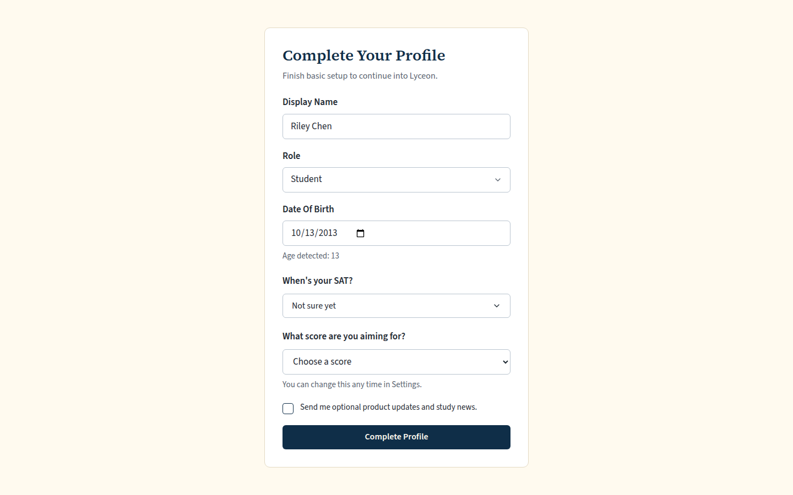
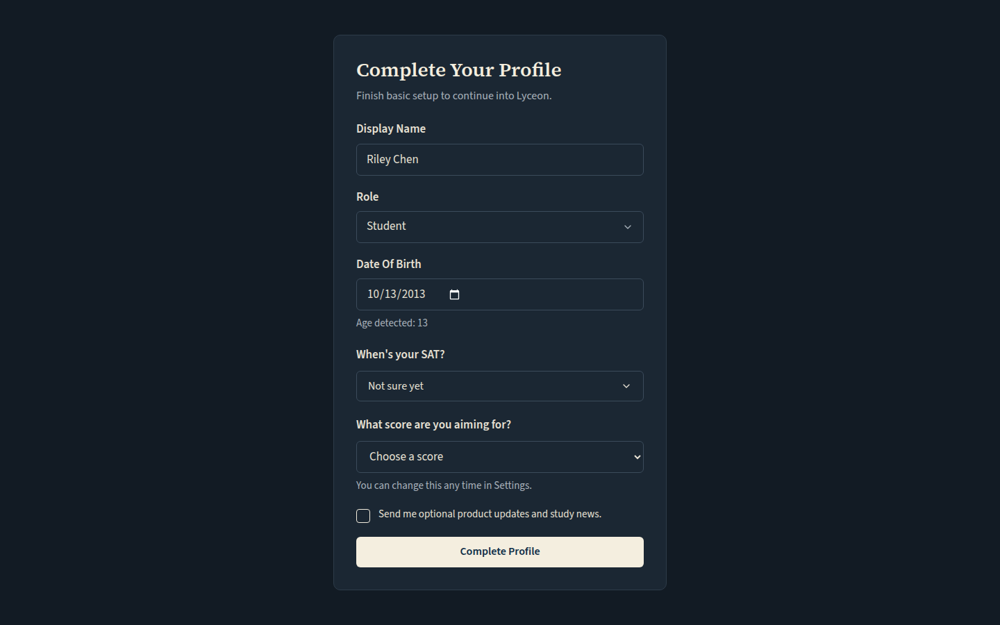
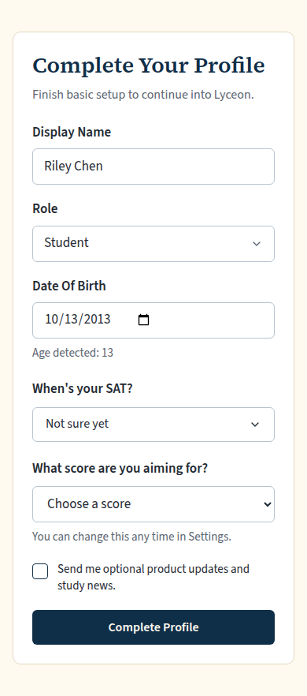
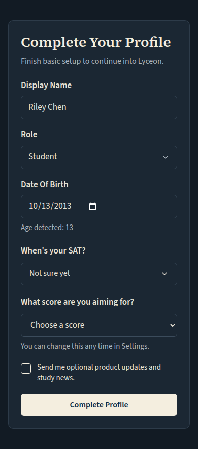

# Onboarding: 'When's your SAT?' and 'What score are you aiming for?' (light and dark, 1440 and 390)

Generated 2026-10-13T10:02:46.522Z by `pnpm exec tsx tests/e2e/student-harness/capture.ts GETTING-STARTED-ONBOARDING` (see `tests/e2e/student-harness/README.md`). Built = a production build of the real client (`vite preview`, or the dev server with STUDENT_HARNESS_CLIENT=dev) against the student harness (real routers over a local Postgres built from this repo's migrations; personas seeded through the real practice routes). Prototype = the signed-off `docs/plans/student-ui/design/prototype/*.dc.html`, rendered locally.

Conditions, read before comparing:
- Viewport screenshots (not full page) unless the shot says full page: desktop 1440x900, phone 390x844, and any extra size a shot names.
- The prototypes are a fixed 1440x900 canvas with no phone layout; phone rows show the desktop prototype.
- Dark is requested through the app's own per-device setting; the theme column records what the page rendered.
- No external requests: the built app's Google Fonts (Inter, Poppins) are blocked, so legacy page bodies fall back to system faces; Source Sans 3 / Source Serif 4 are self-hosted and load for both sides.
- Prototype data is illustrative; built data is the seeded personas' real payloads.

## Onboarding: name, date of birth, 'When's your SAT?', then 'What score are you aiming for?' ('Choose a score' until answered)

Persona: `onboarding`. Route: `/profile/complete`.
Full page: the whole document, not just the viewport.
Prototype: none. NOT PROTOTYPED: the Getting started checklist, Practice's rows and the score question are new in final brief v2 (Karl, 2026-10-13) and its #1230 follow-ups; built to the approved v2 mocks and DESIGN.md's tokens.

| Viewport | Theme (as rendered) | Built | Prototype |
|---|---|---|---|
| desktop | light |  `/profile/complete`, 51 KB, horizontal overflow 0px | none |
| desktop | dark |  `/profile/complete`, 52 KB, horizontal overflow 0px | none |
| mobile | light |  `/profile/complete`, 45 KB, horizontal overflow 0px | none |
| mobile | dark |  `/profile/complete`, 47 KB, horizontal overflow 0px | none |

## Run facts

- Seeded ids: `{"free":{"completedPracticeSessionId":"0aa57759-5e5a-4fd7-a5bf-f0773501e31f","openPracticeSessionId":"13aff575-5542-401b-b6d7-77b52feefae1","openReviewSessionId":null,"diagnosticSessionId":null,"scoredExamSessionId":null,"inProgressExamSessionId":null,"lisaConversationId":null,"answered":13},"paid":{"completedPracticeSessionId":"4bec1a51-faae-4684-8ede-e30abd7662a9","openPracticeSessionId":"9f0db6dc-e7e0-4952-826b-ce77b5d5e399","openReviewSessionId":null,"diagnosticSessionId":"87029287-6a15-4198-92f4-c9343a4f2d39","scoredExamSessionId":null,"inProgressExamSessionId":null,"lisaConversationId":null,"answered":53}}`
- Endpoints the pages asked for that the harness does not serve (answered 404): none
- Desmos (QA2-B, opt-in `STUDENT_HARNESS_DESMOS=1`): not loaded (a local-only run; the calculator shows its unavailable line)
- External hosts blocked: none
