# Getting started checklist, Practice rows, target score (light and dark, 1440 and 390)

Generated 2026-10-13T10:01:54.761Z by `pnpm exec tsx tests/e2e/student-harness/capture.ts GETTING-STARTED` (see `tests/e2e/student-harness/README.md`). Built = a production build of the real client (`vite preview`, or the dev server with STUDENT_HARNESS_CLIENT=dev) against the student harness (real routers over a local Postgres built from this repo's migrations; personas seeded through the real practice routes). Prototype = the signed-off `docs/plans/student-ui/design/prototype/*.dc.html`, rendered locally.

Conditions, read before comparing:
- Viewport screenshots (not full page) unless the shot says full page: desktop 1440x900, phone 390x844, and any extra size a shot names.
- The prototypes are a fixed 1440x900 canvas with no phone layout; phone rows show the desktop prototype.
- Dark is requested through the app's own per-device setting; the theme column records what the page rendered.
- No external requests: the built app's Google Fonts (Inter, Poppins) are blocked, so legacy page bodies fall back to system faces; Source Sans 3 / Source Serif 4 are self-hosted and load for both sides.
- Prototype data is illustrative; built data is the seeded personas' real payloads.

## Home, free: greeting → the Getting started checklist (dots, 'N of M', the current step expanded) → today's question → 'Find your blind spots' → Practice and Review

Persona: `free`. Route: `/dashboard`.
Full page: the whole document, not just the viewport.
Prototype: none. NOT PROTOTYPED: the Getting started checklist, Practice's rows and the score question are new in final brief v2 (Karl, 2026-10-13) and its #1230 follow-ups; built to the approved v2 mocks and DESIGN.md's tokens.

| Viewport | Theme (as rendered) | Built | Prototype |
|---|---|---|---|
| desktop | light | 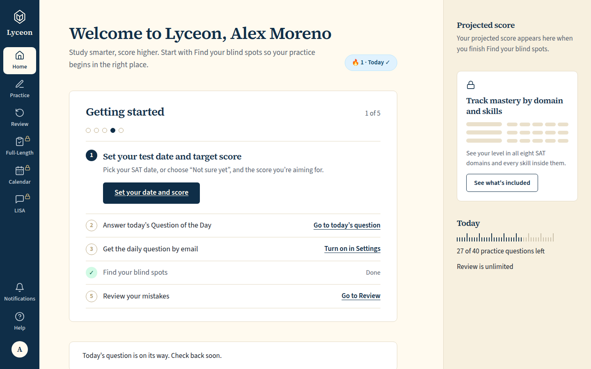 `/dashboard`, 141 KB, horizontal overflow 0px | none |
| desktop | dark | 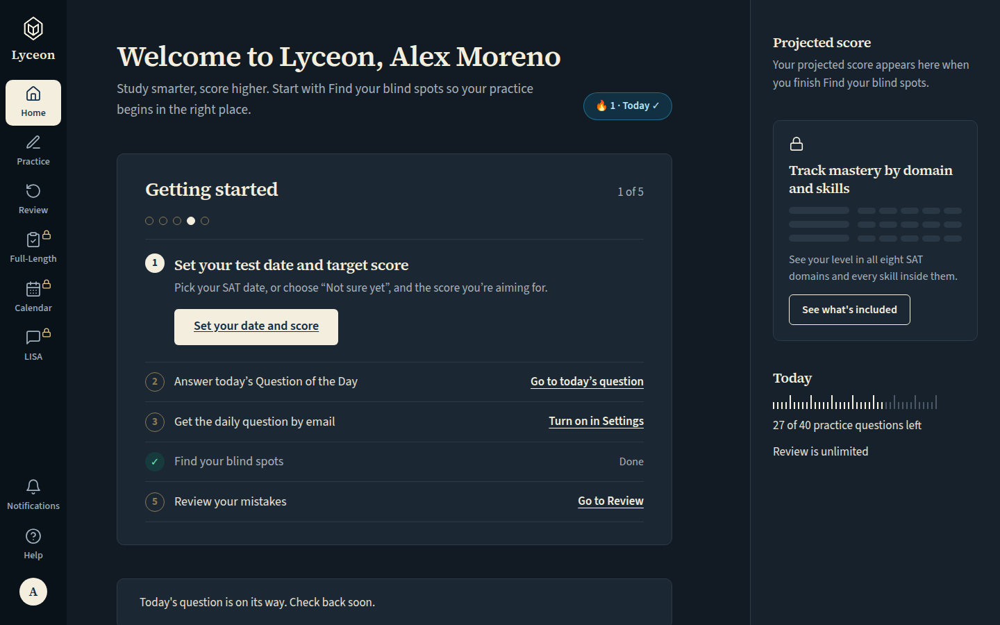 `/dashboard`, 143 KB, horizontal overflow 0px | none |
| mobile | light | 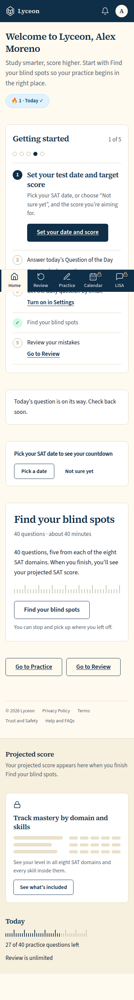 `/dashboard`, 171 KB, horizontal overflow 0px | none |
| mobile | dark | 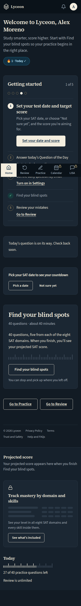 `/dashboard`, 174 KB, horizontal overflow 0px | none |

## Home, Pro: the checklist's eight steps above today's question; today's plan outlined while it shows

Persona: `paid`. Route: `/dashboard`.
Full page: the whole document, not just the viewport.
Prototype: none. NOT PROTOTYPED: the Getting started checklist, Practice's rows and the score question are new in final brief v2 (Karl, 2026-10-13) and its #1230 follow-ups; built to the approved v2 mocks and DESIGN.md's tokens.

| Viewport | Theme (as rendered) | Built | Prototype |
|---|---|---|---|
| desktop | light | 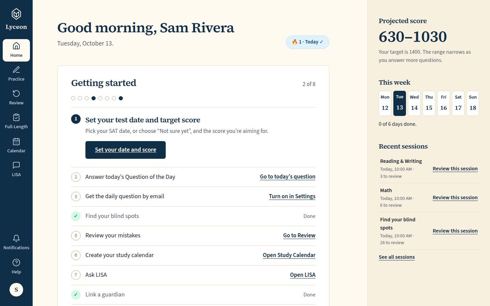 `/dashboard`, 152 KB, horizontal overflow 0px | none |
| desktop | dark | 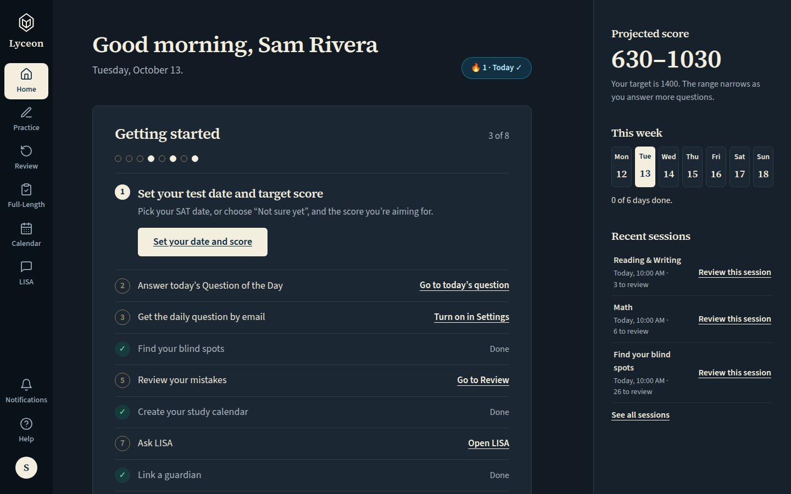 `/dashboard`, 151 KB, horizontal overflow 0px | none |
| mobile | light | 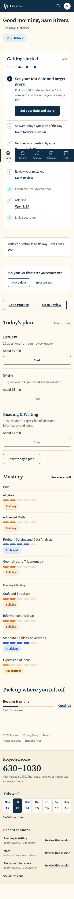 `/dashboard`, 258 KB, horizontal overflow 0px | none |
| mobile | dark | 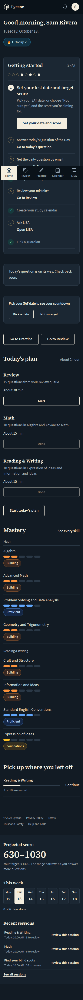 `/dashboard`, 264 KB, horizontal overflow 0px | none |

## Practice, free: the 'Find your blind spots' row below the filters, then 'Your session', then the locked 'Full-length test' row

Persona: `free`. Route: `/practice`.
Full page: the whole document, not just the viewport.
Prototype: none. NOT PROTOTYPED: the Getting started checklist, Practice's rows and the score question are new in final brief v2 (Karl, 2026-10-13) and its #1230 follow-ups; built to the approved v2 mocks and DESIGN.md's tokens.

| Viewport | Theme (as rendered) | Built | Prototype |
|---|---|---|---|
| desktop | light | 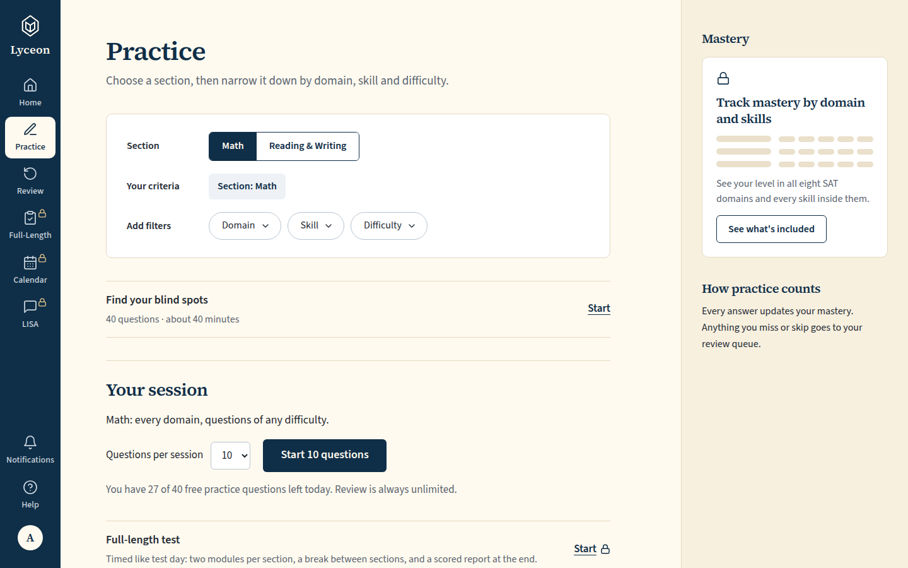 `/practice`, 120 KB, horizontal overflow 0px | none |
| desktop | dark | 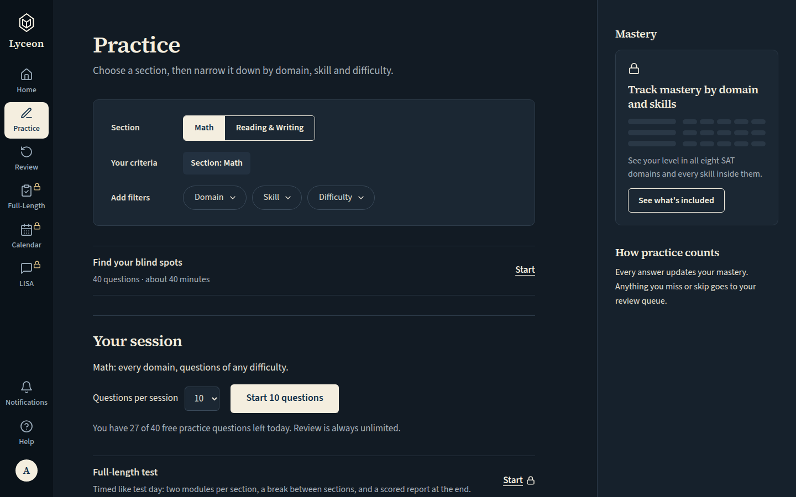 `/practice`, 121 KB, horizontal overflow 0px | none |
| mobile | light | 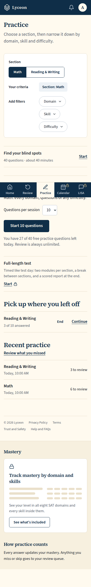 `/practice`, 142 KB, horizontal overflow 0px | none |
| mobile | dark | 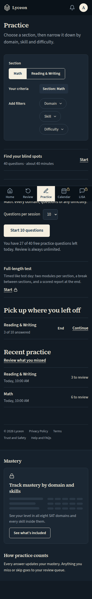 `/practice`, 143 KB, horizontal overflow 0px | none |

## Practice, free: the locked full-length Start opens the upgrade modal in place (phone and desktop)

Persona: `free`. Route: `/practice`.
Step: click `{"desktop":"[data-testid=\"practice-full-length-start\"]","mobile":"[data-testid=\"practice-full-length-start\"]"}`.
Must then show `[data-testid="upgrade-modal"]` (the capture fails otherwise).
Click path: must land on a path matching `^/practice$` (the capture fails otherwise); the path it landed on is under each built shot.
Prototype: none. NOT PROTOTYPED: the Getting started checklist, Practice's rows and the score question are new in final brief v2 (Karl, 2026-10-13) and its #1230 follow-ups; built to the approved v2 mocks and DESIGN.md's tokens.

| Viewport | Theme (as rendered) | Built | Prototype |
|---|---|---|---|
| desktop | light | 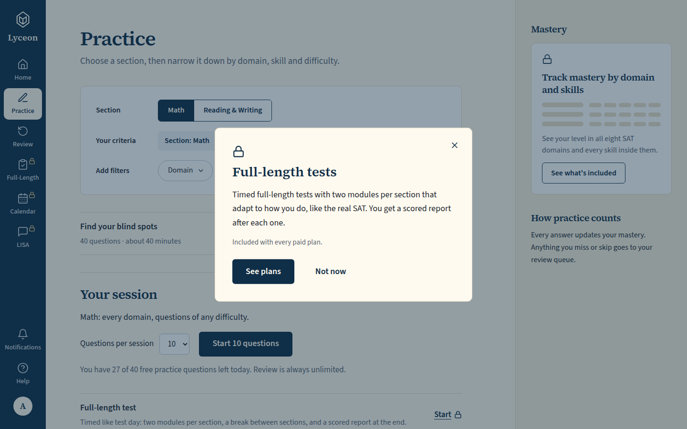 `/practice`, 139 KB, horizontal overflow 0px | none |
| desktop | dark | 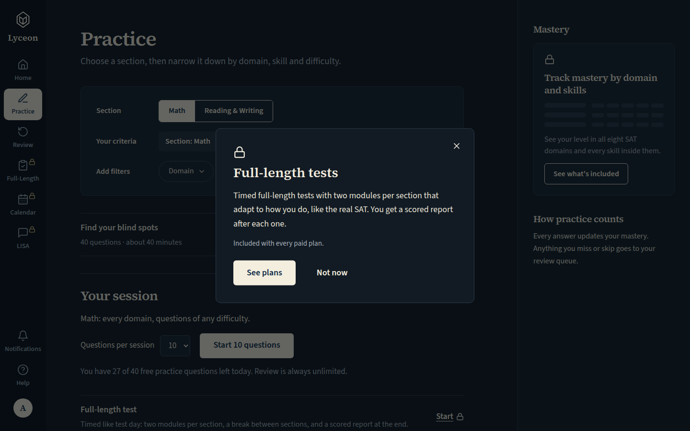 `/practice`, 136 KB, horizontal overflow 0px | none |
| mobile | light | 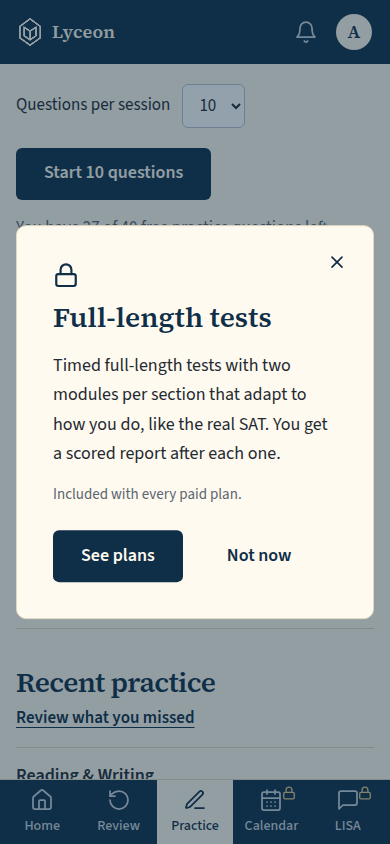 `/practice`, 55 KB, horizontal overflow 0px | none |
| mobile | dark | 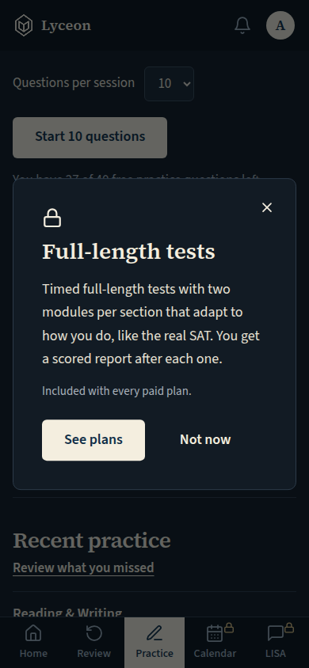 `/practice`, 54 KB, horizontal overflow 0px | none |

## Practice, Pro: the 'Full-length test' row, whose Start links to the Full-Length page

Persona: `paid`. Route: `/practice`.
Full page: the whole document, not just the viewport.
Prototype: none. NOT PROTOTYPED: the Getting started checklist, Practice's rows and the score question are new in final brief v2 (Karl, 2026-10-13) and its #1230 follow-ups; built to the approved v2 mocks and DESIGN.md's tokens.

| Viewport | Theme (as rendered) | Built | Prototype |
|---|---|---|---|
| desktop | light | 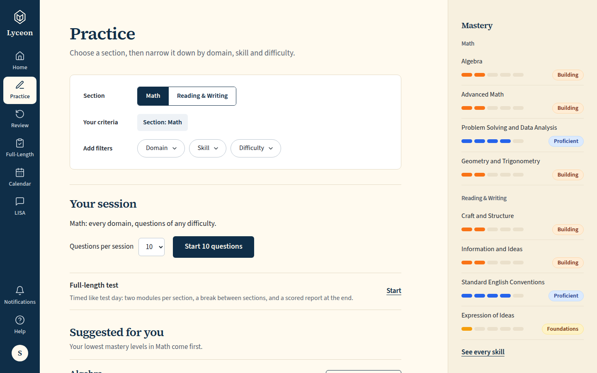 `/practice`, 125 KB, horizontal overflow 0px | none |
| desktop | dark | 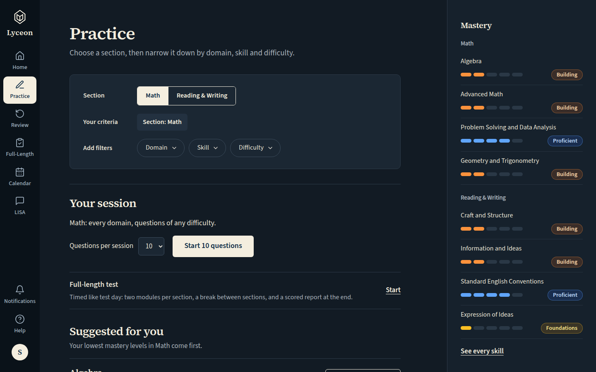 `/practice`, 127 KB, horizontal overflow 0px | none |
| mobile | light | 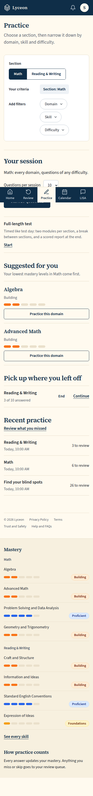 `/practice`, 183 KB, horizontal overflow 0px | none |
| mobile | dark | 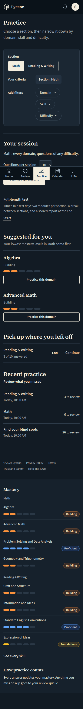 `/practice`, 186 KB, horizontal overflow 0px | none |

## Settings → Profile, free: SAT test date and target score shown to every student; the score reads 'Choose a score' until one is chosen

Persona: `free`. Route: `/profile?tab=profile`.
Prototype: none. NOT PROTOTYPED: the Getting started checklist, Practice's rows and the score question are new in final brief v2 (Karl, 2026-10-13) and its #1230 follow-ups; built to the approved v2 mocks and DESIGN.md's tokens.

| Viewport | Theme (as rendered) | Built | Prototype |
|---|---|---|---|
| desktop | light | 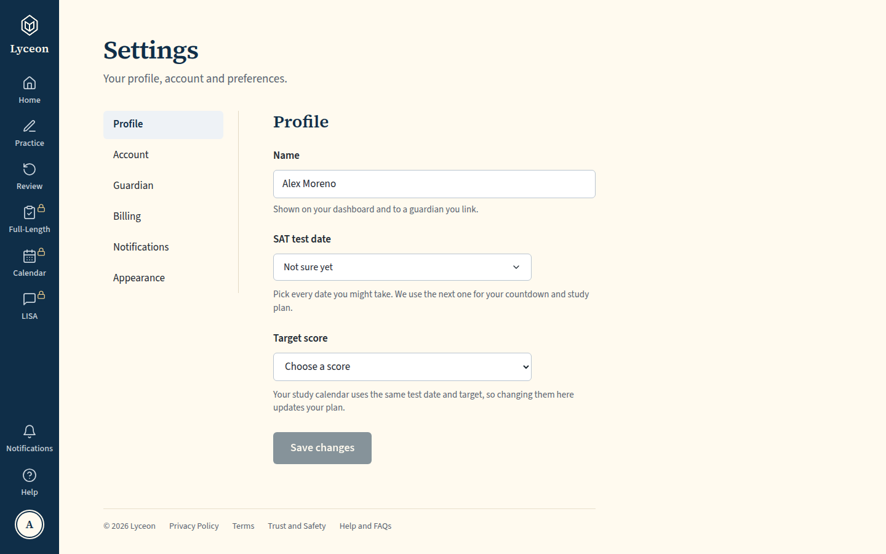 `/profile`, 80 KB, horizontal overflow 0px | none |
| desktop | dark | 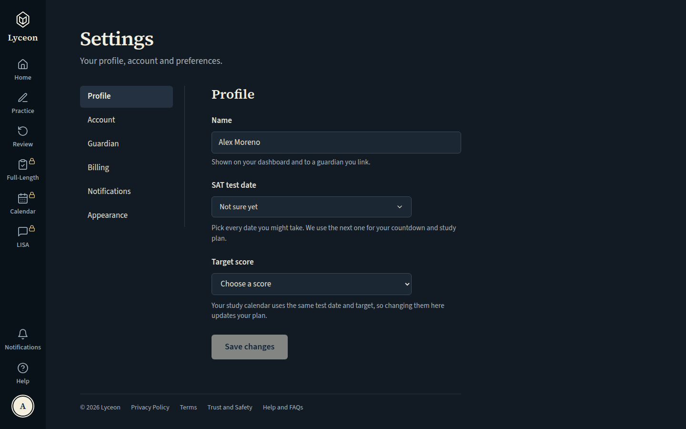 `/profile`, 80 KB, horizontal overflow 0px | none |
| mobile | light | 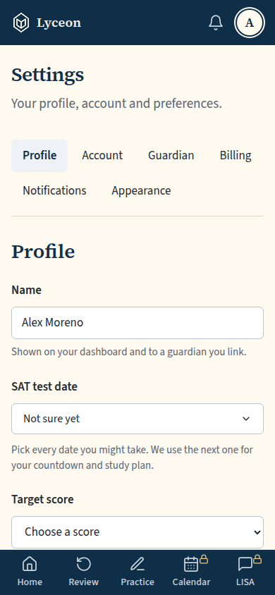 `/profile`, 51 KB, horizontal overflow 0px | none |
| mobile | dark | 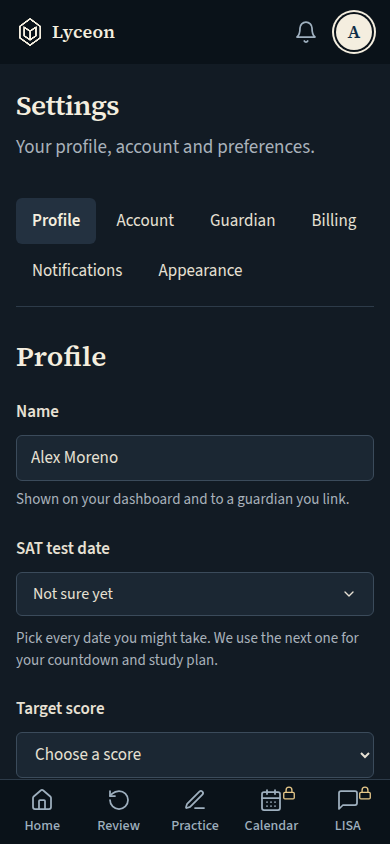 `/profile`, 51 KB, horizontal overflow 0px | none |

## Run facts

- Seeded ids: `{"free":{"completedPracticeSessionId":"fd1f1897-a84a-48ce-9349-8ab1c3664605","openPracticeSessionId":"9732f23e-3831-455a-bf8a-a6819338f383","openReviewSessionId":null,"diagnosticSessionId":null,"scoredExamSessionId":null,"inProgressExamSessionId":null,"lisaConversationId":null,"answered":13},"paid":{"completedPracticeSessionId":"53678d91-8d3f-49b9-b0e8-323c189668b1","openPracticeSessionId":"f52b20c9-d04b-4251-b95b-43e9c6f87ad7","openReviewSessionId":null,"diagnosticSessionId":"fc50a325-3279-421b-87ba-e07ebf4893d3","scoredExamSessionId":null,"inProgressExamSessionId":null,"lisaConversationId":null,"answered":53}}`
- Endpoints the pages asked for that the harness does not serve (answered 404): none
- Desmos (QA2-B, opt-in `STUDENT_HARNESS_DESMOS=1`): not loaded (a local-only run; the calculator shows its unavailable line)
- External hosts blocked: none
