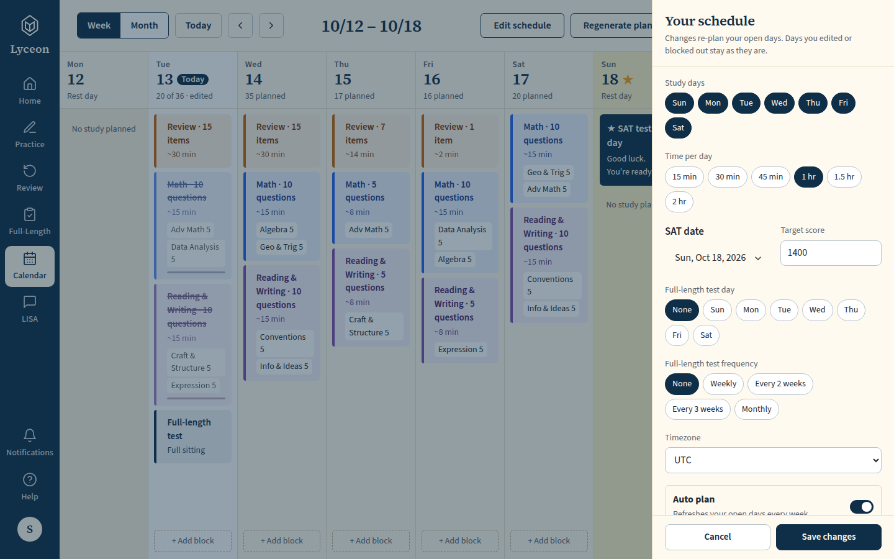
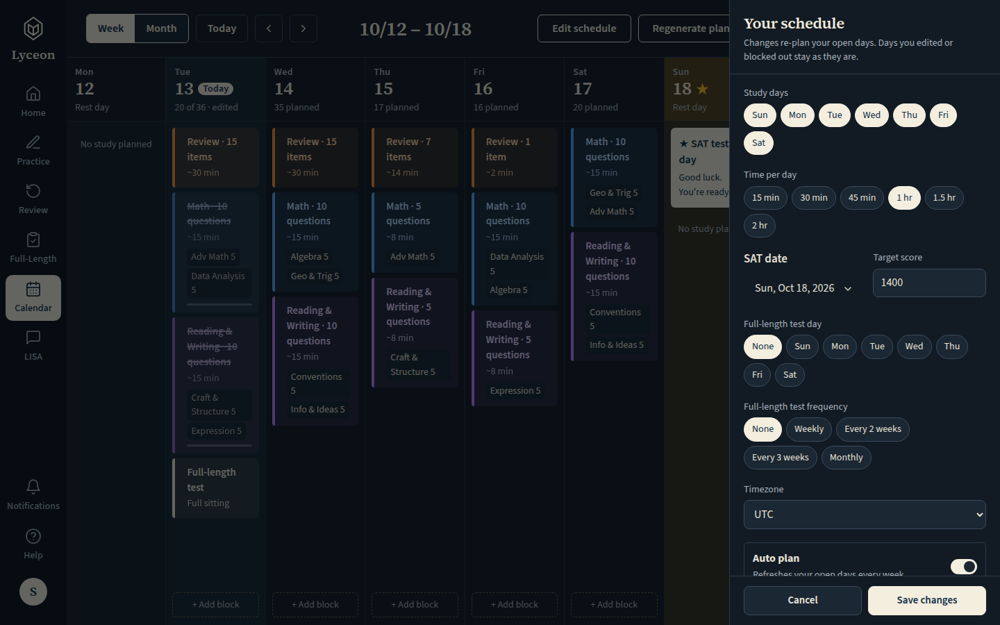
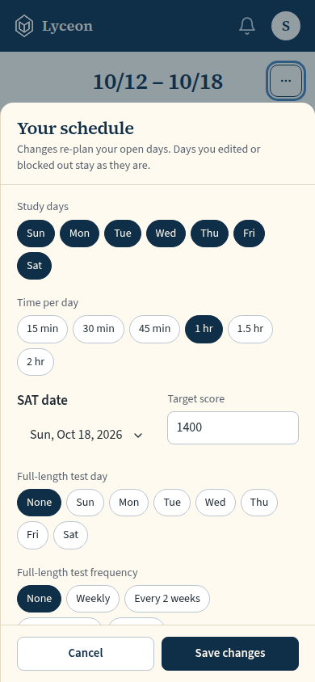
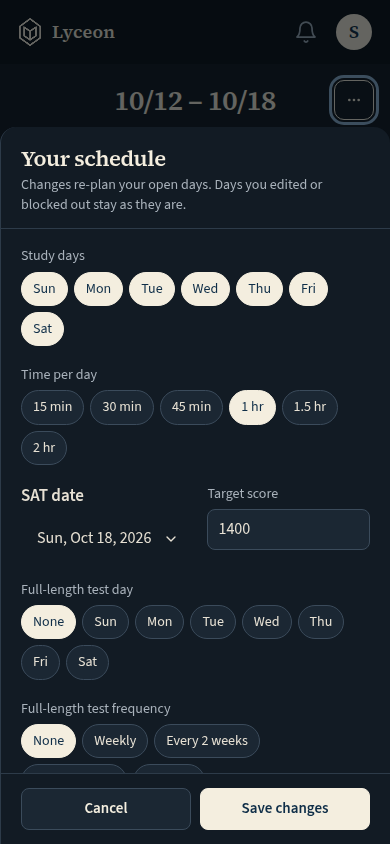

# Guardian accountability: the calendar's guardian line in the day menu and the block panel (active link); light and dark, 1440 and 390

Generated 2026-10-13T06:21:10.598Z by `pnpm exec tsx tests/e2e/student-harness/capture.ts GUARDIAN-NOTICE` (see `tests/e2e/student-harness/README.md`). Built = a production build of the real client (`vite preview`, or the dev server with STUDENT_HARNESS_CLIENT=dev) against the student harness (real routers over a local Postgres built from this repo's migrations; personas seeded through the real practice routes). Prototype = the signed-off `docs/plans/student-ui/design/prototype/*.dc.html`, rendered locally.

Conditions, read before comparing:
- Viewport screenshots (not full page) unless the shot says full page: desktop 1440x900, phone 390x844, and any extra size a shot names.
- The prototypes are a fixed 1440x900 canvas with no phone layout; phone rows show the desktop prototype.
- Dark is requested through the app's own per-device setting; the theme column records what the page rendered.
- No external requests: the built app's Google Fonts (Inter, Poppins) are blocked, so legacy page bodies fall back to system faces; Source Sans 3 / Source Serif 4 are self-hosted and load for both sides.
- Prototype data is illustrative; built data is the seeded personas' real payloads.

## The day ⋯ menu open: Block out this day, Regenerate day, then a rule and the one muted line "Your guardian is notified when you change your study plan." (14px, the menu's note style)

Persona: `paid`. Route: `/calendar`.
Step: click `{"desktop":"button.dmenu","mobile":"button.dmenu"}`.
Must then show `[data-testid^="day-menu-guardian-notice-"]` (the capture fails otherwise).
Prototype: none. The line is new (owner brief 2026-10-13); the prototype's day menu has no guardian line.

| Viewport | Theme (as rendered) | Built | Prototype |
|---|---|---|---|
| desktop | light |  `/calendar`, 177 KB, horizontal overflow 0px | none |
| desktop | dark |  `/calendar`, 179 KB, horizontal overflow 0px | none |
| mobile | light |  `/calendar`, 54 KB, horizontal overflow 0px | none |
| mobile | dark |  `/calendar`, 55 KB, horizontal overflow 0px | none |

## The block panel of a block the student can change: Move to…, then the guardian line under it (field-note style), then Start and Remove in the footer

Persona: `paid`. Route: `/calendar`.
Step: click `{"desktop":"button.block.rev","mobile":"button.block.rev"}`.
Must then show `[data-testid="calendar-block-guardian-notice"]` (the capture fails otherwise).
Prototype: none. The line is new (owner brief 2026-10-13); the prototype's block sheet has no guardian line.

| Viewport | Theme (as rendered) | Built | Prototype |
|---|---|---|---|
| desktop | light |  `/calendar`, 156 KB, horizontal overflow 0px | none |
| desktop | dark |  `/calendar`, 151 KB, horizontal overflow 0px | none |
| mobile | light |  `/calendar`, 46 KB, horizontal overflow 0px | none |
| mobile | dark |  `/calendar`, 46 KB, horizontal overflow 0px | none |

## Edit schedule (SCL-230, approved by Karl 2026-10-13): the schedule sheet with the guardian line under the live readout, above Cancel / Save changes (at 390 the sheet is opened from the '⋯' menu)

Persona: `paid`. Route: `/calendar`.
Step: click `{"desktop":"[data-testid=\"topbar-edit-schedule\"]","mobile":"[data-testid=\"calendar-more-actions\"]"}`.
Step: click `{"desktop":null,"mobile":"[data-testid=\"calendar-more-edit-schedule\"]"}`.
Must then show `[data-testid="settings-guardian-notice"]` (the capture fails otherwise).
Prototype: none. The line is new (SCL-230, approved 2026-10-13); the prototype's schedule sheet has no guardian line.

| Viewport | Theme (as rendered) | Built | Prototype |
|---|---|---|---|
| desktop | light |  `/calendar`, 184 KB, horizontal overflow 0px | none |
| desktop | dark |  `/calendar`, 180 KB, horizontal overflow 0px | none |
| mobile | light |  `/calendar`, 53 KB, horizontal overflow 0px | none |
| mobile | dark |  `/calendar`, 53 KB, horizontal overflow 0px | none |

## Run facts

- Seeded ids: `{"free":{"completedPracticeSessionId":"16c92ca5-a6c7-4517-a10b-3592a62b8f8c","openPracticeSessionId":"ea2f8f8d-f51d-4d01-8db5-f8b9be219025","openReviewSessionId":null,"diagnosticSessionId":null,"scoredExamSessionId":null,"inProgressExamSessionId":null,"lisaConversationId":null,"answered":13},"paid":{"completedPracticeSessionId":"d52d88dd-0b11-497e-a201-0f5f654ec15d","openPracticeSessionId":"a61c924c-90ce-4d84-87f5-8a88e39410fb","openReviewSessionId":null,"diagnosticSessionId":"8862ac8e-ce7f-451d-a1b5-5841257562ed","scoredExamSessionId":null,"inProgressExamSessionId":null,"lisaConversationId":null,"answered":53}}`
- Endpoints the pages asked for that the harness does not serve (answered 404): none
- Desmos (QA2-B, opt-in `STUDENT_HARNESS_DESMOS=1`): not loaded (a local-only run; the calculator shows its unavailable line)
- External hosts blocked: none
