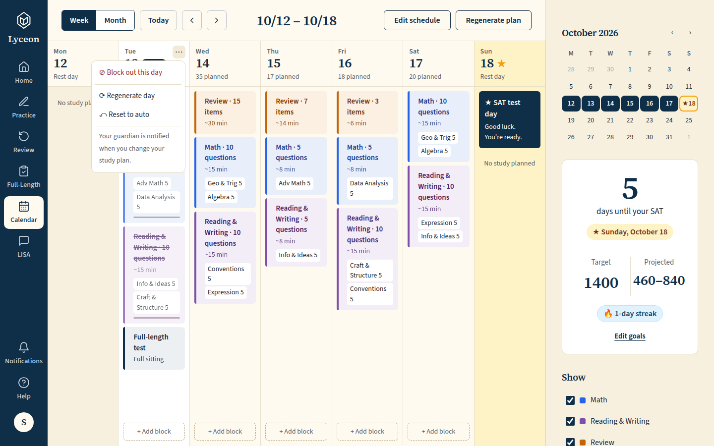
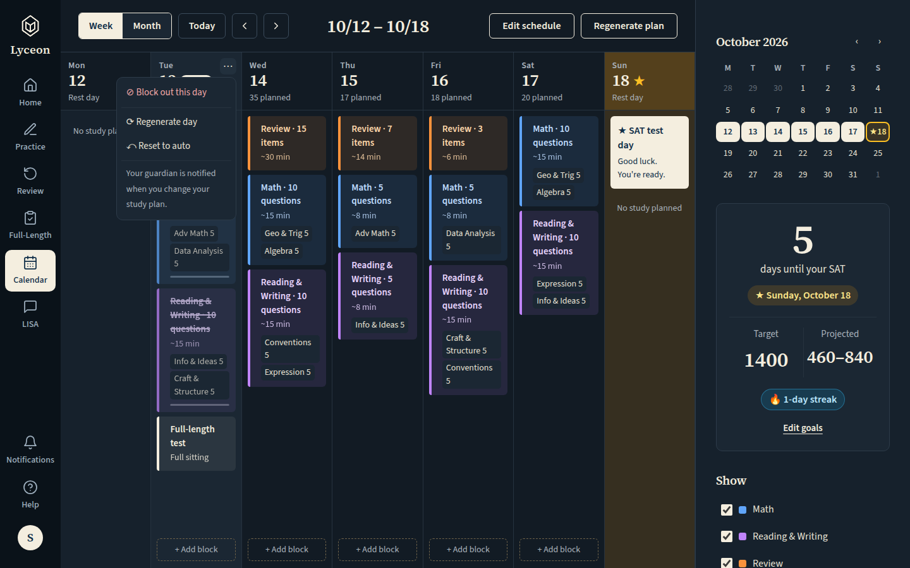
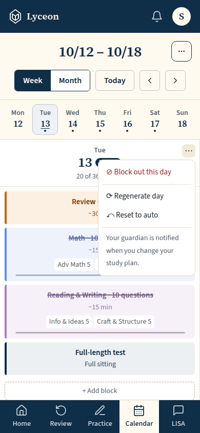
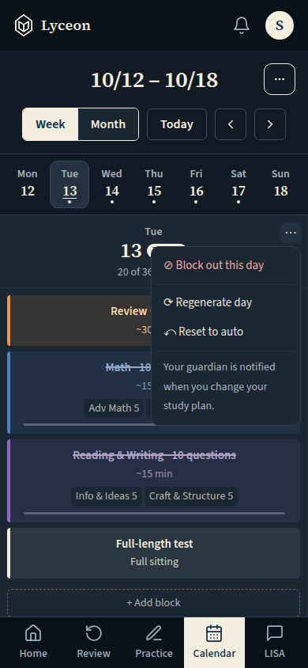
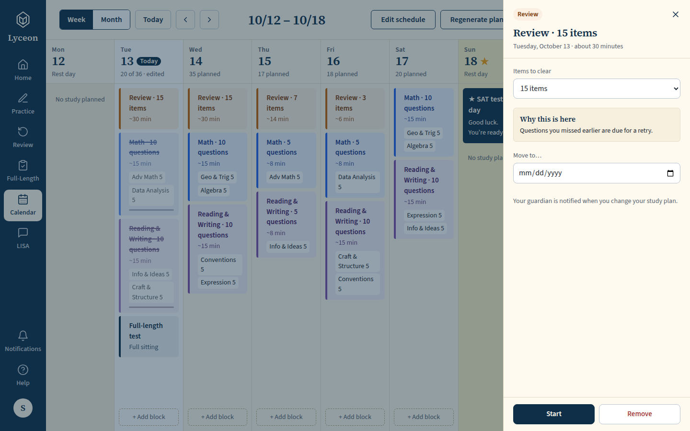
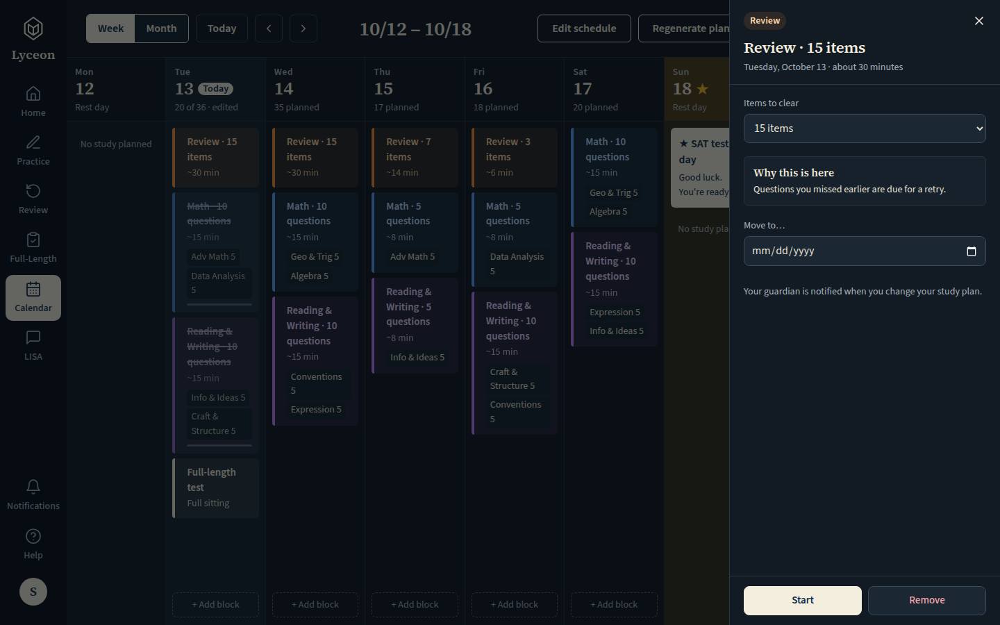
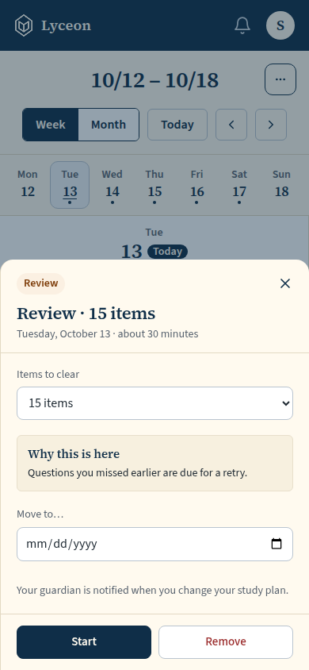
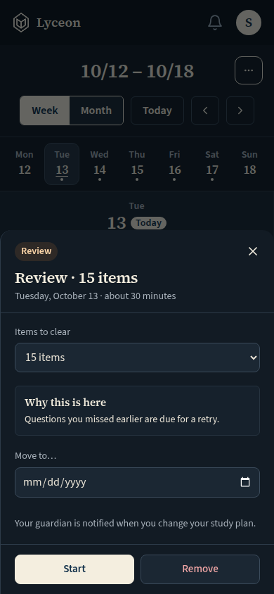

# Guardian accountability: the calendar's guardian line in the day menu and the block panel (active link); light and dark, 1440 and 390

Generated 2026-10-13T05:26:51.605Z by `pnpm exec tsx tests/e2e/student-harness/capture.ts GUARDIAN-NOTICE` (see `tests/e2e/student-harness/README.md`). Built = a production build of the real client (`vite preview`, or the dev server with STUDENT_HARNESS_CLIENT=dev) against the student harness (real routers over a local Postgres built from this repo's migrations; personas seeded through the real practice routes). Prototype = the signed-off `docs/plans/student-ui/design/prototype/*.dc.html`, rendered locally.

Conditions, read before comparing:
- Viewport screenshots (not full page) unless the shot says full page: desktop 1440x900, phone 390x844, and any extra size a shot names.
- The prototypes are a fixed 1440x900 canvas with no phone layout; phone rows show the desktop prototype.
- Dark is requested through the app's own per-device setting; the theme column records what the page rendered.
- No external requests: the built app's Google Fonts (Inter, Poppins) are blocked, so legacy page bodies fall back to system faces; Source Sans 3 / Source Serif 4 are self-hosted and load for both sides.
- Prototype data is illustrative; built data is the seeded personas' real payloads.

## The day ⋯ menu open: Block out this day, Regenerate day, then a rule and the one muted line "Your guardian is notified when you change your study plan." (14px, the menu's note style)

Persona: `paid`. Route: `/calendar`.
Step: click `{"desktop":"button.dmenu","mobile":"button.dmenu"}`.
Must then show `[data-testid^="day-menu-guardian-notice-"]` (the capture fails otherwise).
Prototype: none. The line is new (owner brief 2026-10-13); the prototype's day menu has no guardian line.

| Viewport | Theme (as rendered) | Built | Prototype |
|---|---|---|---|
| desktop | light |  `/calendar`, 175 KB, horizontal overflow 0px | none |
| desktop | dark |  `/calendar`, 177 KB, horizontal overflow 0px | none |
| mobile | light |  `/calendar`, 54 KB, horizontal overflow 0px | none |
| mobile | dark |  `/calendar`, 55 KB, horizontal overflow 0px | none |

## The block panel of a block the student can change: Move to…, then the guardian line under it (field-note style), then Start and Remove in the footer

Persona: `paid`. Route: `/calendar`.
Step: click `{"desktop":"button.block.rev","mobile":"button.block.rev"}`.
Must then show `[data-testid="calendar-block-guardian-notice"]` (the capture fails otherwise).
Prototype: none. The line is new (owner brief 2026-10-13); the prototype's block sheet has no guardian line.

| Viewport | Theme (as rendered) | Built | Prototype |
|---|---|---|---|
| desktop | light |  `/calendar`, 153 KB, horizontal overflow 0px | none |
| desktop | dark |  `/calendar`, 149 KB, horizontal overflow 0px | none |
| mobile | light |  `/calendar`, 46 KB, horizontal overflow 0px | none |
| mobile | dark |  `/calendar`, 46 KB, horizontal overflow 0px | none |

## Run facts

- Seeded ids: `{"free":{"completedPracticeSessionId":"018baf2a-0fad-455d-9e8d-9bc3fc83b973","openPracticeSessionId":"d9da80d5-89b0-408a-a9fa-f75d7921888d","openReviewSessionId":null,"diagnosticSessionId":null,"scoredExamSessionId":null,"inProgressExamSessionId":null,"lisaConversationId":null,"answered":13},"paid":{"completedPracticeSessionId":"b9ab34bc-408b-40c4-8959-dfc2727f185c","openPracticeSessionId":"805fafa6-7d58-4b98-aed0-b32285a650b4","openReviewSessionId":null,"diagnosticSessionId":"5b4eb01c-1d54-4e89-8e3c-c971d4aa177e","scoredExamSessionId":null,"inProgressExamSessionId":null,"lisaConversationId":null,"answered":53}}`
- Endpoints the pages asked for that the harness does not serve (answered 404): none
- Desmos (QA2-B, opt-in `STUDENT_HARNESS_DESMOS=1`): not loaded (a local-only run; the calculator shows its unavailable line)
- External hosts blocked: none
