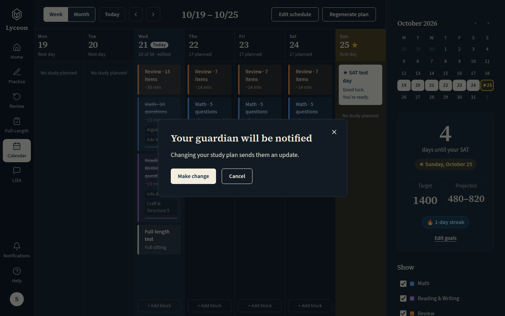
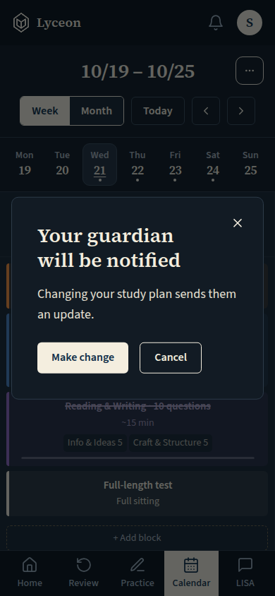
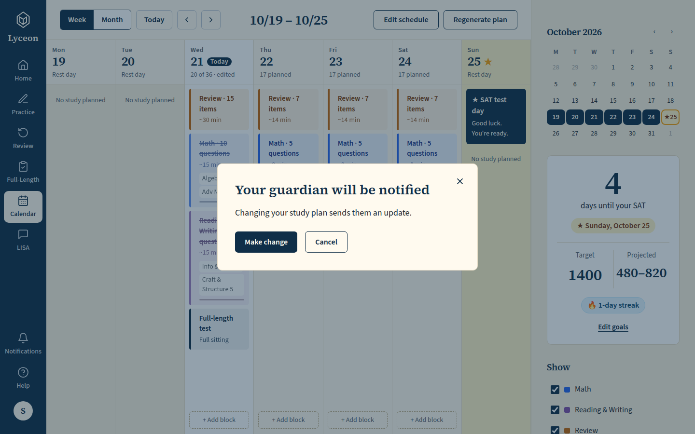
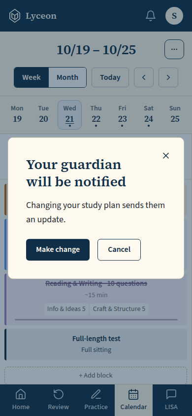
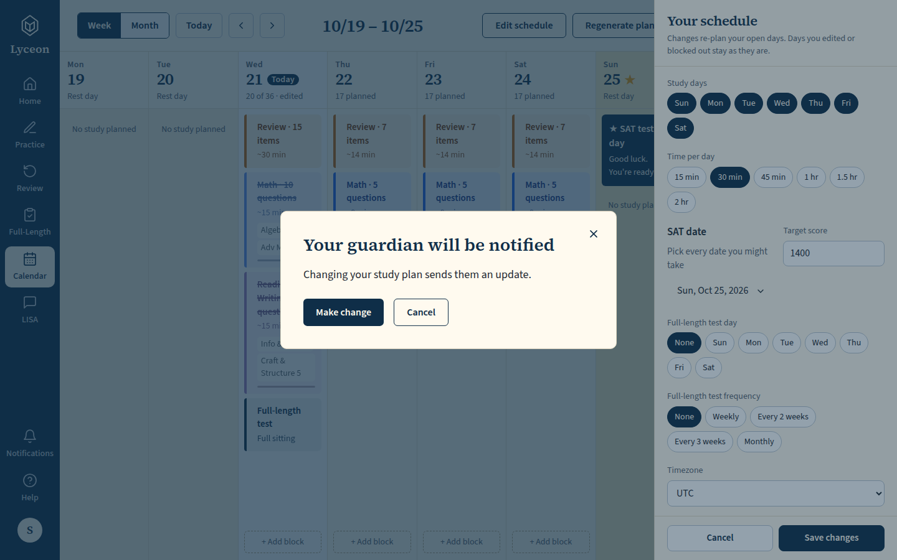
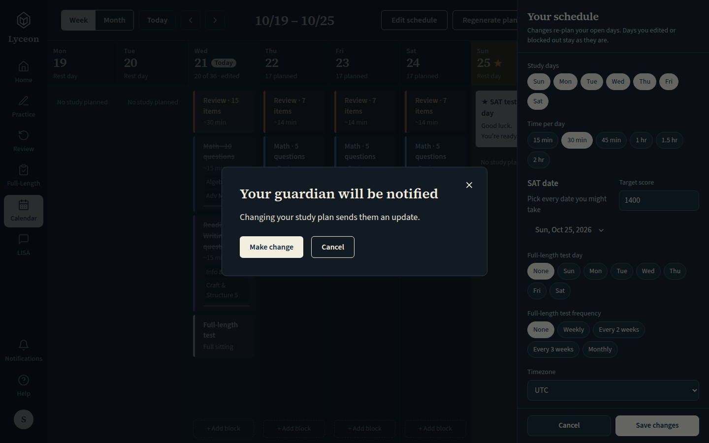
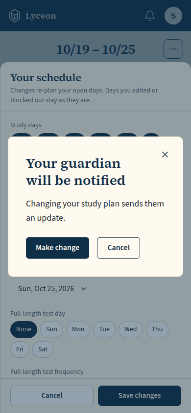
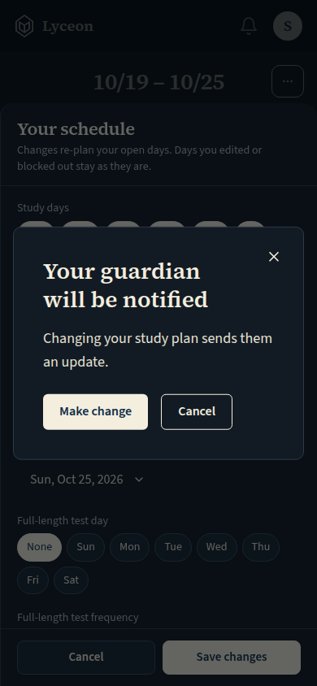

# Guardian confirmation (SCL-238): 'Your guardian will be notified' before a recorded calendar change (block out a day, remove a block, save fewer minutes); light and dark, 1440 and 390

Generated 2026-10-21T04:37:39.763Z by `pnpm exec tsx tests/e2e/student-harness/capture.ts GUARDIAN-NOTICE` (see `tests/e2e/student-harness/README.md`). Built = a production build of the real client (`vite preview`, or the dev server with STUDENT_HARNESS_CLIENT=dev) against the student harness (real routers over a local Postgres built from this repo's migrations; personas seeded through the real practice routes). Prototype = the signed-off `docs/plans/student-ui/design/prototype/*.dc.html`, rendered locally.

Conditions, read before comparing:
- Viewport screenshots (not full page) unless the shot says full page: desktop 1440x900, phone 390x844, and any extra size a shot names.
- The prototypes are a fixed 1440x900 canvas with no phone layout; phone rows show the desktop prototype.
- Dark is requested through the app's own per-device setting; the theme column records what the page rendered.
- No external requests: the built app's Google Fonts (Inter, Poppins) are blocked, so legacy page bodies fall back to system faces; Source Sans 3 / Source Serif 4 are self-hosted and load for both sides.
- Prototype data is illustrative; built data is the seeded personas' real payloads.

## Day ⋯ menu → Block out this day: the dialog asks first (title, body, filled 'Make change', outline 'Cancel'); nothing is written until 'Make change'

Persona: `paid`. Route: `/calendar`.
Step: click `{"desktop":"button.dmenu","mobile":"button.dmenu"}`.
Step: click `{"desktop":"[data-testid^=\"day-block-\"]","mobile":"[data-testid^=\"day-block-\"]"}`.
Must then show `[data-testid="guardian-notify-confirm"]` (the capture fails otherwise).
Prototype: none. The confirmation is new (owner brief 2026-10-21, SCL-238); no prototype screen has it. It is the shared student Modal (UI-46).

| Viewport | Theme (as rendered) | Built | Prototype |
|---|---|---|---|
| desktop | light |  `/calendar`, 142 KB, horizontal overflow 0px | none |
| desktop | dark |  `/calendar`, 139 KB, horizontal overflow 0px | none |
| mobile | light |  `/calendar`, 55 KB, horizontal overflow 0px | none |
| mobile | dark |  `/calendar`, 54 KB, horizontal overflow 0px | none |

## Block panel → Remove: the dialog over the sheet; the panel no longer carries a guardian line

Persona: `paid`. Route: `/calendar`.
Step: click `{"desktop":"button.block.rev","mobile":"button.block.rev"}`.
Step: click `{"desktop":"[data-testid=\"calendar-block-sheet\"] button:has-text(\"Remove\")","mobile":"[data-testid=\"calendar-block-sheet\"] button:has-text(\"Remove\")"}`.
Must then show `[data-testid="guardian-notify-confirm"]` (the capture fails otherwise).
Prototype: none. The confirmation is new (owner brief 2026-10-21, SCL-238); no prototype screen has it. It is the shared student Modal (UI-46).

| Viewport | Theme (as rendered) | Built | Prototype |
|---|---|---|---|
| desktop | light |  `/calendar`, 142 KB, horizontal overflow 0px | none |
| desktop | dark |  `/calendar`, 139 KB, horizontal overflow 0px | none |
| mobile | light |  `/calendar`, 55 KB, horizontal overflow 0px | none |
| mobile | dark |  `/calendar`, 54 KB, horizontal overflow 0px | none |

## Edit schedule → 30 min → Save changes: the dialog over the schedule sheet (at 390 the sheet is opened from the '⋯' menu)

Persona: `paid`. Route: `/calendar`.
Step: click `{"desktop":"[data-testid=\"topbar-edit-schedule\"]","mobile":"[data-testid=\"calendar-more-actions\"]"}`.
Step: click `{"desktop":null,"mobile":"[data-testid=\"calendar-more-edit-schedule\"]"}`.
Step: click `{"desktop":"[data-testid=\"settings-minutes\"] button:has-text(\"30 min\")","mobile":"[data-testid=\"settings-minutes\"] button:has-text(\"30 min\")"}`.
Step: click `{"desktop":"[data-testid=\"settings-save\"]","mobile":"[data-testid=\"settings-save\"]"}`.
Must then show `[data-testid="guardian-notify-confirm"]` (the capture fails otherwise).
Prototype: none. The confirmation is new (owner brief 2026-10-21, SCL-238); no prototype screen has it. It is the shared student Modal (UI-46).

| Viewport | Theme (as rendered) | Built | Prototype |
|---|---|---|---|
| desktop | light |  `/calendar`, 152 KB, horizontal overflow 0px | none |
| desktop | dark |  `/calendar`, 145 KB, horizontal overflow 0px | none |
| mobile | light |  `/calendar`, 52 KB, horizontal overflow 0px | none |
| mobile | dark |  `/calendar`, 51 KB, horizontal overflow 0px | none |

## Run facts

- Seeded ids: `{"free":{"completedPracticeSessionId":"cb061bee-928b-4871-a54b-431f1dbf4ed6","openPracticeSessionId":"624bdd3a-1959-45f9-a3c2-35f101c15b24","openReviewSessionId":null,"diagnosticSessionId":null,"scoredExamSessionId":null,"inProgressExamSessionId":null,"lisaConversationId":null,"answered":13},"paid":{"completedPracticeSessionId":"08c07515-00f9-408a-a77c-6afc2ec42b92","openPracticeSessionId":"bdd69970-d49a-49b9-97d9-50f8f25d377e","openReviewSessionId":null,"diagnosticSessionId":"1a19fb25-b000-413d-a4de-9c5b6635a1a8","scoredExamSessionId":null,"inProgressExamSessionId":null,"lisaConversationId":null,"answered":53}}`
- Endpoints the pages asked for that the harness does not serve (answered 404): none
- Desmos (QA2-B, opt-in `STUDENT_HARNESS_DESMOS=1`): not loaded (a local-only run; the calculator shows its unavailable line)
- External hosts blocked: none
