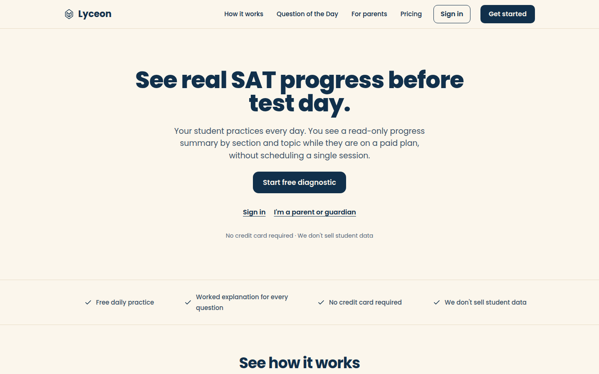
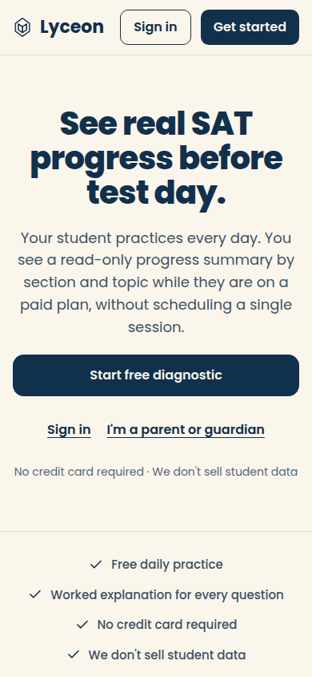

# F-98 homepage hero (one primary button, two text links) and Part G legal pages in the student tokens; light and dark, 1440 and 390

Generated 2026-10-21T08:56:44.943Z by `pnpm exec tsx tests/e2e/student-harness/capture.ts HOMEPAGE-HERO` (see `tests/e2e/student-harness/README.md`). Built = a production build of the real client (`vite preview`, or the dev server with STUDENT_HARNESS_CLIENT=dev) against the student harness (real routers over a local Postgres built from this repo's migrations; personas seeded through the real practice routes). Prototype = the signed-off `docs/plans/student-ui/design/prototype/*.dc.html`, rendered locally.

Conditions, read before comparing:
- Viewport screenshots (not full page) unless the shot says full page: desktop 1440x900, phone 390x844, and any extra size a shot names.
- The prototypes are a fixed 1440x900 canvas with no phone layout; phone rows show the desktop prototype.
- Dark is requested through the app's own per-device setting; the theme column records what the page rendered.
- No external requests: the built app's Google Fonts (Inter, Poppins) are blocked, so legacy page bodies fall back to system faces; Source Sans 3 / Source Serif 4 are self-hosted and load for both sides.
- Prototype data is illustrative; built data is the seeded personas' real payloads.

## Homepage hero: H1, one sentence, 'Start free diagnostic' (the one filled button), 'Sign in' and 'I'm a parent or guardian' as text links

Persona: `signed-out`. Route: `/`.
Must then show `[data-testid="hero-secondary-links"]` (the capture fails otherwise).
Prototype: none. SEO-owned public pages; no student prototype covers them.

| Viewport | Theme (as rendered) | Built | Prototype |
|---|---|---|---|
| desktop | light |  `/`, 81 KB, horizontal overflow 0px | none |
| desktop | dark |  `/`, 81 KB, horizontal overflow 0px | none |
| mobile | light |  `/`, 58 KB, horizontal overflow 0px | none |
| mobile | dark |  `/`, 58 KB, horizontal overflow 0px | none |

## Homepage hero, experiment Variant B (analytics accepted, B stored): its own H1 and sentence over the same F-98 hero, one filled button, two text links, no label above the title (ruling 4, 2026-10-21)

Persona: `signed-out`. Route: `/`.
Preset localStorage: `{"ph_lyceon_homepage_hero":"test"}`.
Cookie banner answered with analytics ACCEPTED (the real `lyceon_consent` cookie, current banner version), so a stored hero-experiment variant is shown.
Must then show the text `See real SAT progress before test day.` (the capture fails otherwise).
Must then show `[data-testid="hero-secondary-links"]` (the capture fails otherwise).
Prototype: none. SEO-owned public pages; no student prototype covers them.

| Viewport | Theme (as rendered) | Built | Prototype |
|---|---|---|---|
| desktop | light |  `/`, 87 KB, horizontal overflow 0px | none |
| desktop | dark |  `/`, 87 KB, horizontal overflow 0px | none |
| mobile | light |  `/`, 64 KB, horizontal overflow 0px | none |
| mobile | dark |  `/`, 64 KB, horizontal overflow 0px | none |

## /legal in the student token set (dark follows the device)

Persona: `signed-out`. Route: `/legal`.
Prototype: none. SEO-owned public pages; no student prototype covers them.

| Viewport | Theme (as rendered) | Built | Prototype |
|---|---|---|---|
| desktop | light |  `/legal`, 75 KB, horizontal overflow 0px | none |
| desktop | dark |  `/legal`, 76 KB, horizontal overflow 0px | none |
| mobile | light |  `/legal`, 48 KB, horizontal overflow 0px | none |
| mobile | dark |  `/legal`, 48 KB, horizontal overflow 0px | none |

## /legal/privacy-policy in the student token set; body text 16px, nothing below 14px

Persona: `signed-out`. Route: `/legal/privacy-policy`.
Prototype: none. SEO-owned public pages; no student prototype covers them.

| Viewport | Theme (as rendered) | Built | Prototype |
|---|---|---|---|
| desktop | light |  `/legal/privacy-policy`, 123 KB, horizontal overflow 0px | none |
| desktop | dark |  `/legal/privacy-policy`, 127 KB, horizontal overflow 0px | none |
| mobile | light |  `/legal/privacy-policy`, 59 KB, horizontal overflow 0px | none |
| mobile | dark |  `/legal/privacy-policy`, 62 KB, horizontal overflow 0px | none |

## Run facts

- Seeded ids: `{"free":{"completedPracticeSessionId":"11a9a462-d620-42a3-b89e-299a94fd0e7d","openPracticeSessionId":"ca5e5502-d08f-47d0-8bba-b3c56dda7d80","openReviewSessionId":null,"diagnosticSessionId":null,"scoredExamSessionId":null,"inProgressExamSessionId":null,"lisaConversationId":null,"answered":13},"paid":{"completedPracticeSessionId":"75058ea1-86e1-47d0-8dcf-fd3c9ca22f35","openPracticeSessionId":"4a0111ee-fbda-45ff-b109-01e1d92192d4","openReviewSessionId":null,"diagnosticSessionId":"a99e4a1e-9056-43f7-9bcd-382cee1e9f35","scoredExamSessionId":null,"inProgressExamSessionId":null,"lisaConversationId":null,"answered":53}}`
- Endpoints the pages asked for that the harness does not serve (answered 404): `GET /public/pricing`
- Desmos (QA2-B, opt-in `STUDENT_HARNESS_DESMOS=1`): not loaded (a local-only run; the calculator shows its unavailable line)
- External hosts blocked: none
