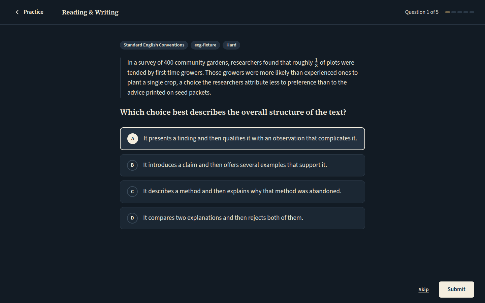
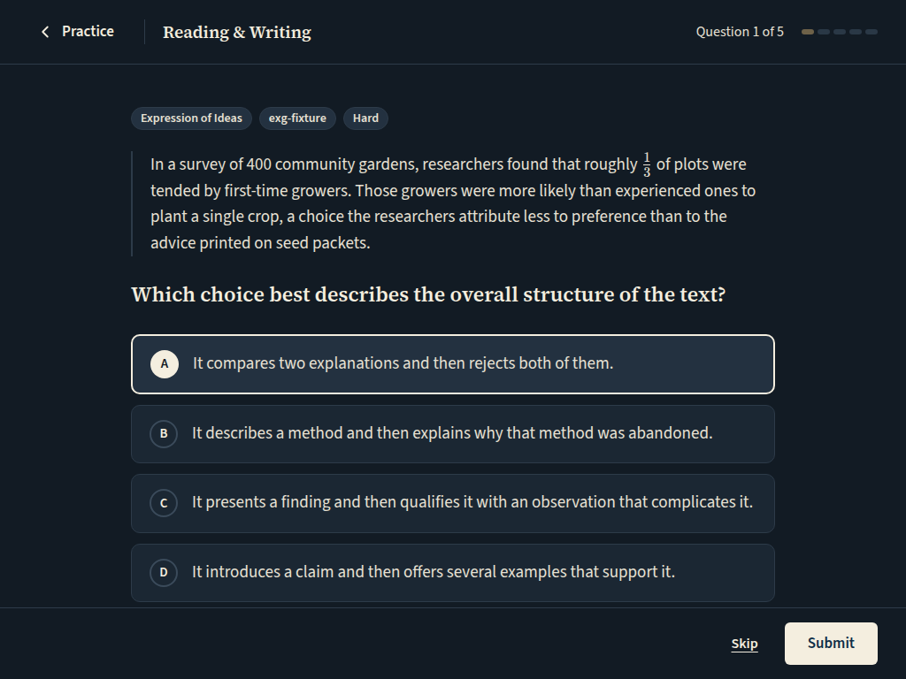
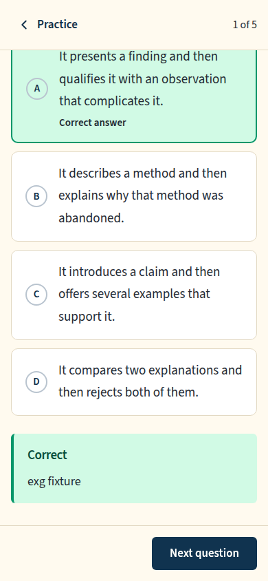
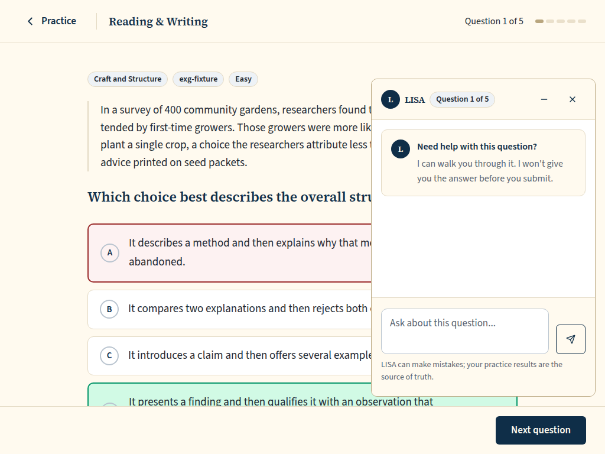
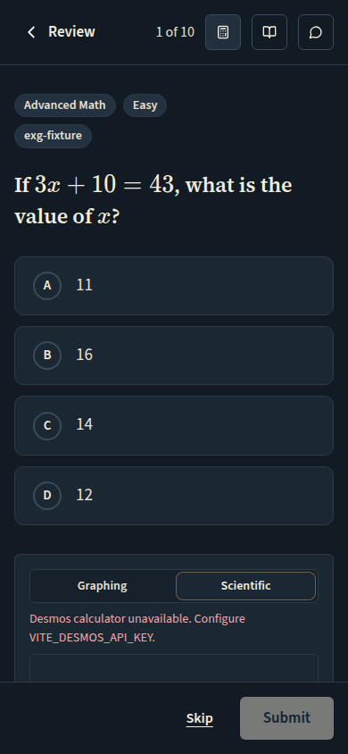
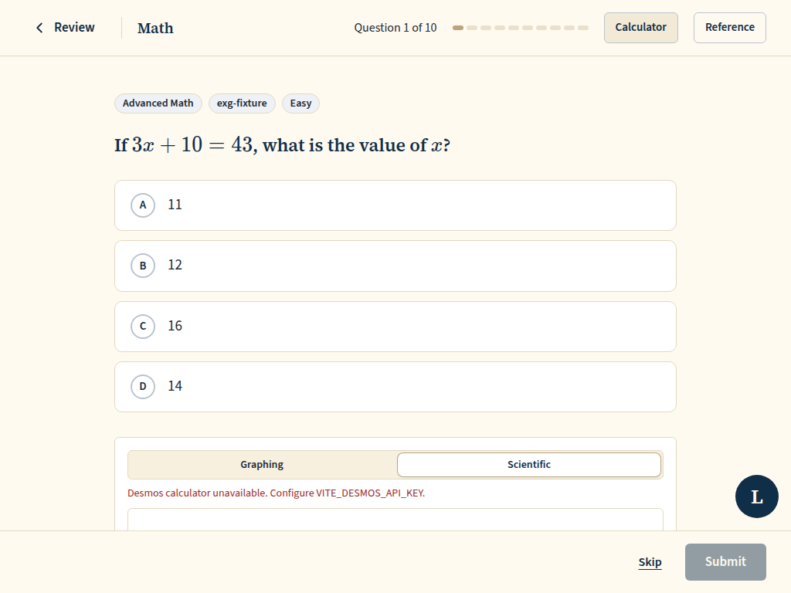

# LISA chat dock: Home, Review and the review runner, bubble and open dock; the free lock modal; absent on phones and the timed module; light and dark, 1440, 1024 and 390

Generated 2026-10-23T05:34:10.329Z by `pnpm exec tsx tests/e2e/student-harness/capture.ts LISA-DOCK` (see `tests/e2e/student-harness/README.md`). Built = a production build of the real client (`vite preview`, or the dev server with STUDENT_HARNESS_CLIENT=dev) against the student harness (real routers over a local Postgres built from this repo's migrations; personas seeded through the real practice routes). Prototype = the signed-off `docs/plans/student-ui/design/prototype/*.dc.html`, rendered locally.

Conditions, read before comparing:
- Viewport screenshots (not full page) unless the shot says full page: desktop 1440x900, phone 390x844, and any extra size a shot names.
- The prototypes are a fixed 1440x900 canvas with no phone layout; phone rows show the desktop prototype.
- Dark is requested through the app's own per-device setting; the theme column records what the page rendered.
- No external requests: the built app's Google Fonts (Inter, Poppins) are blocked, so legacy page bodies fall back to system faces; Source Sans 3 / Source Serif 4 are self-hosted and load for both sides.
- Prototype data is illustrative; built data is the seeded personas' real payloads.

## Home (paid): the LISA bubble bottom-right, collapsed (it never opens by itself). Phone: no bubble, the LISA tab as before

Persona: `paid`. Route: `/dashboard`.
Also shot at w1024 1024x768 (the desktop steps and selectors).
Prototype: none. No prototype draws the chat dock: it is the owner brief of 2026-10-22 ("LISA chat dock", floating bubble, no bar); DESIGN.md §3 and §4 describe it.

| Viewport | Theme (as rendered) | Built | Prototype |
|---|---|---|---|
| desktop | light |  `/dashboard`, 159 KB, horizontal overflow 0px | none |
| desktop | dark |  `/dashboard`, 158 KB, horizontal overflow 0px | none |
| mobile | light |  `/dashboard`, 61 KB, horizontal overflow 0px | none |
| mobile | dark |  `/dashboard`, 62 KB, horizontal overflow 0px | none |
| w1024 | light |  `/dashboard`, 122 KB, horizontal overflow 0px | none |
| w1024 | dark |  `/dashboard`, 123 KB, horizontal overflow 0px | none |

## Home (paid): the bubble clicked, the dock open in general mode on the student's latest LISA conversation (the one heading the LISA page's history), Open in LISA, Minimize and Close

Persona: `paid`. Route: `/dashboard`.
Step: click `{"desktop":"[data-testid=\"chat-dock-bubble\"]","mobile":null}`.
Also shot at w1024 1024x768 (the desktop steps and selectors).
Prototype: none. No prototype draws the chat dock: it is the owner brief of 2026-10-22 ("LISA chat dock", floating bubble, no bar); DESIGN.md §3 and §4 describe it.

| Viewport | Theme (as rendered) | Built | Prototype |
|---|---|---|---|
| desktop | light |  `/dashboard`, 148 KB, horizontal overflow 0px | none |
| desktop | dark |  `/dashboard`, 150 KB, horizontal overflow 0px | none |
| mobile | light |  `/dashboard`, 61 KB, horizontal overflow 0px | none |
| mobile | dark |  `/dashboard`, 62 KB, horizontal overflow 0px | none |
| w1024 | light |  `/dashboard`, 112 KB, horizontal overflow 0px | none |
| w1024 | dark |  `/dashboard`, 114 KB, horizontal overflow 0px | none |

## Home (free): the bubble carries the rail's lock; clicked, it opens the existing upgrade modal for LISA (no tutor request)

Persona: `free`. Route: `/dashboard`.
Step: click `{"desktop":"[data-testid=\"chat-dock-bubble\"]","mobile":null}`.
Also shot at w1024 1024x768 (the desktop steps and selectors).
Prototype: none. No prototype draws the chat dock: it is the owner brief of 2026-10-22 ("LISA chat dock", floating bubble, no bar); DESIGN.md §3 and §4 describe it.

| Viewport | Theme (as rendered) | Built | Prototype |
|---|---|---|---|
| desktop | light |  `/dashboard`, 154 KB, horizontal overflow 0px | none |
| desktop | dark |  `/dashboard`, 151 KB, horizontal overflow 0px | none |
| mobile | light |  `/dashboard`, 64 KB, horizontal overflow 0px | none |
| mobile | dark |  `/dashboard`, 64 KB, horizontal overflow 0px | none |
| w1024 | light |  `/dashboard`, 119 KB, horizontal overflow 0px | none |
| w1024 | dark |  `/dashboard`, 117 KB, horizontal overflow 0px | none |

## Home (paid), the cookie banner not yet answered: the bubble sits above the banner (measured through lib/bottom-chrome.ts), never under it

Persona: `paid`. Route: `/dashboard`.
Also shot at w1024 1024x768 (the desktop steps and selectors).
Prototype: none. No prototype draws the chat dock: it is the owner brief of 2026-10-22 ("LISA chat dock", floating bubble, no bar); DESIGN.md §3 and §4 describe it.

| Viewport | Theme (as rendered) | Built | Prototype |
|---|---|---|---|
| desktop | light |  `/dashboard`, 162 KB, horizontal overflow 0px | none |
| desktop | dark |  `/dashboard`, 163 KB, horizontal overflow 0px | none |
| mobile | light |  `/dashboard`, 60 KB, horizontal overflow 0px | none |
| mobile | dark |  `/dashboard`, 62 KB, horizontal overflow 0px | none |
| w1024 | light |  `/dashboard`, 124 KB, horizontal overflow 0px | none |
| w1024 | dark |  `/dashboard`, 125 KB, horizontal overflow 0px | none |

## Review (paid): the LISA bubble, collapsed

Persona: `paid`. Route: `/review`.
Also shot at w1024 1024x768 (the desktop steps and selectors).
Prototype: none. No prototype draws the chat dock: it is the owner brief of 2026-10-22 ("LISA chat dock", floating bubble, no bar); DESIGN.md §3 and §4 describe it.

| Viewport | Theme (as rendered) | Built | Prototype |
|---|---|---|---|
| desktop | light |  `/review`, 142 KB, horizontal overflow 0px | none |
| desktop | dark |  `/review`, 144 KB, horizontal overflow 0px | none |
| mobile | light |  `/review`, 58 KB, horizontal overflow 0px | none |
| mobile | dark |  `/review`, 58 KB, horizontal overflow 0px | none |
| w1024 | light |  `/review`, 110 KB, horizontal overflow 0px | none |
| w1024 | dark |  `/review`, 111 KB, horizontal overflow 0px | none |

## Review (paid): the dock open in general mode

Persona: `paid`. Route: `/review`.
Step: click `{"desktop":"[data-testid=\"chat-dock-bubble\"]","mobile":null}`.
Also shot at w1024 1024x768 (the desktop steps and selectors).
Prototype: none. No prototype draws the chat dock: it is the owner brief of 2026-10-22 ("LISA chat dock", floating bubble, no bar); DESIGN.md §3 and §4 describe it.

| Viewport | Theme (as rendered) | Built | Prototype |
|---|---|---|---|
| desktop | light |  `/review`, 143 KB, horizontal overflow 0px | none |
| desktop | dark |  `/review`, 145 KB, horizontal overflow 0px | none |
| mobile | light |  `/review`, 58 KB, horizontal overflow 0px | none |
| mobile | dark |  `/review`, 58 KB, horizontal overflow 0px | none |
| w1024 | light |  `/review`, 105 KB, horizontal overflow 0px | none |
| w1024 | dark |  `/review`, 106 KB, horizontal overflow 0px | none |

## Review runner (paid), before submitting: no side panel; the bubble above the Submit footer and clear of the choices. Phone: unchanged (Show LISA in the bar, LISA closed)

Persona: `paid`. Route: `/review/session/{session}`.
Preset localStorage: `{"lyceon_client_instance_id":"student-harness-seed"}`.
Fresh session per capture (real create route, ended after the shot): `review {"mode":"filter","filters":{"sections":["RW"]},"target_count":10}`.
Also shot at w1024 1024x768 (the desktop steps and selectors).
Prototype: none. No prototype draws the chat dock: it is the owner brief of 2026-10-22 ("LISA chat dock", floating bubble, no bar); DESIGN.md §3 and §4 describe it.

| Viewport | Theme (as rendered) | Built | Prototype |
|---|---|---|---|
| desktop | light |  `/review/session/22ae1076-5971-40c1-b916-cdb929110158`, 91 KB, horizontal overflow 0px | none |
| desktop | dark |  `/review/session/45297cb2-dbdf-4004-be89-c278d9ef051b`, 94 KB, horizontal overflow 0px | none |
| mobile | light |  `/review/session/d10e758b-5cb3-4574-a6a4-80bbb32505de`, 74 KB, horizontal overflow 0px | none |
| mobile | dark |  `/review/session/99045826-c042-4967-bc4a-a41e8f759f33`, 76 KB, horizontal overflow 0px | none |
| w1024 | light |  `/review/session/b96d88c4-945c-40b5-a4d1-3656ef2f0f4e`, 88 KB, horizontal overflow 0px | none |
| w1024 | dark |  `/review/session/80bba988-8229-4c3c-8d94-d60430c78475`, 91 KB, horizontal overflow 0px | none |

## Review runner (paid): the dock open in the current question's scope (the 'Question N of M' chip, the opener), above the footer; the question stays usable

Persona: `paid`. Route: `/review/session/{session}`.
Preset localStorage: `{"lyceon_client_instance_id":"student-harness-seed"}`.
Fresh session per capture (real create route, ended after the shot): `review {"mode":"filter","filters":{"sections":["RW"]},"target_count":10}`.
Step: click `{"desktop":"[data-testid=\"chat-dock-bubble\"]","mobile":null}`.
Also shot at w1024 1024x768 (the desktop steps and selectors).
Prototype: none. No prototype draws the chat dock: it is the owner brief of 2026-10-22 ("LISA chat dock", floating bubble, no bar); DESIGN.md §3 and §4 describe it.

| Viewport | Theme (as rendered) | Built | Prototype |
|---|---|---|---|
| desktop | light |  `/review/session/31122697-dfad-4391-af69-881c23f7957b`, 115 KB, horizontal overflow 0px | none |
| desktop | dark |  `/review/session/85495c43-6ffc-4f9d-ad9a-5a6329b97121`, 119 KB, horizontal overflow 0px | none |
| mobile | light |  `/review/session/60e5fec4-169d-4130-aa58-67eab434247e`, 72 KB, horizontal overflow 0px | none |
| mobile | dark |  `/review/session/52ff3fdf-47db-4e38-8f75-4cdc0d9f2d49`, 75 KB, horizontal overflow 0px | none |
| w1024 | light |  `/review/session/127ca6a0-4682-4556-96da-b18bf0d52eea`, 101 KB, horizontal overflow 0px | none |
| w1024 | dark |  `/review/session/d75cda54-bc7e-4d8a-b513-b513fdf8801e`, 103 KB, horizontal overflow 0px | none |

## The live timed module (Full-Length, Reading and Writing Module 2): no bubble and no dock (LISA never appears in a live test)

Persona: `paid`. Route: `/tests/{paid.inProgressExamSessionId}/RW/2`.
Must then show no `[data-testid="chat-dock-bubble"]` (the capture fails otherwise).
Also shot at w1024 1024x768 (the desktop steps and selectors).
Prototype: none. No prototype draws the chat dock: it is the owner brief of 2026-10-22 ("LISA chat dock", floating bubble, no bar); DESIGN.md §3 and §4 describe it.

| Viewport | Theme (as rendered) | Built | Prototype |
|---|---|---|---|
| desktop | light |  `/tests/d813201e-c02f-42e8-9936-e9cc30b5d617/RW/2`, 97 KB, horizontal overflow 0px | none |
| mobile | light |  `/tests/d813201e-c02f-42e8-9936-e9cc30b5d617/RW/2`, 64 KB, horizontal overflow 0px | none |
| w1024 | light |  `/tests/d813201e-c02f-42e8-9936-e9cc30b5d617/RW/2`, 97 KB, horizontal overflow 0px | none |

## Run facts

- Seeded ids: `{"free":{"completedPracticeSessionId":"8ac06f6b-70eb-4b01-8b25-4d1fd3e0a874","openPracticeSessionId":"23b63420-ea41-44b5-a9b6-bd02f9663fd0","openReviewSessionId":"cc1a15aa-0843-4190-8985-250d10780ce2","diagnosticSessionId":null,"scoredExamSessionId":null,"inProgressExamSessionId":null,"lisaConversationId":null,"answered":39},"paid":{"completedPracticeSessionId":"cab018fd-4351-40f8-a2ba-40261d673f9b","openPracticeSessionId":"d85a4d66-23fb-40ef-8e6b-43b1298d3fd6","openReviewSessionId":"7fc1c974-f61c-4d89-98ac-f14a36ecee4e","diagnosticSessionId":"7bcc73e6-b597-4511-84de-2427e5e68f81","scoredExamSessionId":"facaf8ae-5771-4d5b-8253-134830e04826","inProgressExamSessionId":"d813201e-c02f-42e8-9936-e9cc30b5d617","lisaConversationId":"28da0726-9375-49e7-8a31-139e0ebc93f9","answered":204}}`
- Endpoints the pages asked for that the harness does not serve (answered 404): none
- Desmos (QA2-B, opt-in `STUDENT_HARNESS_DESMOS=1`): not loaded (a local-only run; the calculator shows its unavailable line)
- External hosts blocked: none

---

## Merged from LISA-DOCK-2 (2026-10-24)

These shots, the #1300 follow-ups (rulings 2, 4 and 5; Karl, 2026-10-23), were captured as their own group, LISA-DOCK-2, only to stay under the student harness's old request limit (1000 per 15 minutes, production's). The harness's ceiling was raised for the test server only (owner ruling, Karl, 2026-10-24; `tests/e2e/student-harness/rate-limit.ts`), so the group was folded into LISA-DOCK and its images moved here with `git mv` (not re-encoded). Their capture line, unchanged: Generated 2026-10-23T05:35:30.450Z by `pnpm exec tsx tests/e2e/student-harness/capture.ts LISA-DOCK-2` (see `tests/e2e/student-harness/README.md`). Built = a production build of the real client (`vite preview`, or the dev server with STUDENT_HARNESS_CLIENT=dev) against the student harness (real routers over a local Postgres built from this repo's migrations; personas seeded through the real practice routes). Prototype = the signed-off `docs/plans/student-ui/design/prototype/*.dc.html`, rendered locally.

### Practice runner (paid), before submitting: no bubble (owner ruling 2 on #1300: the dock comes only after submit)

Persona: `paid`. Route: `/practice/session/{session}`.
Preset localStorage: `{"lyceon_client_instance_id":"student-harness-seed"}`.
Fresh session per capture (real create route, ended after the shot): `practice {"sections":["RW"],"target_question_count":5}`.
Step: pick the first choice (resolved from the served item's stored order in the harness database).
Must then show no `[data-testid="chat-dock-bubble"]` (the capture fails otherwise).
Also shot at w1024 1024x768 (the desktop steps and selectors).
Prototype: none. No prototype draws the chat dock: it is the owner brief of 2026-10-22 ("LISA chat dock", floating bubble, no bar); DESIGN.md §3 and §4 describe it.

| Viewport | Theme (as rendered) | Built | Prototype |
|---|---|---|---|
| desktop | light |  `/practice/session/89d81683-74ab-499e-ade3-85164941f493`, 93 KB, horizontal overflow 0px | none |
| desktop | dark |  `/practice/session/ab8ac414-ee7a-4caf-ae39-76c43bd93548`, 95 KB, horizontal overflow 0px | none |
| mobile | light |  `/practice/session/c1093197-3424-4e55-bfe0-d1b24a11d7f4`, 74 KB, horizontal overflow 0px | none |
| mobile | dark |  `/practice/session/b508cf10-92d3-4a3f-ab34-26ebc486e95e`, 77 KB, horizontal overflow 0px | none |
| w1024 | light |  `/practice/session/5ffeca87-9f9b-4ca0-be87-645115385aec`, 100 KB, horizontal overflow 0px | none |
| w1024 | dark |  `/practice/session/1b40c8a4-b83e-49a8-8135-2051644955ba`, 92 KB, horizontal overflow 0px | none |

### Practice runner (paid), after submitting: the bubble appears above the footer; opened, the dock is scoped to the answered question, with Send as the outline paper-plane icon button (rulings 2 and 4 on #1300). Phone: unchanged, no LISA in practice

Persona: `paid`. Route: `/practice/session/{session}`.
Preset localStorage: `{"lyceon_client_instance_id":"student-harness-seed"}`.
Fresh session per capture (real create route, ended after the shot): `practice {"sections":["RW"],"target_question_count":5}`.
Step: pick the first choice (resolved from the served item's stored order in the harness database).
Step: click `{"desktop":"[data-testid=\"runner-submit\"]","mobile":"[data-testid=\"runner-submit\"]"}`.
Step: click `{"desktop":"[data-testid=\"chat-dock-bubble\"]","mobile":null}`.
Also shot at w1024 1024x768 (the desktop steps and selectors).
Prototype: none. No prototype draws the chat dock: it is the owner brief of 2026-10-22 ("LISA chat dock", floating bubble, no bar); DESIGN.md §3 and §4 describe it.

| Viewport | Theme (as rendered) | Built | Prototype |
|---|---|---|---|
| desktop | light |  `/practice/session/04aad454-01fd-47d4-85a4-e58bdb3b9614`, 134 KB, horizontal overflow 0px | none |
| desktop | dark |  `/practice/session/e37c7af7-4d2f-4ac1-a516-ce8d3dea5db4`, 138 KB, horizontal overflow 0px | none |
| mobile | light |  `/practice/session/2a99782b-f75f-4e00-b018-3d53fc1d22ac`, 52 KB, horizontal overflow 0px | none |
| mobile | dark |  `/practice/session/56d24c59-5a57-4b8e-8fa9-8b935345eb6f`, 50 KB, horizontal overflow 0px | none |
| w1024 | light |  `/practice/session/205e1f60-c76c-4c89-a809-58786309af86`, 103 KB, horizontal overflow 0px | none |
| w1024 | dark |  `/practice/session/e614a4a0-7aff-4aa9-8d76-0d8b95c5360b`, 99 KB, horizontal overflow 0px | none |

### Math review runner with the calculator open (ruling 5 on #1300): beside the question (1062, 1440) Desmos keeps the bubble's footprint clear at its bottom; stacked (1024) the column already clears it

Persona: `paid`. Route: `/review/session/{session}`.
Preset localStorage: `{"lyceon_client_instance_id":"student-harness-seed"}`.
Fresh session per capture (real create route, ended after the shot): `review {"mode":"filter","filters":{"sections":["M"]},"target_count":10}`.
Step: click `{"desktop":"[data-testid=\"practice-calculator-toggle\"]","mobile":"[data-testid=\"practice-calculator-toggle\"]"}`.
Also shot at w1024 1024x768 (the desktop steps and selectors).
Also shot at w1062 1062x800 (the desktop steps and selectors).
Prototype: none. No prototype draws the chat dock: it is the owner brief of 2026-10-22 ("LISA chat dock", floating bubble, no bar); DESIGN.md §3 and §4 describe it.

| Viewport | Theme (as rendered) | Built | Prototype |
|---|---|---|---|
| desktop | light |  `/review/session/f176f655-ad05-4c0e-83ad-74687264dd92`, 47 KB, horizontal overflow 0px | none |
| desktop | dark |  `/review/session/9d89c6e7-8cd7-4470-908c-24ec4c875d4b`, 47 KB, horizontal overflow 0px | none |
| mobile | light |  `/review/session/8950a64a-3f1f-425b-8c57-072047438bec`, 38 KB, horizontal overflow 0px | none |
| mobile | dark |  `/review/session/1c0f5133-c396-4755-a162-6cc7f7aabf0b`, 38 KB, horizontal overflow 0px | none |
| w1024 | light |  `/review/session/f60794fb-330b-4e99-b592-f1080120d5d5`, 44 KB, horizontal overflow 0px | none |
| w1024 | dark |  `/review/session/4643c9ef-361c-4613-8f9e-9734324aca4b`, 45 KB, horizontal overflow 0px | none |
| w1062 | light |  `/review/session/ed14f3cf-2fbd-4a30-8293-f63f4a14ce34`, 45 KB, horizontal overflow 0px | none |
| w1062 | dark |  `/review/session/1018b168-a805-41be-abd9-7be17e1bc4d5`, 45 KB, horizontal overflow 0px | none |

### Run facts

- Seeded ids: `{"free":{"completedPracticeSessionId":"dc29e46e-04a3-4eb8-8d82-0df9200fc261","openPracticeSessionId":"fcf22a0b-960b-47cb-8027-1934b9a052a5","openReviewSessionId":"30cda17d-74e0-461b-9337-5ea523c8b4c9","diagnosticSessionId":null,"scoredExamSessionId":null,"inProgressExamSessionId":null,"lisaConversationId":null,"answered":39},"paid":{"completedPracticeSessionId":"8d8f1609-48fe-443f-b6ca-7887af81aaf4","openPracticeSessionId":"f31eabef-aa7c-4855-9886-66919944bafd","openReviewSessionId":"0bcbc5e3-926b-44e5-868f-cb5ed7b02145","diagnosticSessionId":"8da58286-d978-4a59-9ee4-c33881883873","scoredExamSessionId":"f9feea6a-3178-4f3a-8228-ebda45f630ab","inProgressExamSessionId":"38ec7b79-c1aa-4f16-b9be-24583d1d1eda","lisaConversationId":"7082c8ff-b692-433e-8ef4-fdddc7f12843","answered":204}}`
- Endpoints the pages asked for that the harness does not serve (answered 404): none
- Desmos (QA2-B, opt-in `STUDENT_HARNESS_DESMOS=1`): not loaded (a local-only run; the calculator shows its unavailable line)
- External hosts blocked: none
