# LISA launcher in the practice runner after a wrong answer: 'Still confused? Ask LISA' under the explanation, and the panel it opens scoped to that question; light and dark, 1440, 1024 and 390

Generated 2026-10-23T08:10:29.170Z by `pnpm exec tsx tests/e2e/student-harness/capture.ts LISA-LAUNCHER-2` (see `tests/e2e/student-harness/README.md`). Built = a production build of the real client (`vite preview`, or the dev server with STUDENT_HARNESS_CLIENT=dev) against the student harness (real routers over a local Postgres built from this repo's migrations; personas seeded through the real practice routes). Prototype = the signed-off `docs/plans/student-ui/design/prototype/*.dc.html`, rendered locally.

Conditions, read before comparing:
- Viewport screenshots (not full page) unless the shot says full page: desktop 1440x900, phone 390x844, and any extra size a shot names.
- The prototypes are a fixed 1440x900 canvas with no phone layout; phone rows show the desktop prototype.
- Dark is requested through the app's own per-device setting; the theme column records what the page rendered.
- No external requests: the built app's Google Fonts (Inter, Poppins) are blocked, so legacy page bodies fall back to system faces; Source Sans 3 / Source Serif 4 are self-hosted and load for both sides.
- Prototype data is illustrative; built data is the seeded personas' real payloads.

## Practice runner (paid), a wrong answer submitted: the muted 'Still confused? Ask LISA' link under the explanation, and the launcher above the footer. Phone: unchanged (no LISA in practice)

Persona: `paid`. Route: `/practice/session/{session}`.
Preset localStorage: `{"lyceon_client_instance_id":"student-harness-seed"}`.
Fresh session per capture (real create route, ended after the shot): `practice {"sections":["RW"],"target_question_count":5}`.
Step: pick the incorrect choice (resolved from the served item's stored order in the harness database).
Step: click `{"desktop":"[data-testid=\"runner-submit\"]","mobile":"[data-testid=\"runner-submit\"]"}`.
Step: focus `{"desktop":"[data-testid=\"runner-ask-lisa\"]","mobile":null}` (no typing).
Also shot at w1024 1024x768 (the desktop steps and selectors).
Prototype: none. No prototype draws the launcher: it is the owner brief of 2026-10-23 ("LISA launcher redesign + placement", option D); DESIGN.md §3 and §4 describe it.

| Viewport | Theme (as rendered) | Built | Prototype |
|---|---|---|---|
| desktop | light | 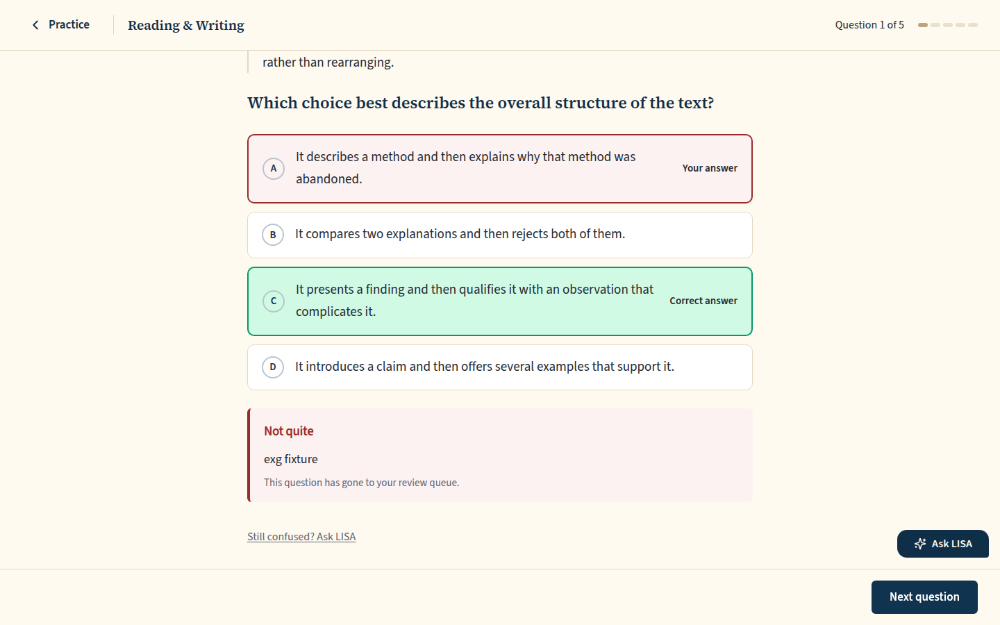 `/practice/session/64d738f3-6ed4-4966-95eb-5b7a9059b18b`, 82 KB, horizontal overflow 0px | none |
| desktop | dark | 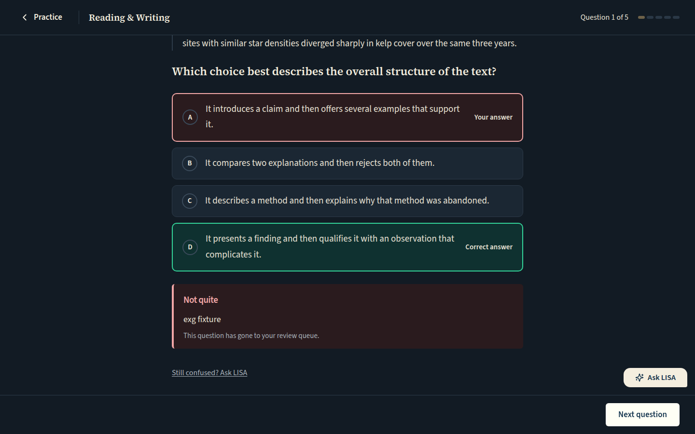 `/practice/session/4cb44f7f-5f27-42b2-9038-0940ef7463f3`, 88 KB, horizontal overflow 0px | none |
| mobile | light | 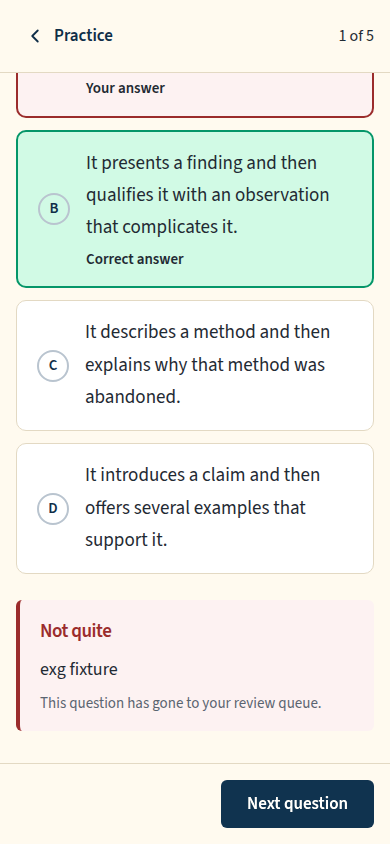 `/practice/session/ec009e71-06a8-4a5e-b91f-c1f9a4f0a5d8`, 49 KB, horizontal overflow 0px | none |
| mobile | dark | 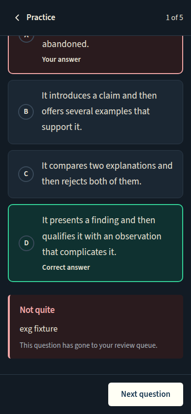 `/practice/session/613bcfd9-ace1-4b7c-b5ba-718860698db5`, 50 KB, horizontal overflow 0px | none |
| w1024 | light | 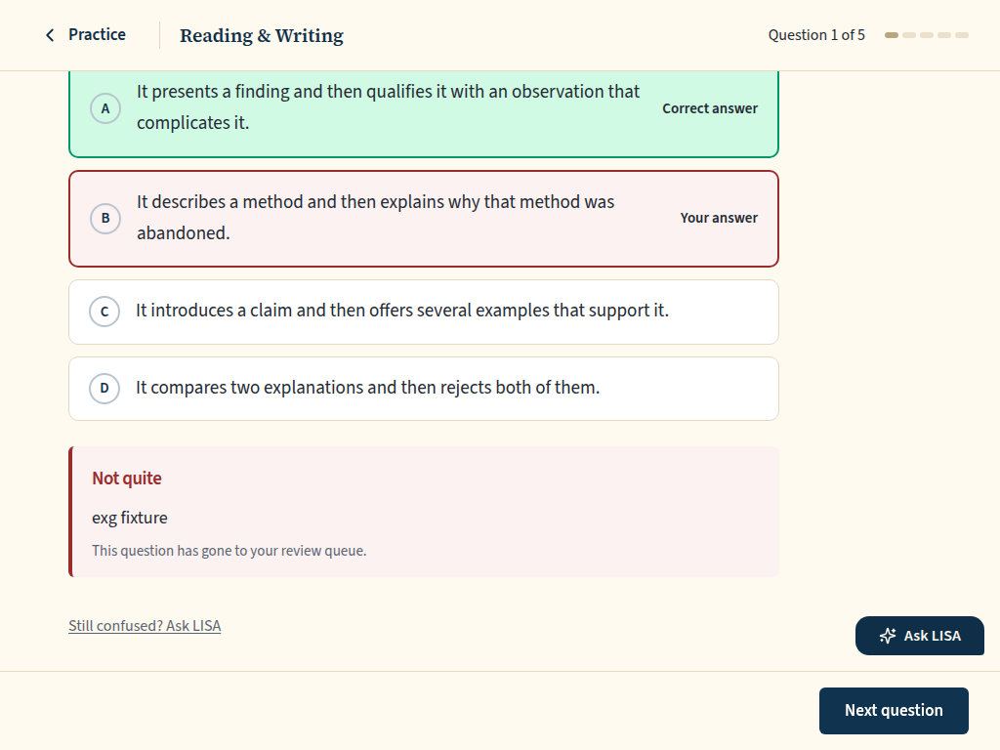 `/practice/session/a37d9b73-7c5b-4002-8dfd-d65dbabf9a7b`, 66 KB, horizontal overflow 0px | none |
| w1024 | dark | 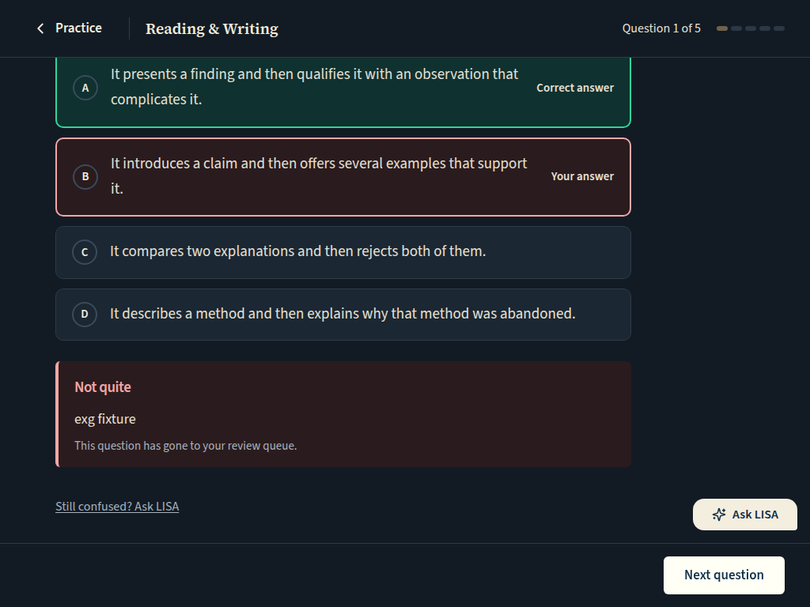 `/practice/session/60274072-e7a2-4383-aac2-a696c1f57bf5`, 66 KB, horizontal overflow 0px | none |

## Practice runner (paid): the link clicked; the panel opens scoped to the answered question ('Question N of M'), with the after-submit line 'Want to walk through this one? Ask me about any step.'

Persona: `paid`. Route: `/practice/session/{session}`.
Preset localStorage: `{"lyceon_client_instance_id":"student-harness-seed"}`.
Fresh session per capture (real create route, ended after the shot): `practice {"sections":["RW"],"target_question_count":5}`.
Step: pick the incorrect choice (resolved from the served item's stored order in the harness database).
Step: click `{"desktop":"[data-testid=\"runner-submit\"]","mobile":"[data-testid=\"runner-submit\"]"}`.
Step: click `{"desktop":"[data-testid=\"runner-ask-lisa\"]","mobile":null}`.
Also shot at w1024 1024x768 (the desktop steps and selectors).
Prototype: none. No prototype draws the launcher: it is the owner brief of 2026-10-23 ("LISA launcher redesign + placement", option D); DESIGN.md §3 and §4 describe it.

| Viewport | Theme (as rendered) | Built | Prototype |
|---|---|---|---|
| desktop | light | 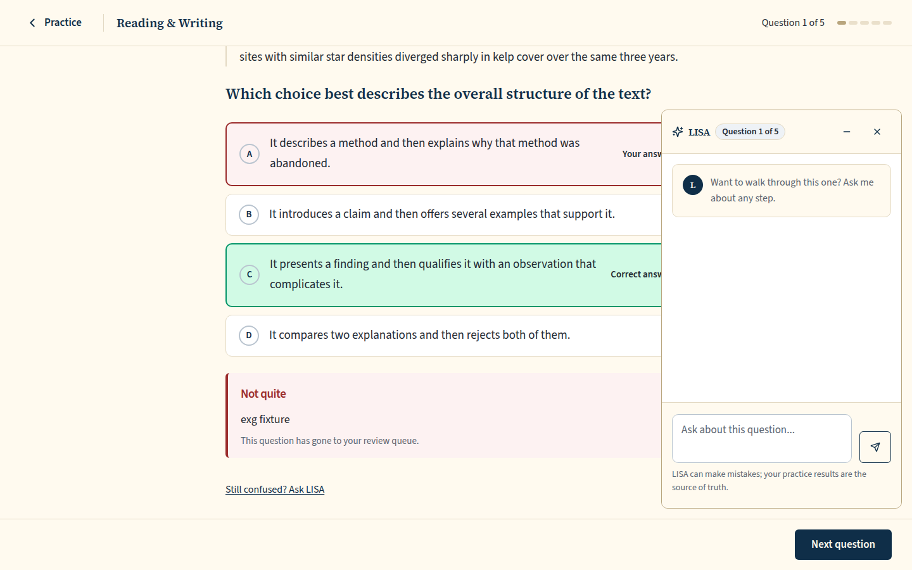 `/practice/session/3a3273ce-7476-4f3a-a8a5-9873fa10dbcc`, 104 KB, horizontal overflow 0px | none |
| desktop | dark | 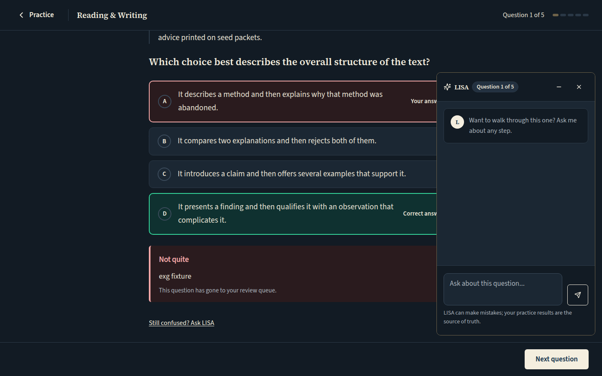 `/practice/session/7d4fa003-5c86-4a20-a6ea-1f2ec8aff4de`, 102 KB, horizontal overflow 0px | none |
| mobile | light | 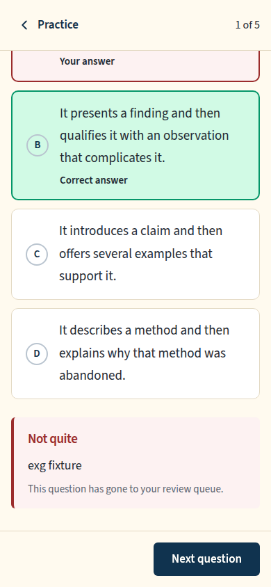 `/practice/session/cd9bf352-c6be-4342-8457-83cfe1a60147`, 49 KB, horizontal overflow 0px | none |
| mobile | dark | 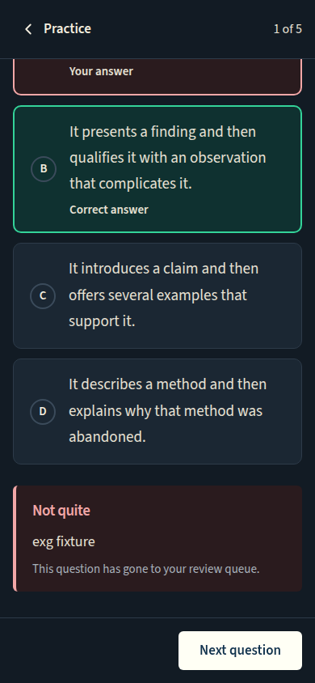 `/practice/session/52595f7e-196f-46fa-8e26-c279584a477b`, 51 KB, horizontal overflow 0px | none |
| w1024 | light | 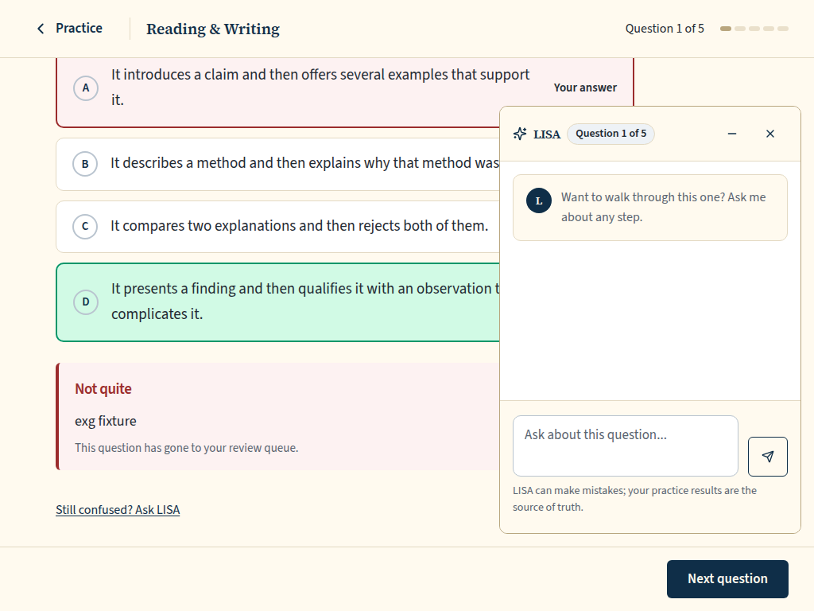 `/practice/session/36ec7a97-e821-41f1-9c3a-7a9b8baf9fa3`, 80 KB, horizontal overflow 0px | none |
| w1024 | dark | 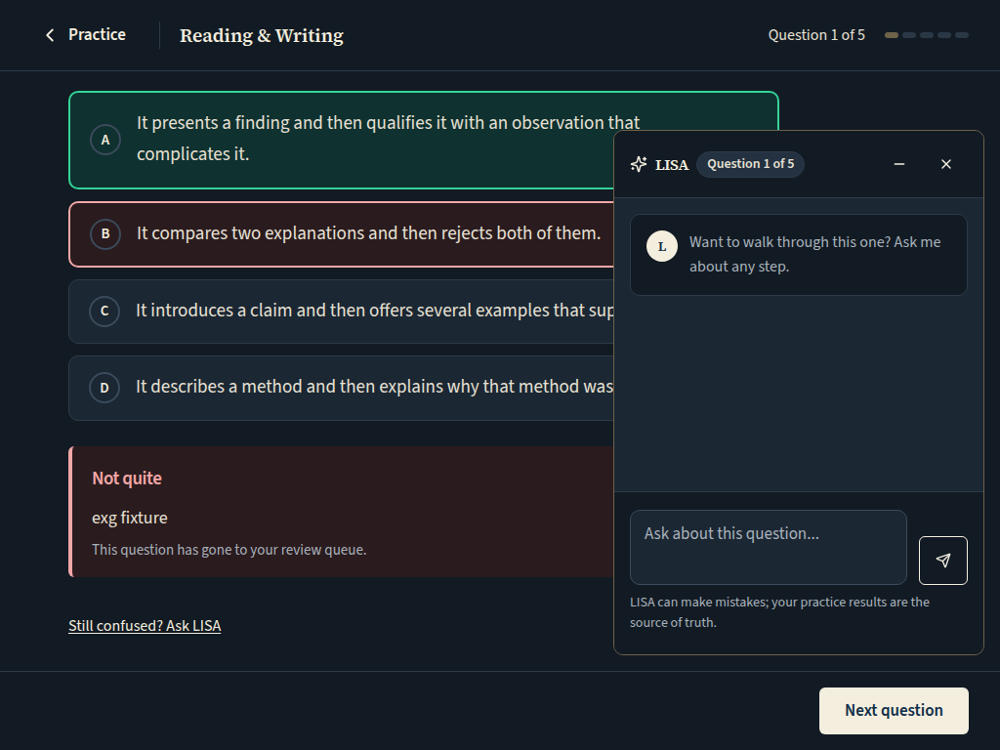 `/practice/session/ccd7a303-ee65-4796-8ca2-1e3fe621ea30`, 80 KB, horizontal overflow 0px | none |

## Run facts

- Seeded ids: `{"free":{"completedPracticeSessionId":"7b712ee5-283d-43dd-8fae-9ec187737e20","openPracticeSessionId":"7ea1b31b-f599-415f-9d5c-376ae3293b03","openReviewSessionId":"cd770ae1-f3a7-457e-8e24-bad8c7145cbb","diagnosticSessionId":null,"scoredExamSessionId":null,"inProgressExamSessionId":null,"lisaConversationId":null,"answered":39},"paid":{"completedPracticeSessionId":"07d764dd-2d3b-44b2-9b2e-c015ad5fd5a5","openPracticeSessionId":"6311aef0-c723-4478-ad34-3d1ad40e7aa6","openReviewSessionId":"3e647423-dc03-40d5-b7e4-43fc2ce27b4d","diagnosticSessionId":"51b50b78-4390-402c-a36a-c80f6f10457f","scoredExamSessionId":"5c4ff4c1-ab96-4a40-8995-af5063c640b3","inProgressExamSessionId":"821a2851-6b16-4d28-8c22-5ceb2accfaed","lisaConversationId":"4ad7b4d1-b124-48e5-a6ad-441eae427960","answered":204}}`
- Endpoints the pages asked for that the harness does not serve (answered 404): none
- Desmos (QA2-B, opt-in `STUDENT_HARNESS_DESMOS=1`): not loaded (a local-only run; the calculator shows its unavailable line)
- External hosts blocked: none
