# LISA walkthrough quick replies in the review runner: under LISA's walkthrough reply, again under the reply to 'I'm stuck', and hidden while typing; light and dark, 1440 and 390

Generated 2026-11-02T16:58:11.193Z by `pnpm exec tsx tests/e2e/student-harness/capture.ts LISA-QUICK-REPLIES` (see `tests/e2e/student-harness/README.md`). Built = a production build of the real client (`vite preview`, or the dev server with STUDENT_HARNESS_CLIENT=dev) against the student harness (real routers over a local Postgres built from this repo's migrations; personas seeded through the real practice routes). Prototype = the signed-off `docs/plans/student-ui/design/prototype/*.dc.html`, rendered locally.

Conditions, read before comparing:
- Viewport screenshots (not full page) unless the shot says full page: desktop 1440x900, phone 390x844, and any extra size a shot names.
- The prototypes are a fixed 1440x900 canvas with no phone layout; phone rows show the desktop prototype.
- Dark is requested through the app's own per-device setting; the theme column records what the page rendered.
- No external requests: the built app's Google Fonts (Inter, Poppins) are blocked, so legacy page bodies fall back to system faces; Source Sans 3 / Source Serif 4 are self-hosted and load for both sides.
- Prototype data is illustrative; built data is the seeded personas' real payloads.

## 'Walk me through it' tapped: LISA's first step, then 'Got it, next step' and 'I'm stuck' under it; the composer is still there

Persona: `paid`. Route: `/review/session/{session}`.
Preset localStorage: `{"lyceon_client_instance_id":"student-harness-seed"}`.
Fresh session per capture (real create route, ended after the shot): `review {"mode":"filter","filters":{"sections":["M"]},"target_count":10}`.
Step: click `{"desktop":"[data-testid=\"chat-dock-panel\"] [data-testid=\"tutor-choice-walkthrough\"]","mobile":"[data-testid=\"guided-choices-bar\"] [data-testid=\"tutor-choice-walkthrough\"]"}`.
Must then show the text `Got it, next step` (the capture fails otherwise).
Prototype: none. No prototype draws LISA's walkthrough quick replies; they are specified by the owner brief "Quick replies in walkthroughs" (Karl, 2026-11-02) and SCL-268, and drawn with the guided choices' outline buttons (DESIGN.md §5: two actions, no filled primary).

| Viewport | Theme (as rendered) | Built | Prototype |
|---|---|---|---|
| desktop | light | 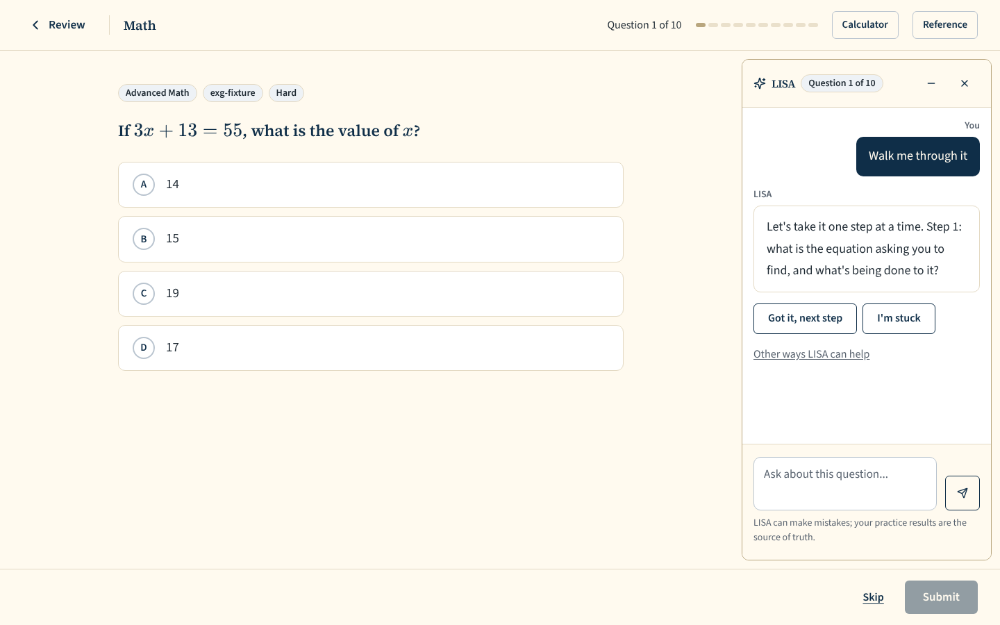 `/review/session/a35a50c6-f884-4aef-b315-5e487489f9d3`, 74 KB, horizontal overflow 0px | none |
| desktop | dark | 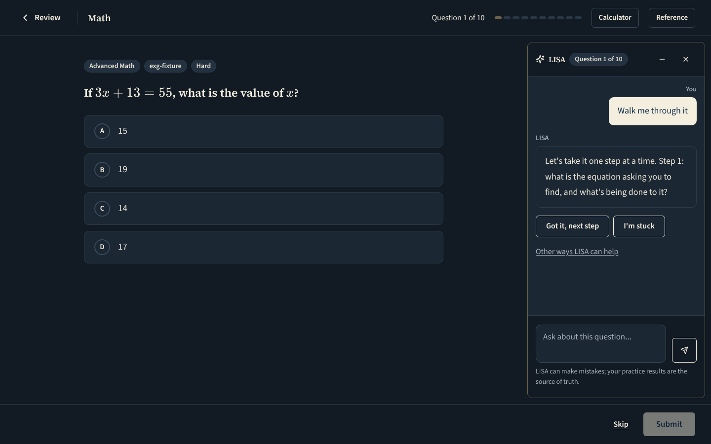 `/review/session/c6bf2282-a4ba-4836-88ed-7512dff41699`, 74 KB, horizontal overflow 0px | none |
| mobile | light | 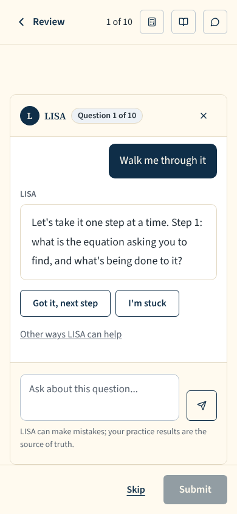 `/review/session/341c82e4-e4a9-4346-9739-d6644c9cd696`, 43 KB, horizontal overflow 0px | none |
| mobile | dark | 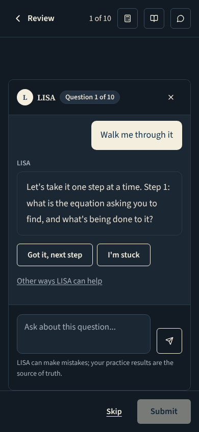 `/review/session/e5f9e766-801c-48b6-a932-4c06c3144dd2`, 44 KB, horizontal overflow 0px | none |

## 'I'm stuck' tapped: one LISA reply to it, and the two taps again under that reply

Persona: `paid`. Route: `/review/session/{session}`.
Preset localStorage: `{"lyceon_client_instance_id":"student-harness-seed"}`.
Fresh session per capture (real create route, ended after the shot): `review {"mode":"filter","filters":{"sections":["M"]},"target_count":10}`.
Step: click `{"desktop":"[data-testid=\"chat-dock-panel\"] [data-testid=\"tutor-choice-walkthrough\"]","mobile":"[data-testid=\"guided-choices-bar\"] [data-testid=\"tutor-choice-walkthrough\"]"}`.
Step: click `{"desktop":"[data-testid=\"tutor-quick-reply-step_stuck\"]","mobile":"[data-testid=\"tutor-quick-reply-step_stuck\"]"}`.
Must then show the text `No problem, let's slow down. Look only at the left side: which number is attached to the variable, and how?` (the capture fails otherwise).
Prototype: none. No prototype draws LISA's walkthrough quick replies; they are specified by the owner brief "Quick replies in walkthroughs" (Karl, 2026-11-02) and SCL-268, and drawn with the guided choices' outline buttons (DESIGN.md §5: two actions, no filled primary).

| Viewport | Theme (as rendered) | Built | Prototype |
|---|---|---|---|
| desktop | light | 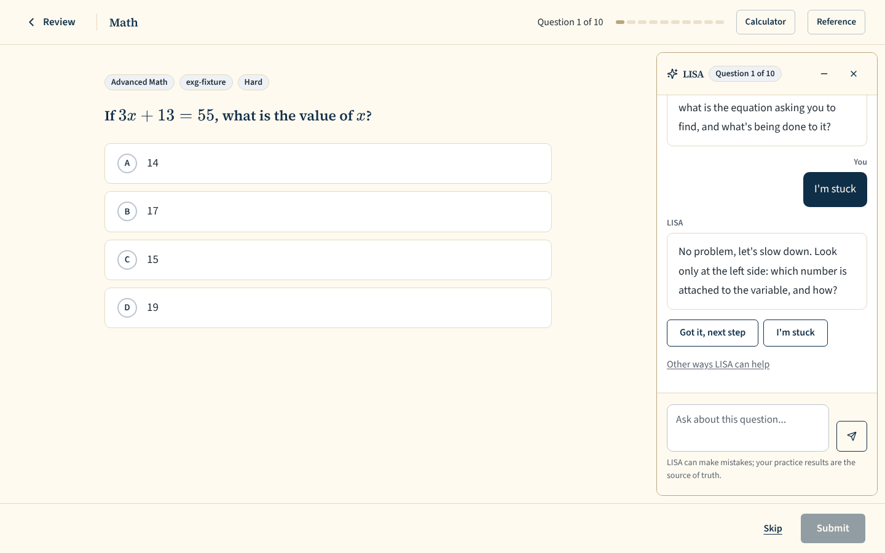 `/review/session/c472343d-25bd-45c6-84af-e2813bc59910`, 81 KB, horizontal overflow 0px | none |
| desktop | dark | 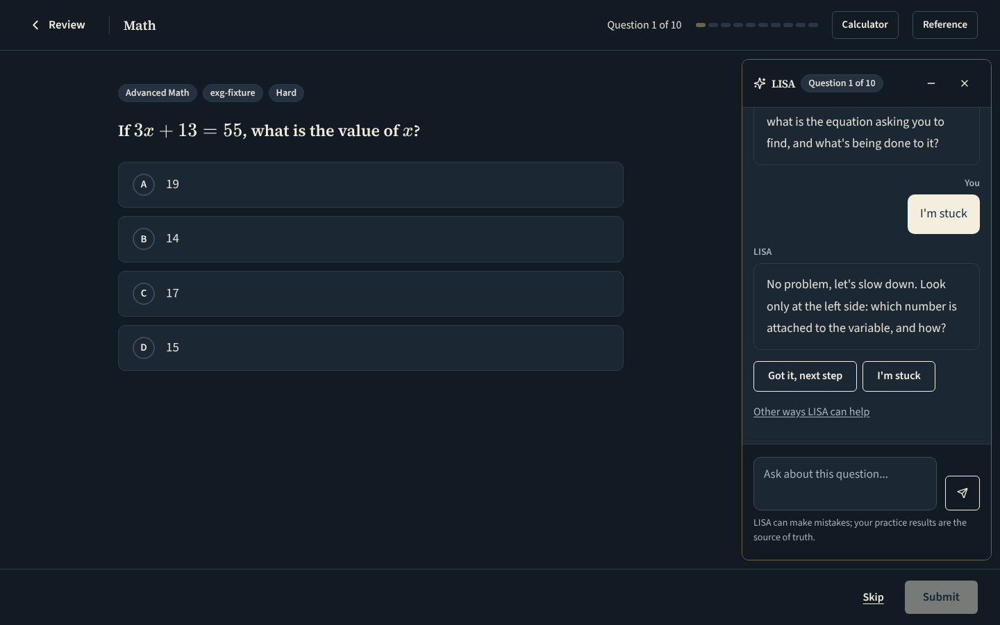 `/review/session/07058fe5-b21e-41c6-8527-6a592f11364b`, 82 KB, horizontal overflow 0px | none |
| mobile | light | 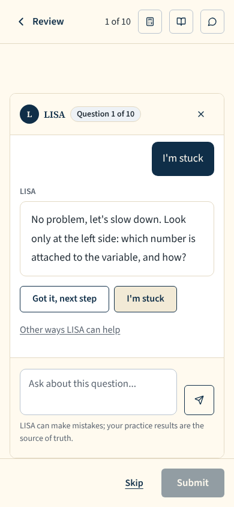 `/review/session/824446fc-a237-4e14-97d3-6684a10398e1`, 43 KB, horizontal overflow 0px | none |
| mobile | dark | 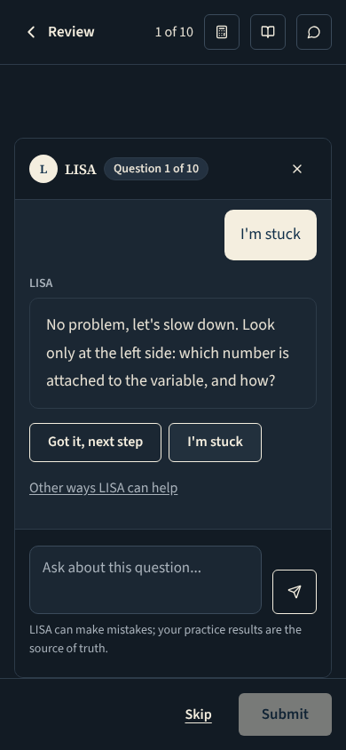 `/review/session/333f7565-95ba-49b8-99c4-59eb3b07630f`, 43 KB, horizontal overflow 0px | none |

## The student starts typing after LISA's walkthrough reply: the two taps are hidden while there is a draft

Persona: `paid`. Route: `/review/session/{session}`.
Preset localStorage: `{"lyceon_client_instance_id":"student-harness-seed"}`.
Fresh session per capture (real create route, ended after the shot): `review {"mode":"filter","filters":{"sections":["M"]},"target_count":10}`.
Step: click `{"desktop":"[data-testid=\"chat-dock-panel\"] [data-testid=\"tutor-choice-walkthrough\"]","mobile":"[data-testid=\"guided-choices-bar\"] [data-testid=\"tutor-choice-walkthrough\"]"}`.
Step: type `Why do we` into `{"desktop":"textarea[aria-label=\"Message\"]","mobile":"textarea[aria-label=\"Message\"]"}`.
Prototype: none. No prototype draws LISA's walkthrough quick replies; they are specified by the owner brief "Quick replies in walkthroughs" (Karl, 2026-11-02) and SCL-268, and drawn with the guided choices' outline buttons (DESIGN.md §5: two actions, no filled primary).

| Viewport | Theme (as rendered) | Built | Prototype |
|---|---|---|---|
| desktop | light | 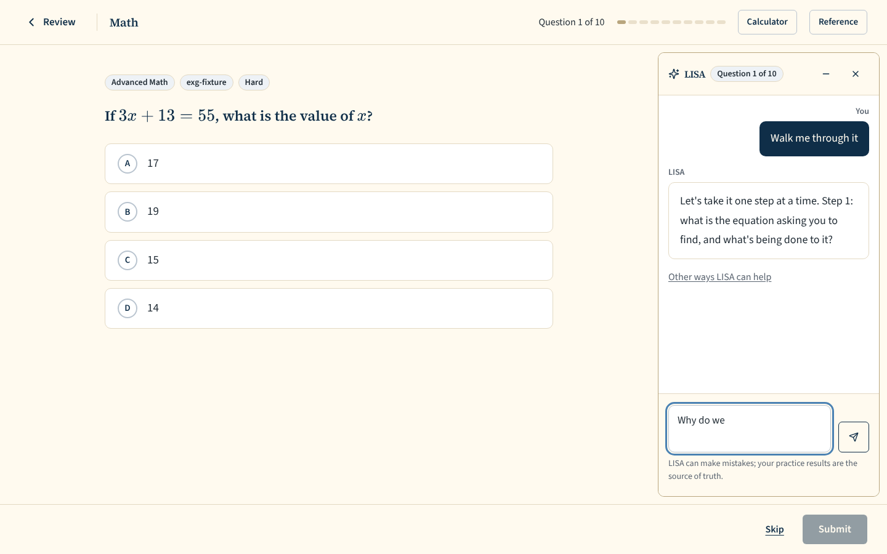 `/review/session/0b05aa02-f61e-47b6-b65e-d310877cd866`, 70 KB, horizontal overflow 0px | none |
| desktop | dark | 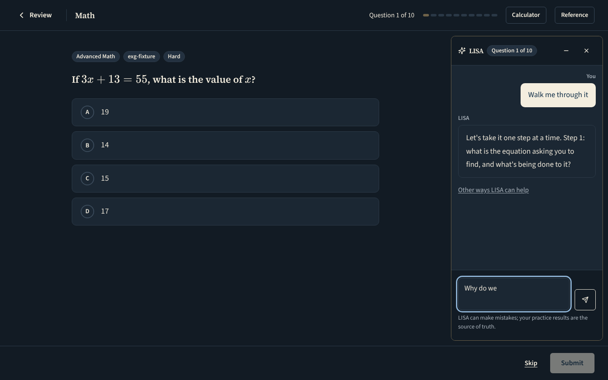 `/review/session/6f8f90c4-bfb0-4577-b42c-dd79c7a6fb9a`, 70 KB, horizontal overflow 0px | none |
| mobile | light | 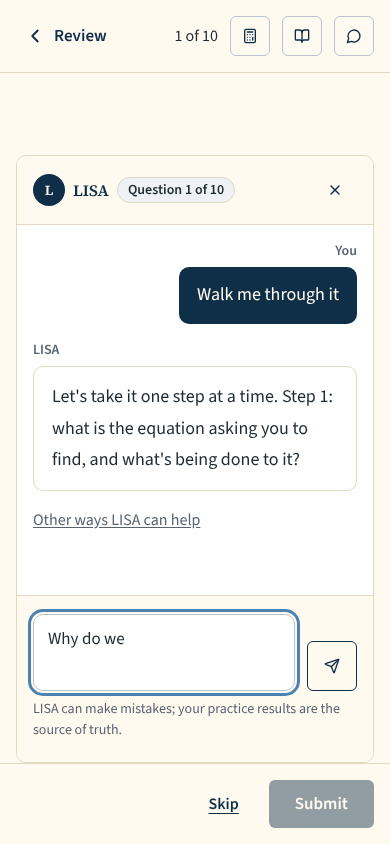 `/review/session/a2e5d3ff-85e8-4395-b7dd-cc670cb8e0bb`, 40 KB, horizontal overflow 0px | none |
| mobile | dark | 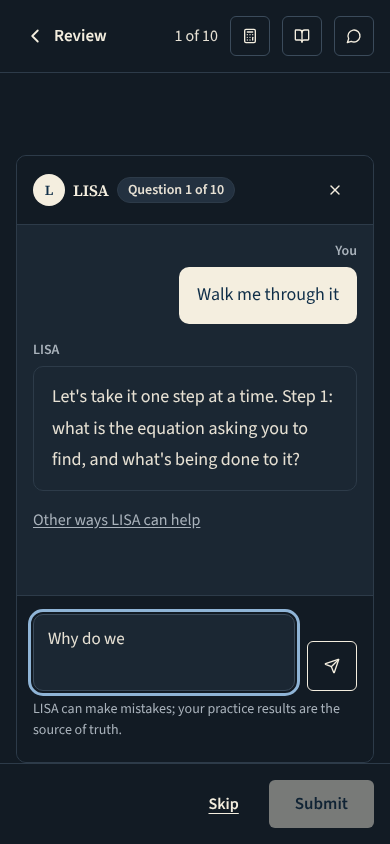 `/review/session/5fbd20a1-7f8a-4346-9c97-4f981faf05b5`, 40 KB, horizontal overflow 0px | none |

## Run facts

- Seeded ids: `{"free":{"completedPracticeSessionId":"42cb9564-9f5a-47dc-96da-803ff9cb7b91","openPracticeSessionId":"daff0322-d731-44b6-9820-950bd787d3e3","openReviewSessionId":"87c30883-64fa-47d8-b0e5-209864445b9b","diagnosticSessionId":null,"scoredExamSessionId":null,"inProgressExamSessionId":null,"lisaConversationId":null,"answered":39},"paid":{"completedPracticeSessionId":"88a29416-dc9e-4031-a393-414600420a21","openPracticeSessionId":"64b07d2f-d61e-47a5-9f76-8b9e2214497f","openReviewSessionId":"e7761315-b7de-422a-90d0-27928d4b00d5","diagnosticSessionId":"ffde914e-6a73-48bf-8292-28c007c2a9d4","scoredExamSessionId":null,"inProgressExamSessionId":null,"lisaConversationId":null,"answered":79}}`
- Endpoints the pages asked for that the harness does not serve (answered 404): `POST /perf/tutor-turn`
- Desmos (QA2-B, opt-in `STUDENT_HARNESS_DESMOS=1`): not loaded (a local-only run; the calculator shows its unavailable line)
- External hosts blocked: none
