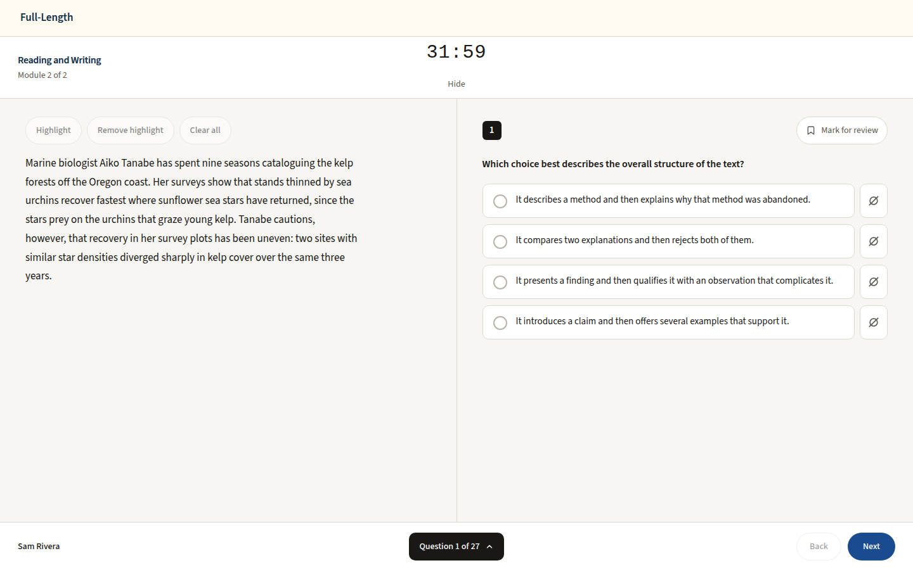
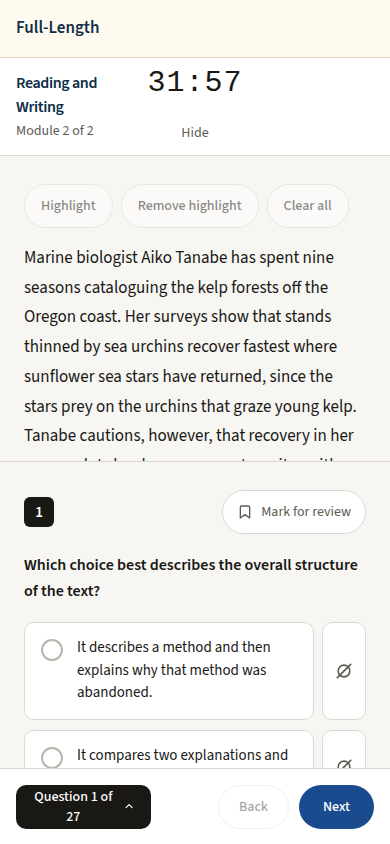

# Question header: none on the timed full-length module (light only, 1440 and 390)

Generated 2026-10-13T06:15:02.957Z by `pnpm exec tsx tests/e2e/student-harness/capture.ts QMH-EXAM` (see `tests/e2e/student-harness/README.md`). Built = a production build of the real client (`vite preview`, or the dev server with STUDENT_HARNESS_CLIENT=dev) against the student harness (real routers over a local Postgres built from this repo's migrations; personas seeded through the real practice routes). Prototype = the signed-off `docs/plans/student-ui/design/prototype/*.dc.html`, rendered locally.

Conditions, read before comparing:
- Viewport screenshots (not full page) unless the shot says full page: desktop 1440x900, phone 390x844, and any extra size a shot names.
- The prototypes are a fixed 1440x900 canvas with no phone layout; phone rows show the desktop prototype.
- Dark is requested through the app's own per-device setting; the theme column records what the page rendered.
- No external requests: the built app's Google Fonts (Inter, Poppins) are blocked, so legacy page bodies fall back to system faces; Source Sans 3 / Source Serif 4 are self-hosted and load for both sides.
- Prototype data is illustrative; built data is the seeded personas' real payloads.

## The timed module (Reading and Writing Module 2): no question header, Bluebook layout kept, light only

Persona: `paid`. Route: `/tests/{paid.inProgressExamSessionId}/RW/2`.
Must fit the viewport (F-69): document no taller than the viewport, window unscrolled, `[data-testid="focus-shell-header"]` wholly in view, nothing to scroll in `main#main` (the capture fails otherwise); the measurement is under each built shot.
Prototype: none. No prototype draws the timed module: DESIGN.md §2 keeps its Bluebook layout, light only. Shown for the header's absence.

| Viewport | Theme (as rendered) | Built | Prototype |
|---|---|---|---|
| desktop | light |  `/tests/8e81b1aa-8b67-41a0-8a31-ab5fddf1d79a/RW/2`, 97 KB, horizontal overflow 0px, document 900px in a 900px viewport, scrollY 0, top bar 0..58px, `main#main` 842px of content in 842px | none |
| mobile | light |  `/tests/8e81b1aa-8b67-41a0-8a31-ab5fddf1d79a/RW/2`, 65 KB, horizontal overflow 0px, document 844px in a 844px viewport, scrollY 0, top bar 0..58px, `main#main` 786px of content in 786px | none |

## Run facts

- Seeded ids: `{"free":{"completedPracticeSessionId":"7b052223-447a-4e58-9bd6-fd62c1482aa2","openPracticeSessionId":"fe74e7dc-a5e4-4e39-8125-48e3b44e9fd7","openReviewSessionId":null,"diagnosticSessionId":null,"scoredExamSessionId":null,"inProgressExamSessionId":null,"lisaConversationId":null,"answered":13},"paid":{"completedPracticeSessionId":"e7df32bb-6a3f-4241-bc01-7e2cd23bfd6e","openPracticeSessionId":"fe532f0a-0938-4a5b-adb7-40e5cd90971b","openReviewSessionId":null,"diagnosticSessionId":"3d0fae11-60a5-4874-a1ff-3f2eda802f04","scoredExamSessionId":"9f6354f0-f5f5-4af1-a18d-c43f0488f15d","inProgressExamSessionId":"8e81b1aa-8b67-41a0-8a31-ab5fddf1d79a","lisaConversationId":null,"answered":178}}`
- Endpoints the pages asked for that the harness does not serve (answered 404): none
- Desmos (QA2-B, opt-in `STUDENT_HARNESS_DESMOS=1`): not loaded (a local-only run; the calculator shows its unavailable line)
- External hosts blocked: none
