# Question header (domain, skill and difficulty pills): practice, review and diagnostic runners, light and dark, 1440 and 390, and the skill focused at 390

Generated 2026-10-13T06:14:23.190Z by `pnpm exec tsx tests/e2e/student-harness/capture.ts QMH` (see `tests/e2e/student-harness/README.md`). Built = a production build of the real client (`vite preview`, or the dev server with STUDENT_HARNESS_CLIENT=dev) against the student harness (real routers over a local Postgres built from this repo's migrations; personas seeded through the real practice routes). Prototype = the signed-off `docs/plans/student-ui/design/prototype/*.dc.html`, rendered locally.

Conditions, read before comparing:
- Viewport screenshots (not full page) unless the shot says full page: desktop 1440x900, phone 390x844, and any extra size a shot names.
- The prototypes are a fixed 1440x900 canvas with no phone layout; phone rows show the desktop prototype.
- Dark is requested through the app's own per-device setting; the theme column records what the page rendered.
- No external requests: the built app's Google Fonts (Inter, Poppins) are blocked, so legacy page bodies fall back to system faces; Source Sans 3 / Source Serif 4 are self-hosted and load for both sides.
- Prototype data is illustrative; built data is the seeded personas' real payloads.

## Practice runner, before submitting: the header above the question (1440: one row; 390: domain + difficulty, then the skill on two lines)

Persona: `paid`. Route: `/practice/session/{session}`.
Preset localStorage: `{"lyceon_client_instance_id":"student-harness-seed"}`.
Fresh session per capture (real create route, ended after the shot): `practice {"sections":["M"],"domains":["Problem Solving and Data Analysis"],"skills":["Ratios, Rates, Proportional Relationships, and Units"],"target_question_count":3}`.
Must then show `[data-testid="question-meta"]` wholly inside the viewport (the capture fails otherwise).
Must fit the viewport (F-69): document no taller than the viewport, window unscrolled, `[data-testid="focus-shell-header"]` wholly in view, nothing to scroll in `main#main` (the capture fails otherwise); the measurement is under each built shot.
Prototype: none. No prototype draws the question header: it is the owner brief of 2026-10-13 (Runner.dc.html predates it); DESIGN.md §4 describes it.

| Viewport | Theme (as rendered) | Built | Prototype |
|---|---|---|---|
| desktop | light | 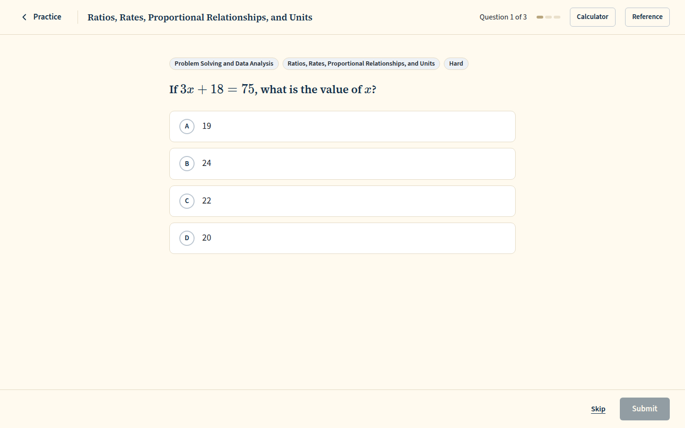 `/practice/session/2c0458cf-51bd-4072-ac18-8b763511f8a9`, 47 KB, horizontal overflow 0px, document 900px in a 900px viewport, scrollY 0, top bar 0..73px, `main#main` 827px of content in 827px | none |
| desktop | dark | 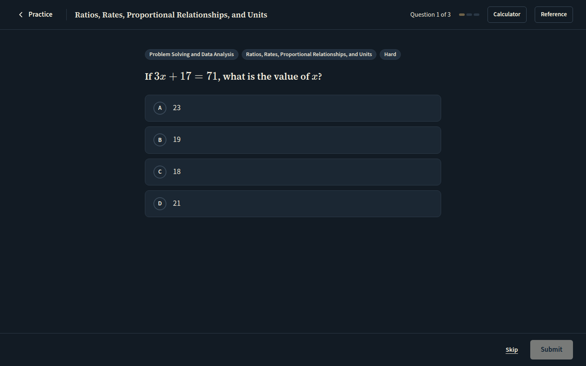 `/practice/session/6c72bbeb-1940-4d02-b844-82c9f50be472`, 47 KB, horizontal overflow 0px, document 900px in a 900px viewport, scrollY 0, top bar 0..73px, `main#main` 827px of content in 827px | none |
| mobile | light | 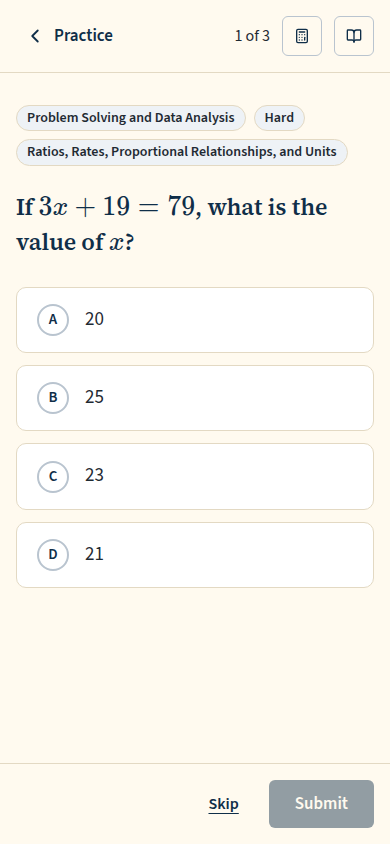 `/practice/session/f5fced40-cc3d-4fb3-b2c5-23bc77dba5cf`, 34 KB, horizontal overflow 0px, document 844px in a 844px viewport, scrollY 0, top bar 0..73px, `main#main` 771px of content in 771px | none |
| mobile | dark | 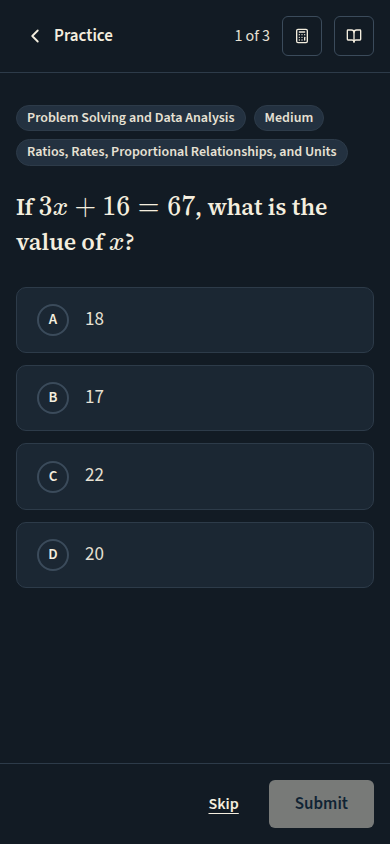 `/practice/session/e49af7f4-3f83-40a0-8edb-6c5a9df052c7`, 34 KB, horizontal overflow 0px, document 844px in a 844px viewport, scrollY 0, top bar 0..73px, `main#main` 771px of content in 771px | none |

## Practice runner, the skill pill focused (the header's one tab stop): its focus ring, and the full skill name on focus (the 390 shot is the one the ruling asks for)

Persona: `paid`. Route: `/practice/session/{session}`.
Preset localStorage: `{"lyceon_client_instance_id":"student-harness-seed"}`.
Fresh session per capture (real create route, ended after the shot): `practice {"sections":["M"],"domains":["Problem Solving and Data Analysis"],"skills":["Ratios, Rates, Proportional Relationships, and Units"],"target_question_count":3}`.
Must then show `[data-testid="question-meta"]` wholly inside the viewport (the capture fails otherwise).
Step: focus `{"desktop":"[data-testid=\"question-meta-skill-pill\"]","mobile":"[data-testid=\"question-meta-skill-pill\"]"}` (no typing).
Prototype: none. No prototype draws the question header: it is the owner brief of 2026-10-13 (Runner.dc.html predates it); DESIGN.md §4 describes it.

| Viewport | Theme (as rendered) | Built | Prototype |
|---|---|---|---|
| desktop | light | 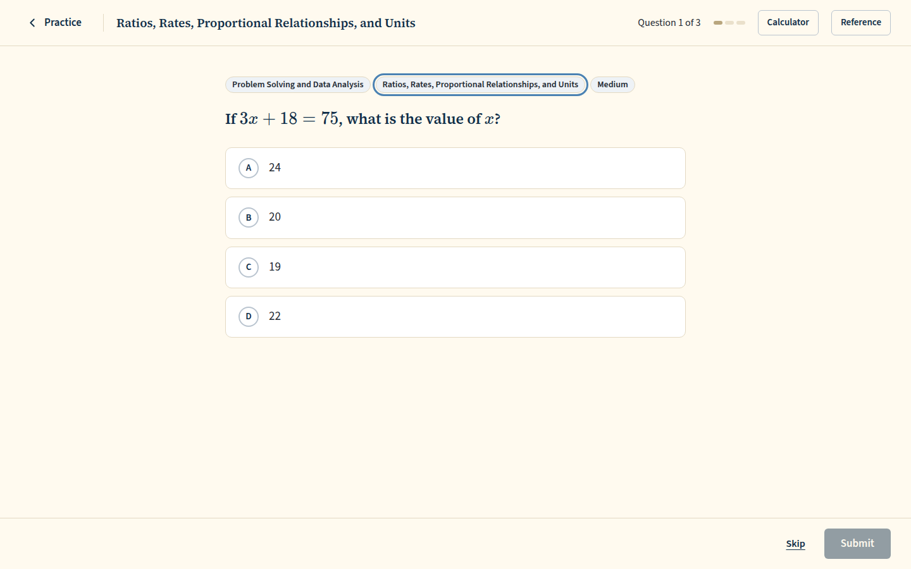 `/practice/session/d8a43565-2ce3-474a-bfcf-2eec1c4f5af5`, 48 KB, horizontal overflow 0px | none |
| desktop | dark | 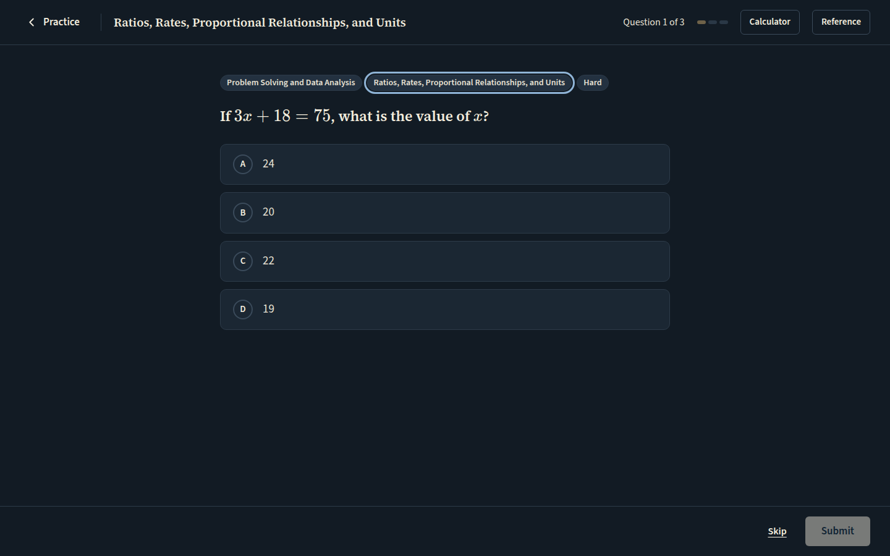 `/practice/session/6447e8d3-3885-43c5-b3c3-99ce1d1549dd`, 49 KB, horizontal overflow 0px | none |
| mobile | light | 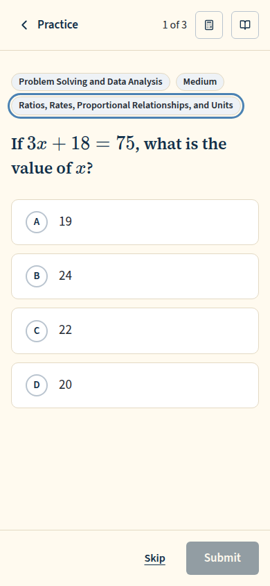 `/practice/session/75981e99-0a47-4b16-899b-865f245d1725`, 36 KB, horizontal overflow 0px | none |
| mobile | dark | 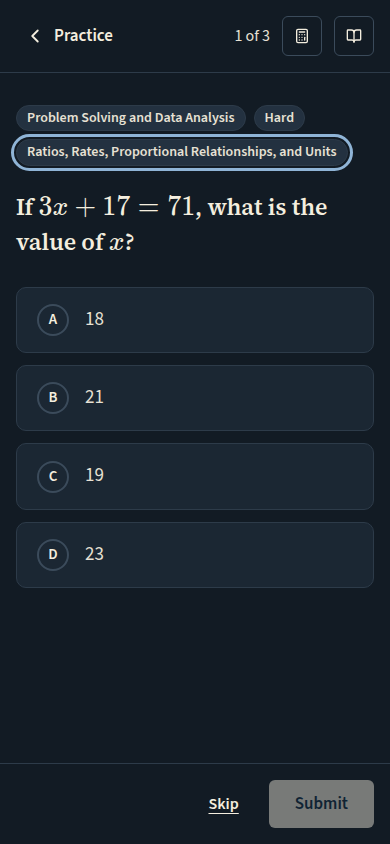 `/practice/session/7a019c20-66cd-4813-bb3c-568e7150ff39`, 35 KB, horizontal overflow 0px | none |

## Review runner, before submitting: the same header (LISA beside the question at 1440, its question chip on the same pill)

Persona: `paid`. Route: `/review/session/{session}`.
Preset localStorage: `{"lyceon_client_instance_id":"student-harness-seed"}`.
Fresh session per capture (real create route, ended after the shot): `review {"mode":"filter","filters":{"sections":["RW"]},"target_count":10}`.
Must then show `[data-testid="question-meta"]` wholly inside the viewport (the capture fails otherwise).
Must fit the viewport (F-69): document no taller than the viewport, window unscrolled, `[data-testid="focus-shell-header"]` wholly in view, nothing to scroll in `main#main` (the capture fails otherwise); the measurement is under each built shot.
Prototype: none. No prototype draws the question header: it is the owner brief of 2026-10-13 (Runner.dc.html predates it); DESIGN.md §4 describes it.

| Viewport | Theme (as rendered) | Built | Prototype |
|---|---|---|---|
| desktop | light | 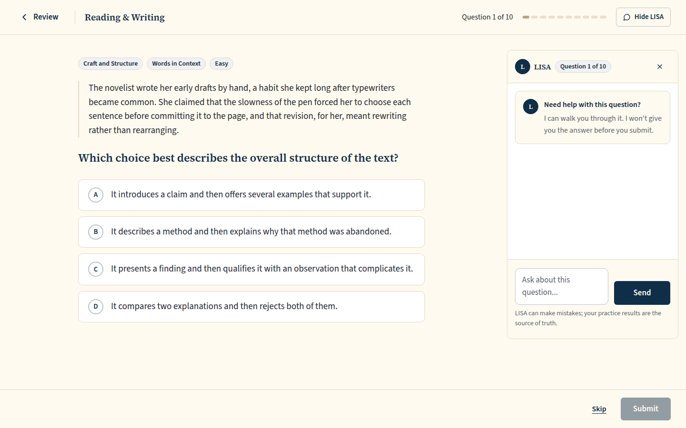 `/review/session/0fde9e6c-6458-49b4-93ea-4472562bdc29`, 119 KB, horizontal overflow 0px, document 900px in a 900px viewport, scrollY 0, top bar 0..73px, `main#main` 827px of content in 827px | none |
| desktop | dark | 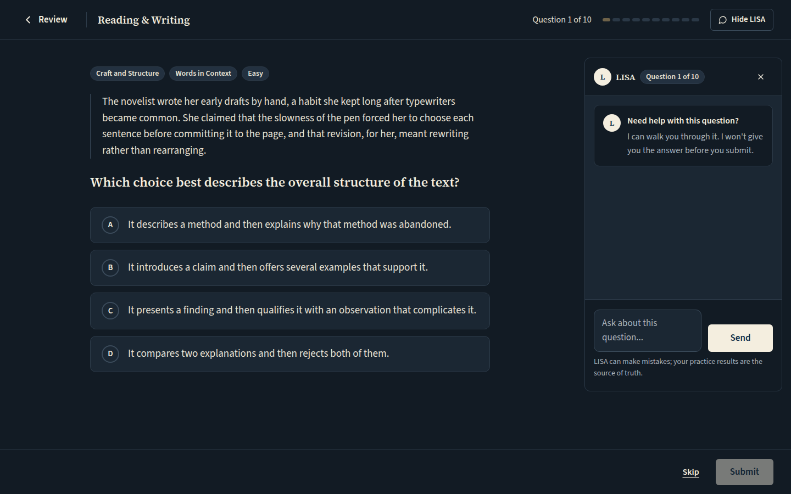 `/review/session/26539b0b-0fce-45a6-a18b-c6a368d44a82`, 122 KB, horizontal overflow 0px, document 900px in a 900px viewport, scrollY 0, top bar 0..73px, `main#main` 827px of content in 827px | none |
| mobile | light | 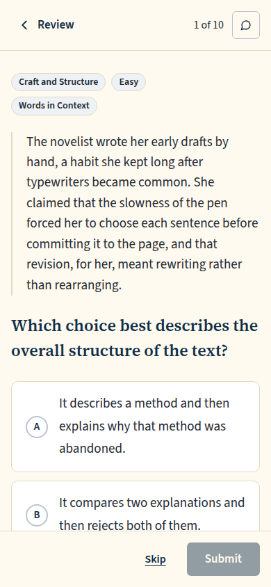 `/review/session/013654b5-8c9a-4e04-928d-23dac7cadaf5`, 75 KB, horizontal overflow 0px, document 844px in a 844px viewport, scrollY 0, top bar 0..73px, `main#main` 771px of content in 771px | none |
| mobile | dark | 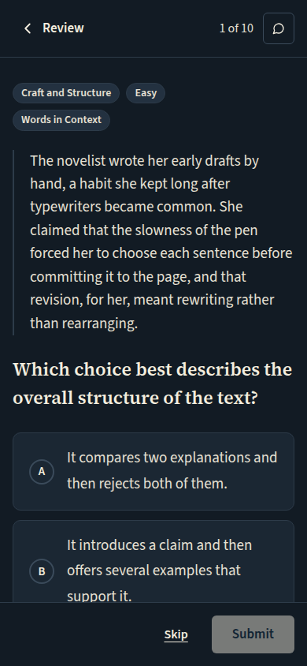 `/review/session/c286584a-0eb3-4051-9e0e-dd44faf482a5`, 75 KB, horizontal overflow 0px, document 844px in a 844px viewport, scrollY 0, top bar 0..73px, `main#main` 771px of content in 771px | none |

## Diagnostic runner (reached by Home's 'Start diagnostic'), before submitting: the same header

Persona: `free`. Route: `/dashboard`.
Preset localStorage: `{"lyceon_client_instance_id":"student-harness-seed"}`.
Must then show `[data-testid="question-meta"]` wholly inside the viewport (the capture fails otherwise).
Step: click `{"desktop":"[data-testid=\"home-start-diagnostic\"]","mobile":"[data-testid=\"home-start-diagnostic\"]"}`.
Click path: must land on a path matching `^/practice/session/[0-9a-f-]{36}$` (the capture fails otherwise); the path it landed on is under each built shot.
Prototype: none. No prototype draws the question header: it is the owner brief of 2026-10-13 (Runner.dc.html predates it); DESIGN.md §4 describes it.

| Viewport | Theme (as rendered) | Built | Prototype |
|---|---|---|---|
| desktop | light | 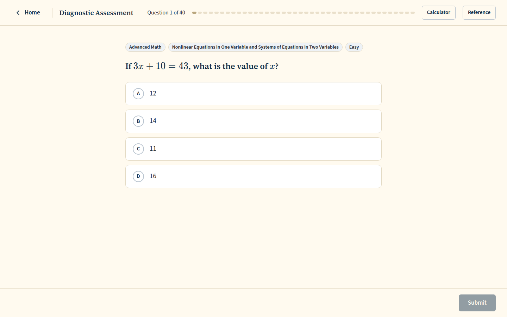 `/practice/session/802a94f7-f270-4a88-9125-6b57765a6e24`, 42 KB, horizontal overflow 0px | none |
| desktop | dark | 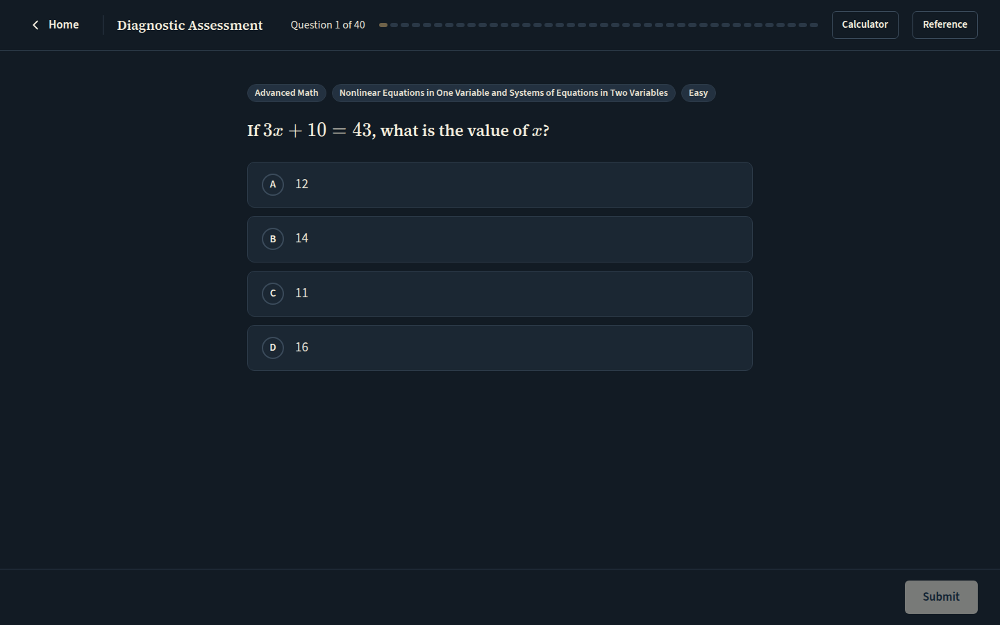 `/practice/session/802a94f7-f270-4a88-9125-6b57765a6e24`, 43 KB, horizontal overflow 0px | none |
| mobile | light | 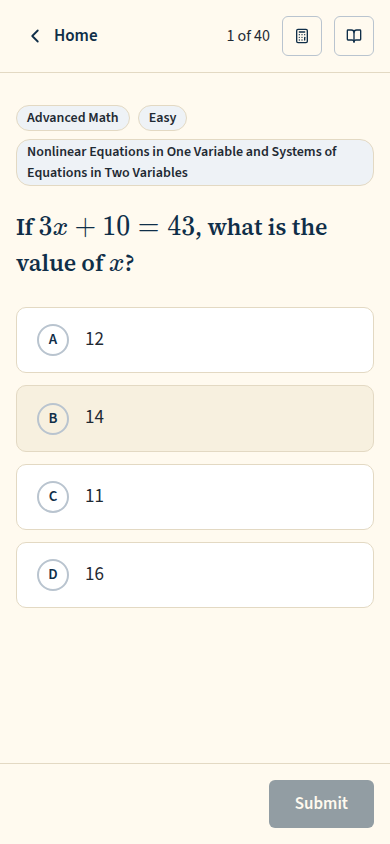 `/practice/session/802a94f7-f270-4a88-9125-6b57765a6e24`, 33 KB, horizontal overflow 0px | none |
| mobile | dark | 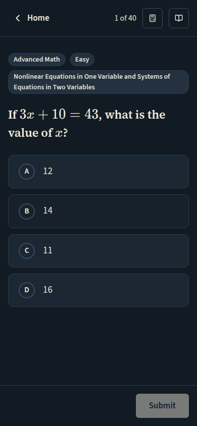 `/practice/session/802a94f7-f270-4a88-9125-6b57765a6e24`, 33 KB, horizontal overflow 0px | none |

## Run facts

- Seeded ids: `{"free":{"completedPracticeSessionId":"18cb59aa-1f67-4a34-8996-f7215594419c","openPracticeSessionId":"54b6905f-fb40-4805-b762-58ff5b773620","openReviewSessionId":null,"diagnosticSessionId":null,"scoredExamSessionId":null,"inProgressExamSessionId":null,"lisaConversationId":null,"answered":13},"paid":{"completedPracticeSessionId":"2bff18fc-0234-451e-bc43-f337c4d1b04e","openPracticeSessionId":"aaa5aa84-adfc-4542-bf20-9ed556e50e1f","openReviewSessionId":null,"diagnosticSessionId":"f0362e8d-9cc7-4b33-91ad-6fdfad70ea0d","scoredExamSessionId":null,"inProgressExamSessionId":null,"lisaConversationId":null,"answered":53}}`
- Endpoints the pages asked for that the harness does not serve (answered 404): none
- Desmos (QA2-B, opt-in `STUDENT_HARNESS_DESMOS=1`): not loaded (a local-only run; the calculator shows its unavailable line)
- External hosts blocked: none
