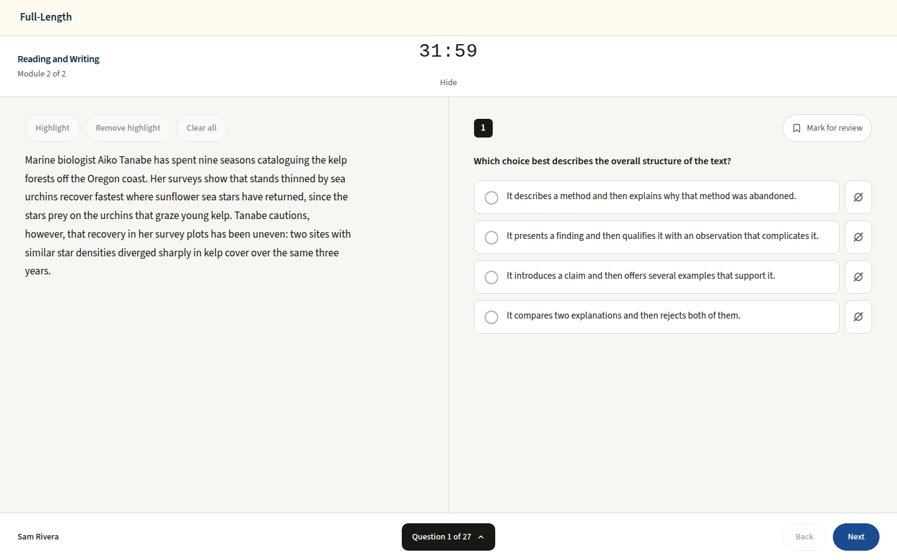
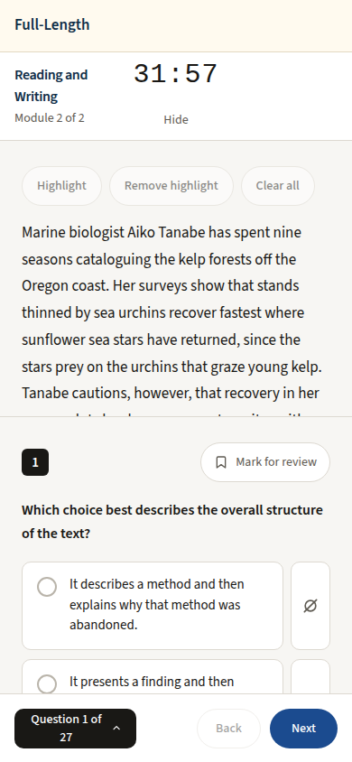

# Question header (domain · skill · difficulty): practice, review and diagnostic runners, light and dark, 1440 and 390; none on the timed module

Generated 2026-10-13T04:57:39.325Z by `pnpm exec tsx tests/e2e/student-harness/capture.ts QMH` (see `tests/e2e/student-harness/README.md`). Built = a production build of the real client (`vite preview`, or the dev server with STUDENT_HARNESS_CLIENT=dev) against the student harness (real routers over a local Postgres built from this repo's migrations; personas seeded through the real practice routes). Prototype = the signed-off `docs/plans/student-ui/design/prototype/*.dc.html`, rendered locally.

Conditions, read before comparing:
- Viewport screenshots (not full page) unless the shot says full page: desktop 1440x900, phone 390x844, and any extra size a shot names.
- The prototypes are a fixed 1440x900 canvas with no phone layout; phone rows show the desktop prototype.
- Dark is requested through the app's own per-device setting; the theme column records what the page rendered.
- No external requests: the built app's Google Fonts (Inter, Poppins) are blocked, so legacy page bodies fall back to system faces; Source Sans 3 / Source Serif 4 are self-hosted and load for both sides.
- Prototype data is illustrative; built data is the seeded personas' real payloads.

## Practice runner, before submitting: the header above the question (1440: one row; 390: domain · difficulty, then the skill)

Persona: `paid`. Route: `/practice/session/{session}`.
Preset localStorage: `{"lyceon_client_instance_id":"student-harness-seed"}`.
Fresh session per capture (real create route, ended after the shot): `practice {"sections":["M"],"target_question_count":10}`.
Must then show `[data-testid="question-meta"]` wholly inside the viewport (the capture fails otherwise).
Must fit the viewport (F-69): document no taller than the viewport, window unscrolled, `[data-testid="focus-shell-header"]` wholly in view, nothing to scroll in `main#main` (the capture fails otherwise); the measurement is under each built shot.
Prototype: none. No prototype draws the question header: it is the owner brief of 2026-10-13 (Runner.dc.html predates it).

| Viewport | Theme (as rendered) | Built | Prototype |
|---|---|---|---|
| desktop | light |  `/practice/session/086e6920-7216-4478-aa65-6110cb0def2f`, 38 KB, horizontal overflow 0px, document 900px in a 900px viewport, scrollY 0, top bar 0..73px, `main#main` 827px of content in 827px | none |
| desktop | dark |  `/practice/session/cbdf53a0-12d8-4e76-9c7b-9fd15888d2a8`, 39 KB, horizontal overflow 0px, document 900px in a 900px viewport, scrollY 0, top bar 0..73px, `main#main` 827px of content in 827px | none |
| mobile | light |  `/practice/session/5464e603-bca1-4b0c-abb5-b8ea164331c9`, 29 KB, horizontal overflow 0px, document 844px in a 844px viewport, scrollY 0, top bar 0..73px, `main#main` 771px of content in 771px | none |
| mobile | dark |  `/practice/session/5272c972-3285-4916-91d5-bd5b14e545af`, 28 KB, horizontal overflow 0px, document 844px in a 844px viewport, scrollY 0, top bar 0..73px, `main#main` 771px of content in 771px | none |

## Review runner, before submitting: the same header (LISA beside the question at 1440)

Persona: `paid`. Route: `/review/session/{session}`.
Preset localStorage: `{"lyceon_client_instance_id":"student-harness-seed"}`.
Fresh session per capture (real create route, ended after the shot): `review {"mode":"filter","filters":{"sections":["RW"]},"target_count":10}`.
Must then show `[data-testid="question-meta"]` wholly inside the viewport (the capture fails otherwise).
Must fit the viewport (F-69): document no taller than the viewport, window unscrolled, `[data-testid="focus-shell-header"]` wholly in view, nothing to scroll in `main#main` (the capture fails otherwise); the measurement is under each built shot.
Prototype: none. No prototype draws the question header: it is the owner brief of 2026-10-13 (Runner.dc.html predates it).

| Viewport | Theme (as rendered) | Built | Prototype |
|---|---|---|---|
| desktop | light |  `/review/session/7784011c-7cab-4a3b-9d2b-ed5f6a865213`, 121 KB, horizontal overflow 0px, document 900px in a 900px viewport, scrollY 0, top bar 0..73px, `main#main` 827px of content in 827px | none |
| desktop | dark |  `/review/session/598c1d2d-471c-4d49-a8fc-4823d68c9b4e`, 124 KB, horizontal overflow 0px, document 900px in a 900px viewport, scrollY 0, top bar 0..73px, `main#main` 827px of content in 827px | none |
| mobile | light |  `/review/session/4034212a-c6a0-4a1b-be6d-8aebbd98c4db`, 71 KB, horizontal overflow 0px, document 844px in a 844px viewport, scrollY 0, top bar 0..73px, `main#main` 771px of content in 771px | none |
| mobile | dark |  `/review/session/115c04f0-5db7-4646-a1ad-6b1cf15e1253`, 76 KB, horizontal overflow 0px, document 844px in a 844px viewport, scrollY 0, top bar 0..73px, `main#main` 771px of content in 771px | none |

## Diagnostic runner (reached by Home's 'Start diagnostic'), before submitting: the same header

Persona: `free`. Route: `/dashboard`.
Preset localStorage: `{"lyceon_client_instance_id":"student-harness-seed"}`.
Must then show `[data-testid="question-meta"]` wholly inside the viewport (the capture fails otherwise).
Step: click `{"desktop":"[data-testid=\"home-start-diagnostic\"]","mobile":"[data-testid=\"home-start-diagnostic\"]"}`.
Click path: must land on a path matching `^/practice/session/[0-9a-f-]{36}$` (the capture fails otherwise); the path it landed on is under each built shot.
Prototype: none. No prototype draws the question header: it is the owner brief of 2026-10-13 (Runner.dc.html predates it).

| Viewport | Theme (as rendered) | Built | Prototype |
|---|---|---|---|
| desktop | light |  `/practice/session/dff7966d-ab48-4d26-b00b-9548190eac99`, 38 KB, horizontal overflow 0px | none |
| desktop | dark |  `/practice/session/dff7966d-ab48-4d26-b00b-9548190eac99`, 38 KB, horizontal overflow 0px | none |
| mobile | light |  `/practice/session/dff7966d-ab48-4d26-b00b-9548190eac99`, 27 KB, horizontal overflow 0px | none |
| mobile | dark |  `/practice/session/dff7966d-ab48-4d26-b00b-9548190eac99`, 27 KB, horizontal overflow 0px | none |

## The timed module (Reading and Writing Module 2): no question header, Bluebook layout kept, light only

Persona: `paid`. Route: `/tests/{paid.inProgressExamSessionId}/RW/2`.
Must fit the viewport (F-69): document no taller than the viewport, window unscrolled, `[data-testid="focus-shell-header"]` wholly in view, nothing to scroll in `main#main` (the capture fails otherwise); the measurement is under each built shot.
Prototype: none. No prototype draws the timed module: DESIGN.md §2 keeps its Bluebook layout, light only. Shown for the header's absence.

| Viewport | Theme (as rendered) | Built | Prototype |
|---|---|---|---|
| desktop | light |  `/tests/a3569fbf-3e0e-42e8-8bb8-01b6aad39aea/RW/2`, 97 KB, horizontal overflow 0px, document 900px in a 900px viewport, scrollY 0, top bar 0..58px, `main#main` 842px of content in 842px | none |
| mobile | light |  `/tests/a3569fbf-3e0e-42e8-8bb8-01b6aad39aea/RW/2`, 64 KB, horizontal overflow 0px, document 844px in a 844px viewport, scrollY 0, top bar 0..58px, `main#main` 786px of content in 786px | none |

## Run facts

- Seeded ids: `{"free":{"completedPracticeSessionId":"f4924bff-e72e-43f5-9b0c-8af2db9eeca4","openPracticeSessionId":"247f248d-d2b7-47af-abe0-2a06cc3182dc","openReviewSessionId":null,"diagnosticSessionId":null,"scoredExamSessionId":null,"inProgressExamSessionId":null,"lisaConversationId":null,"answered":13},"paid":{"completedPracticeSessionId":"a1af311d-8693-443d-8d59-6ec17b8a2b62","openPracticeSessionId":"9e282003-9065-46c3-9e03-a48f790cf627","openReviewSessionId":null,"diagnosticSessionId":"a2002d24-3496-4d61-a39c-9bd042dd5a21","scoredExamSessionId":"da1f7996-b5c8-455b-b74f-7b2801d4b096","inProgressExamSessionId":"a3569fbf-3e0e-42e8-8bb8-01b6aad39aea","lisaConversationId":null,"answered":178}}`
- Endpoints the pages asked for that the harness does not serve (answered 404): none
- Desmos (QA2-B, opt-in `STUDENT_HARNESS_DESMOS=1`): not loaded (a local-only run; the calculator shows its unavailable line)
- External hosts blocked: none
