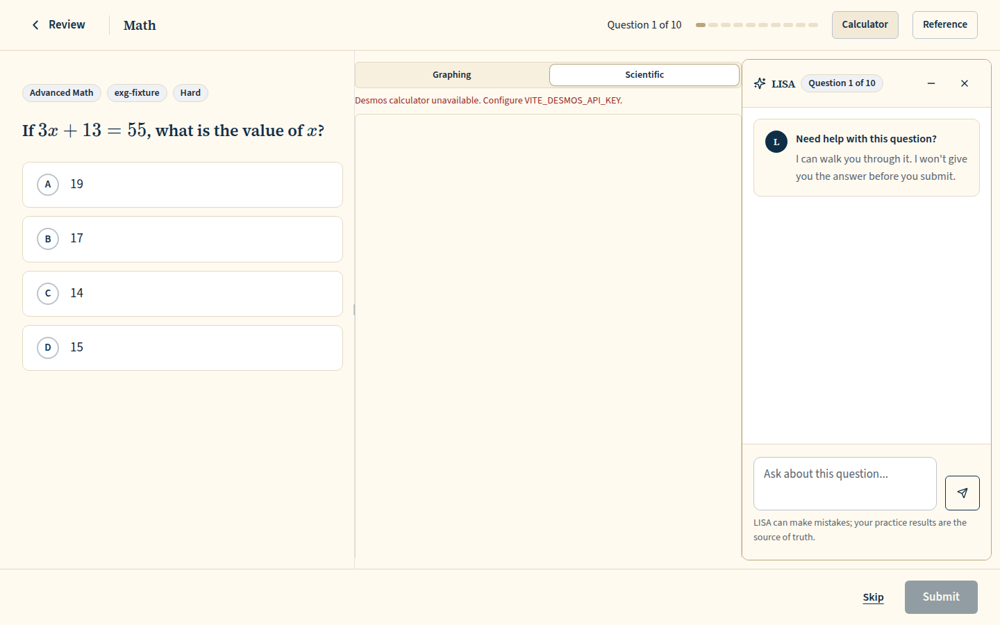
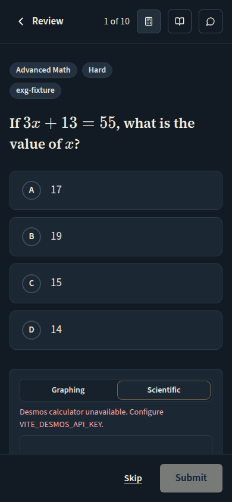
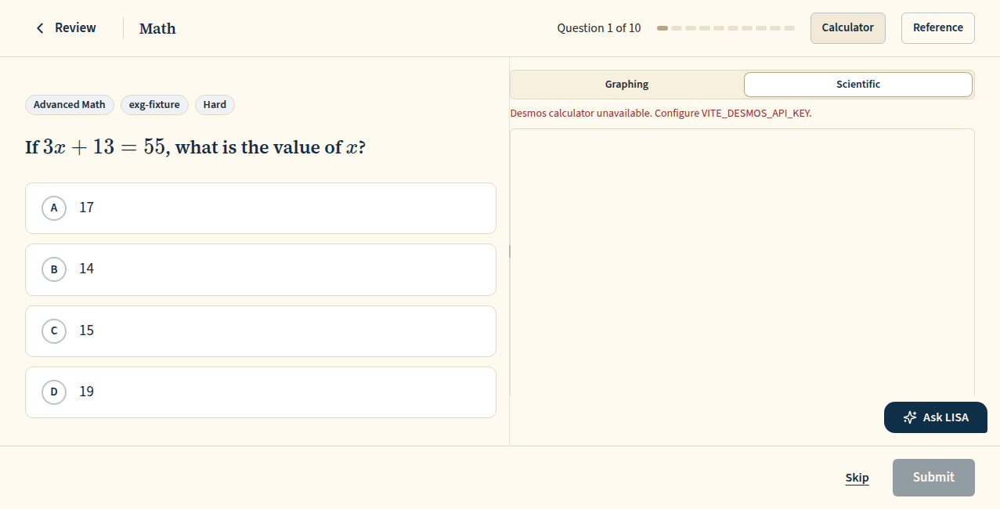
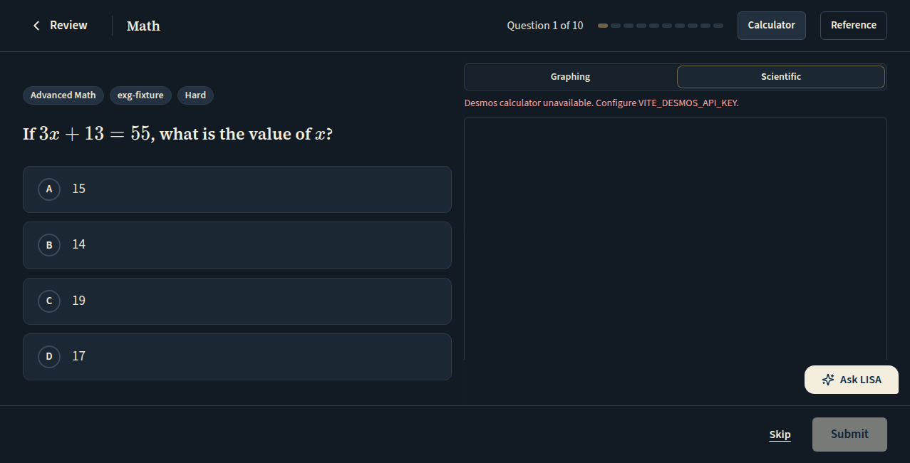
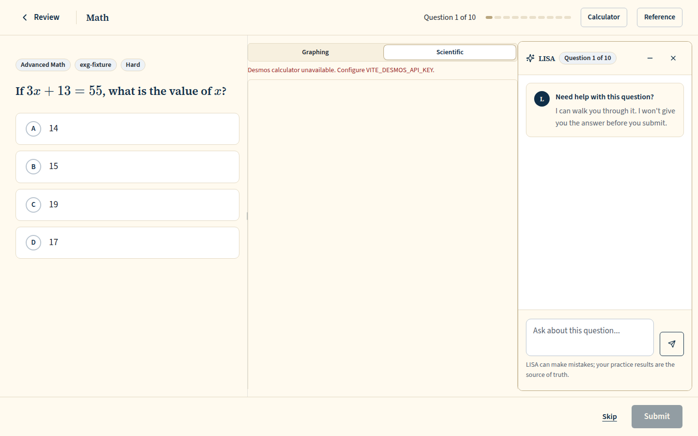
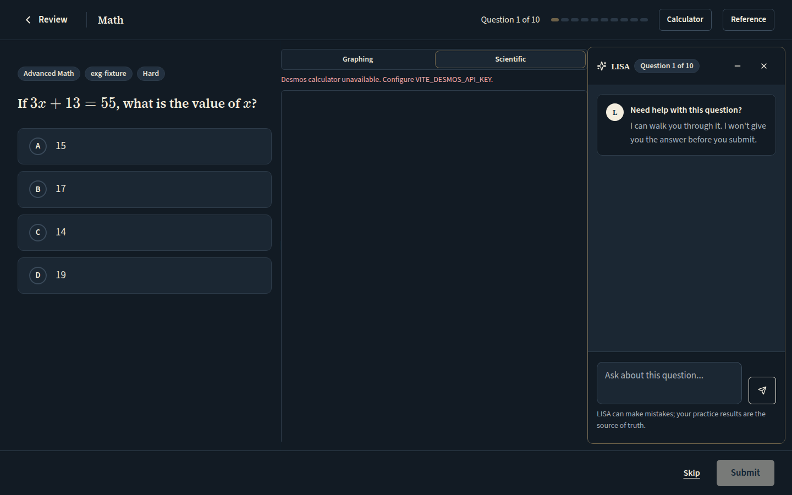
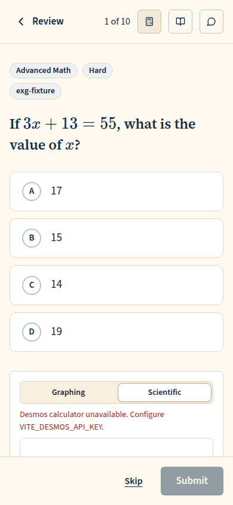
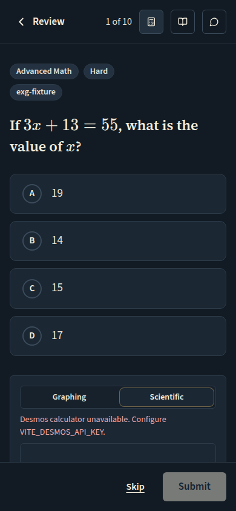
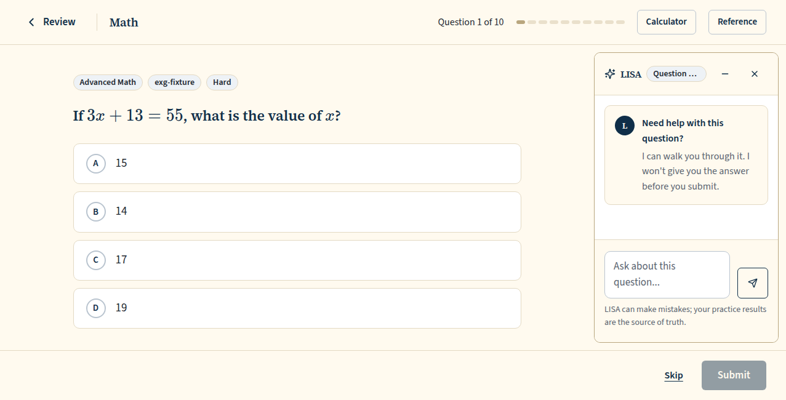
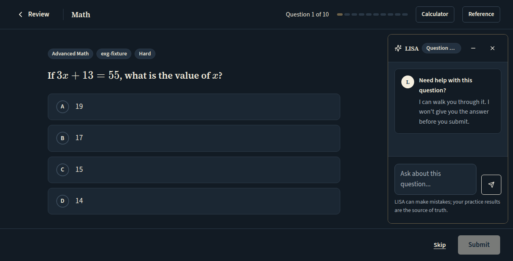

# Runner with LISA docked as the right column: LISA alone, the calculator between the question and LISA (360px and 300px tiers), the below-W3 turn-taking, LISA minimized to the launcher; light and dark, 1440x900, 1366x650, 1280x650, 1277x650 and 390

Generated 2026-10-26T11:03:16.847Z by `pnpm exec tsx tests/e2e/student-harness/capture.ts RUNNER-LISA-DOCKED` (see `tests/e2e/student-harness/README.md`). Built = a production build of the real client (`vite preview`, or the dev server with STUDENT_HARNESS_CLIENT=dev) against the student harness (real routers over a local Postgres built from this repo's migrations; personas seeded through the real practice routes). Prototype = the signed-off `docs/plans/student-ui/design/prototype/*.dc.html`, rendered locally.

Conditions, read before comparing:
- Viewport screenshots (not full page) unless the shot says full page: desktop 1440x900, phone 390x844, and any extra size a shot names.
- The prototypes are a fixed 1440x900 canvas with no phone layout; phone rows show the desktop prototype.
- Dark is requested through the app's own per-device setting; the theme column records what the page rendered.
- No external requests: the built app's Google Fonts (Inter, Poppins) are blocked, so legacy page bodies fall back to system faces; Source Sans 3 / Source Serif 4 are self-hosted and load for both sides.
- Prototype data is illustrative; built data is the seeded personas' real payloads.

## Review runner (paid), on entry: LISA open as the docked right column, full height of the runner body, inset from the top-right corner. Phone: unchanged

Persona: `paid`. Route: `/review/session/{session}`.
Preset localStorage: `{"lyceon_client_instance_id":"student-harness-seed"}`.
Fresh session per capture (real create route, ended after the shot): `review {"mode":"filter","filters":{"sections":["RW"]},"target_count":10}`.
Also shot at w1366 1366x650 (the desktop steps and selectors).
Also shot at w1280 1280x650 (the desktop steps and selectors).
Prototype: none. The runner prototype (Runner.dc.html) has no LISA column; this is the pre-#1300 layout restored by the owner brief of 2026-10-26 ("restore the pre-#1300 runner layout"); DESIGN.md §4 Question runner describes it.

| Viewport | Theme (as rendered) | Built | Prototype |
|---|---|---|---|
| desktop | light |  `/review/session/299aefbe-43f1-42e4-afbc-56611dd843c5`, 118 KB, horizontal overflow 0px | none |
| desktop | dark |  `/review/session/b907b7e7-20ab-49bc-ab92-543101d551eb`, 121 KB, horizontal overflow 0px | none |
| mobile | light |  `/review/session/1600d12d-2129-48c0-9fda-aa97bf43d3e3`, 74 KB, horizontal overflow 0px | none |
| mobile | dark |  `/review/session/bf80121a-e72c-4ded-b88a-6df99142ad63`, 75 KB, horizontal overflow 0px | none |
| w1366 | light |  `/review/session/dc0ae50b-55a1-43bc-9ee7-ebcb3b546bbd`, 104 KB, horizontal overflow 0px | none |
| w1366 | dark |  `/review/session/f8b154c8-1fb0-43e8-94b6-7e8607c124d2`, 106 KB, horizontal overflow 0px | none |
| w1280 | light |  `/review/session/af255dd8-8480-4555-9efc-5c61877fc040`, 104 KB, horizontal overflow 0px | none |
| w1280 | dark |  `/review/session/33a5f9a6-3b53-42eb-b113-6c81f8303f4a`, 107 KB, horizontal overflow 0px | none |

## Math review runner (paid), the calculator opened: between the question and LISA, its right edge LISA's left edge; LISA 360px from 1338px, 300px from W3 (1278px) to 1337px, so 1280x650 keeps all three side by side (owner ruling on #1322, Karl, 2026-10-26)

Persona: `paid`. Route: `/review/session/{session}`.
Preset localStorage: `{"lyceon_client_instance_id":"student-harness-seed"}`.
Fresh session per capture (real create route, ended after the shot): `review {"mode":"filter","filters":{"sections":["M"]},"target_count":10}`.
Step: click `{"desktop":"[data-testid=\"practice-calculator-toggle\"]","mobile":"[data-testid=\"practice-calculator-toggle\"]"}`.
Also shot at w1366 1366x650 (the desktop steps and selectors).
Also shot at w1280 1280x650 (the desktop steps and selectors).
Prototype: none. The runner prototype (Runner.dc.html) has no LISA column; this is the pre-#1300 layout restored by the owner brief of 2026-10-26 ("restore the pre-#1300 runner layout"); DESIGN.md §4 Question runner describes it.

| Viewport | Theme (as rendered) | Built | Prototype |
|---|---|---|---|
| desktop | light |  `/review/session/7473901d-7c85-4451-afd5-dd366df191a5`, 71 KB, horizontal overflow 0px | none |
| desktop | dark |  `/review/session/644f98c2-6128-4753-8d56-6b6da3aff905`, 71 KB, horizontal overflow 0px | none |
| mobile | light |  `/review/session/f470946d-9f61-4f89-9cd0-0cad63a6ba42`, 38 KB, horizontal overflow 0px | none |
| mobile | dark |  `/review/session/e68a38ab-49e7-4d2e-b098-24f05149ae28`, 38 KB, horizontal overflow 0px | none |
| w1366 | light |  `/review/session/01cd656c-6d96-4f5e-a40c-00c028af28a3`, 69 KB, horizontal overflow 0px | none |
| w1366 | dark |  `/review/session/ff7d6765-51b3-47e5-adca-6fa1c9141846`, 69 KB, horizontal overflow 0px | none |
| w1280 | light |  `/review/session/fa14d84e-1774-45ad-939c-3b72920ce0ce`, 69 KB, horizontal overflow 0px | none |
| w1280 | dark |  `/review/session/79d6bb61-f2b0-4f0d-a4cf-993ad209ab10`, 69 KB, horizontal overflow 0px | none |

## Below W3 (1277x650): the calculator opened takes LISA's place; LISA shows as its launcher (the last tool opened wins). At 1440 and on the phone the same steps show the wide and phone layouts

Persona: `paid`. Route: `/review/session/{session}`.
Preset localStorage: `{"lyceon_client_instance_id":"student-harness-seed"}`.
Fresh session per capture (real create route, ended after the shot): `review {"mode":"filter","filters":{"sections":["M"]},"target_count":10}`.
Step: click `{"desktop":"[data-testid=\"practice-calculator-toggle\"]","mobile":"[data-testid=\"practice-calculator-toggle\"]"}`.
Also shot at w1277 1277x650 (the desktop steps and selectors).
Prototype: none. The runner prototype (Runner.dc.html) has no LISA column; this is the pre-#1300 layout restored by the owner brief of 2026-10-26 ("restore the pre-#1300 runner layout"); DESIGN.md §4 Question runner describes it.

| Viewport | Theme (as rendered) | Built | Prototype |
|---|---|---|---|
| desktop | light |  `/review/session/f35a0d6c-1916-4bd5-99a8-99190421c1b9`, 71 KB, horizontal overflow 0px | none |
| desktop | dark |  `/review/session/25d34dfb-9697-4074-905b-2e050e9e9de1`, 71 KB, horizontal overflow 0px | none |
| mobile | light |  `/review/session/d2c23b0f-b10f-43c8-83fd-cc69e5808a7f`, 38 KB, horizontal overflow 0px | none |
| mobile | dark |  `/review/session/25beb68b-2de1-4d3f-bcba-6830f9005abd`, 38 KB, horizontal overflow 0px | none |
| w1277 | light |  `/review/session/5146a28c-89f7-45d6-bb92-790f3d343732`, 45 KB, horizontal overflow 0px | none |
| w1277 | dark |  `/review/session/a1c9754d-c7d4-4110-a767-f8088230f3c7`, 45 KB, horizontal overflow 0px | none |

## Below W3 (1277x650): LISA reopened from its launcher; the calculator closes (its state kept) and LISA's column is back

Persona: `paid`. Route: `/review/session/{session}`.
Preset localStorage: `{"lyceon_client_instance_id":"student-harness-seed"}`.
Fresh session per capture (real create route, ended after the shot): `review {"mode":"filter","filters":{"sections":["M"]},"target_count":10}`.
Step: click `{"desktop":"[data-testid=\"practice-calculator-toggle\"]","mobile":"[data-testid=\"practice-calculator-toggle\"]"}`.
Step: click `{"desktop":"[data-testid=\"chat-dock-bubble\"]:visible, [data-testid=\"tutor-question-chip\"]:visible","mobile":null}`.
Also shot at w1277 1277x650 (the desktop steps and selectors).
Prototype: none. The runner prototype (Runner.dc.html) has no LISA column; this is the pre-#1300 layout restored by the owner brief of 2026-10-26 ("restore the pre-#1300 runner layout"); DESIGN.md §4 Question runner describes it.

| Viewport | Theme (as rendered) | Built | Prototype |
|---|---|---|---|
| desktop | light |  `/review/session/398b7f21-19cf-4318-b3cc-22d8f4c96e86`, 71 KB, horizontal overflow 0px | none |
| desktop | dark |  `/review/session/4a9437e9-ec9e-4b6e-999f-6bbc97aa431a`, 71 KB, horizontal overflow 0px | none |
| mobile | light |  `/review/session/e8122771-0f98-4e03-8a0c-13c2f502f8c3`, 38 KB, horizontal overflow 0px | none |
| mobile | dark |  `/review/session/f5b05b80-0e65-471f-84a5-5d10915d7fe5`, 38 KB, horizontal overflow 0px | none |
| w1277 | light |  `/review/session/32d1d2a7-f2c3-46c1-bd90-4dd3d5fe071f`, 60 KB, horizontal overflow 0px | none |
| w1277 | dark |  `/review/session/6deb085e-a27b-4843-a990-e13ce63c54e7`, 60 KB, horizontal overflow 0px | none |

## Review runner (paid), LISA minimized: the column goes, the question takes the width back, and LISA is the 'Ask LISA' launcher above the footer

Persona: `paid`. Route: `/review/session/{session}`.
Preset localStorage: `{"lyceon_client_instance_id":"student-harness-seed"}`.
Fresh session per capture (real create route, ended after the shot): `review {"mode":"filter","filters":{"sections":["RW"]},"target_count":10}`.
Step: click `{"desktop":"[data-testid=\"chat-dock-minimize\"]","mobile":null}`.
Also shot at w1366 1366x650 (the desktop steps and selectors).
Also shot at w1280 1280x650 (the desktop steps and selectors).
Prototype: none. The runner prototype (Runner.dc.html) has no LISA column; this is the pre-#1300 layout restored by the owner brief of 2026-10-26 ("restore the pre-#1300 runner layout"); DESIGN.md §4 Question runner describes it.

| Viewport | Theme (as rendered) | Built | Prototype |
|---|---|---|---|
| desktop | light |  `/review/session/e025cb1e-738a-4e56-8fa2-67efef64f51c`, 94 KB, horizontal overflow 0px | none |
| desktop | dark |  `/review/session/f583d87e-1f95-42b5-9fac-5856aa12c79e`, 97 KB, horizontal overflow 0px | none |
| mobile | light |  `/review/session/94a63192-b305-4874-93d5-23aedb4a75d9`, 71 KB, horizontal overflow 0px | none |
| mobile | dark |  `/review/session/bf1f357c-95e3-4dd9-88d9-9c1a89870070`, 76 KB, horizontal overflow 0px | none |
| w1366 | light |  `/review/session/d44dfc8c-d9e8-43ce-b942-bd6c2ea3156f`, 79 KB, horizontal overflow 0px | none |
| w1366 | dark |  `/review/session/bcb30499-888f-43fc-a941-680fec47fe0c`, 84 KB, horizontal overflow 0px | none |
| w1280 | light |  `/review/session/4c7f3fd1-0c6e-40a8-b786-5cc3b22dd1d1`, 80 KB, horizontal overflow 0px | none |
| w1280 | dark |  `/review/session/808e523f-8938-4058-92c4-1cd6accc2e66`, 82 KB, horizontal overflow 0px | none |

## Run facts

- Seeded ids: `{"free":{"completedPracticeSessionId":"fc488c37-f823-4d55-9de2-f904caa15a34","openPracticeSessionId":"40cf72d1-90a6-40f7-8662-66de8de99561","openReviewSessionId":"e4f5aa85-465f-4073-b4c3-d0daa2dbf3b3","diagnosticSessionId":null,"scoredExamSessionId":null,"inProgressExamSessionId":null,"lisaConversationId":null,"answered":39},"paid":{"completedPracticeSessionId":"f9117eb2-f126-4ac1-941d-e27f2e102fc0","openPracticeSessionId":"998ff656-f6ff-4ced-acc3-7bac44e19079","openReviewSessionId":"b786a9bc-586d-48f1-8134-8360d9992225","diagnosticSessionId":"0e2255bf-b334-457d-83d5-5a1bb6ed166d","scoredExamSessionId":"063a55bd-5147-4eb4-a257-7c48d852dac0","inProgressExamSessionId":"f3fa3423-be9f-4e99-85d1-7403e9c37e9e","lisaConversationId":"0a739dc2-d6c2-4d25-99fa-dab6a4c48cac","answered":204}}`
- Endpoints the pages asked for that the harness does not serve (answered 404): none
- Desmos (QA2-B, opt-in `STUDENT_HARNESS_DESMOS=1`): not loaded (a local-only run; the calculator shows its unavailable line)
- External hosts blocked: none
