# Runner with LISA docked as the right column: LISA alone, the calculator between the question and LISA, LISA minimized to the launcher; light and dark, 1440x900, 1366x650, 1280x650 and 390

Generated 2026-10-26T09:59:17.200Z by `pnpm exec tsx tests/e2e/student-harness/capture.ts RUNNER-LISA-DOCKED` (see `tests/e2e/student-harness/README.md`). Built = a production build of the real client (`vite preview`, or the dev server with STUDENT_HARNESS_CLIENT=dev) against the student harness (real routers over a local Postgres built from this repo's migrations; personas seeded through the real practice routes). Prototype = the signed-off `docs/plans/student-ui/design/prototype/*.dc.html`, rendered locally.

Conditions, read before comparing:
- Viewport screenshots (not full page) unless the shot says full page: desktop 1440x900, phone 390x844, and any extra size a shot names.
- The prototypes are a fixed 1440x900 canvas with no phone layout; phone rows show the desktop prototype.
- Dark is requested through the app's own per-device setting; the theme column records what the page rendered.
- No external requests: the built app's Google Fonts (Inter, Poppins) are blocked, so legacy page bodies fall back to system faces; Source Sans 3 / Source Serif 4 are self-hosted and load for both sides.
- Prototype data is illustrative; built data is the seeded personas' real payloads.

## Review runner (paid), on entry: LISA open as the docked right column, full height of the runner body, inset from the top-right corner. Phone: unchanged

Persona: `paid`. Route: `/review/session/{session}`.
Preset localStorage: `{"lyceon_client_instance_id":"student-harness-seed"}`.
Fresh session per capture (real create route, ended after the shot): `review {"mode":"filter","filters":{"sections":["RW"]},"target_count":10}`.
Also shot at w1366 1366x650 (the desktop steps and selectors).
Also shot at w1280 1280x650 (the desktop steps and selectors).
Prototype: none. The runner prototype (Runner.dc.html) has no LISA column; this is the pre-#1300 layout restored by the owner brief of 2026-10-26 ("restore the pre-#1300 runner layout"); DESIGN.md §4 Question runner describes it.

| Viewport | Theme (as rendered) | Built | Prototype |
|---|---|---|---|
| desktop | light | 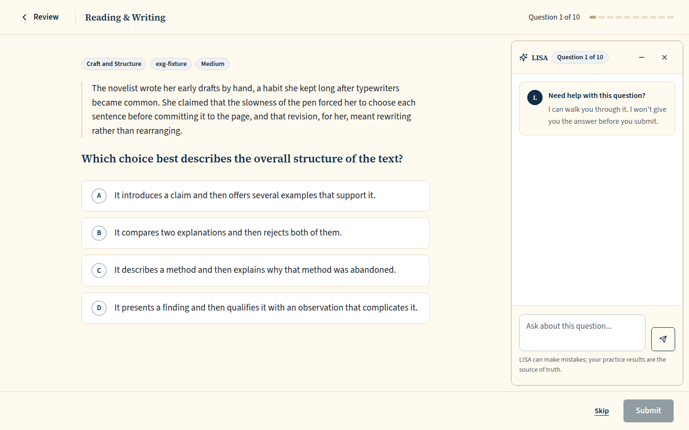 `/review/session/6b1f36d8-fd04-4b16-9e45-ee6d275691fb`, 117 KB, horizontal overflow 0px | none |
| desktop | dark | 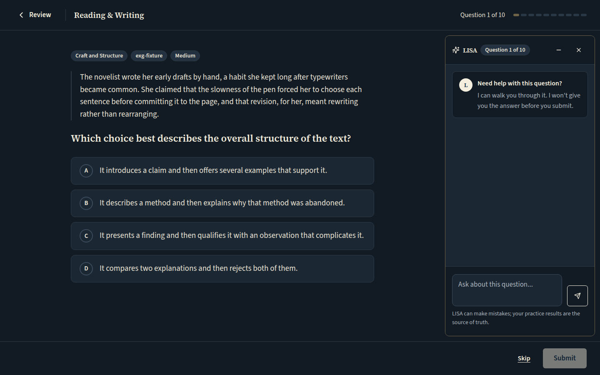 `/review/session/c6ea3190-c0ca-4bfb-b901-e0e0aeb420e4`, 119 KB, horizontal overflow 0px | none |
| mobile | light | 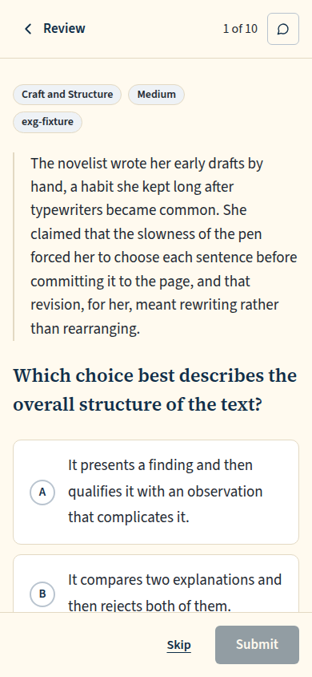 `/review/session/b87f760f-8291-463a-8ed2-f89ba486992d`, 74 KB, horizontal overflow 0px | none |
| mobile | dark | 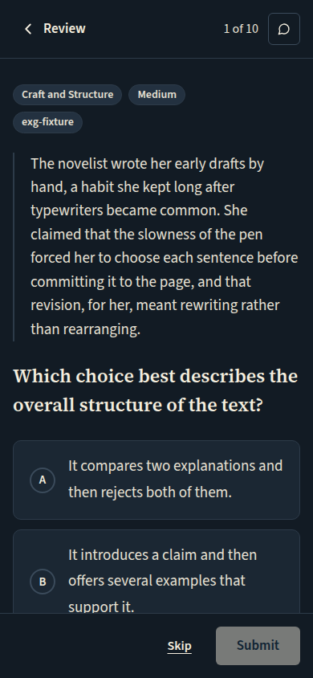 `/review/session/caee6044-e0db-4630-b06d-df97144a1a97`, 75 KB, horizontal overflow 0px | none |
| w1366 | light | 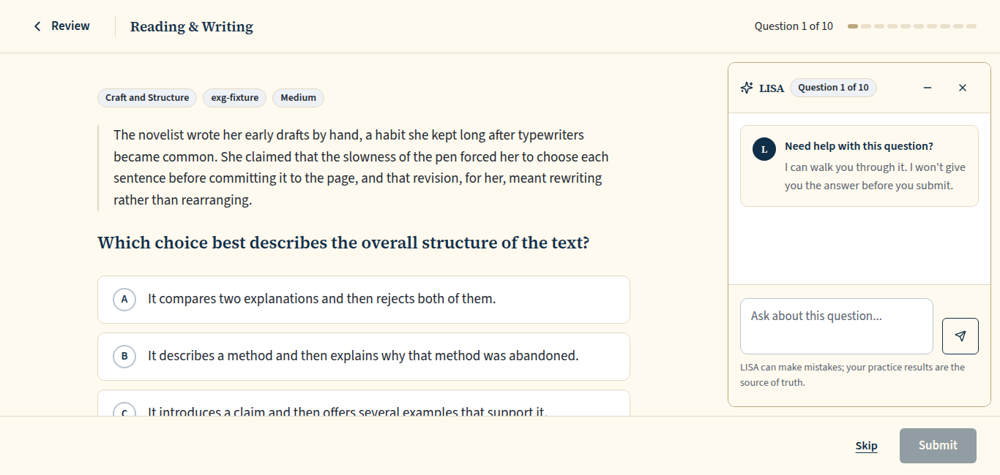 `/review/session/7d823f8f-9e88-4deb-a88c-dfa254a900e3`, 103 KB, horizontal overflow 0px | none |
| w1366 | dark | 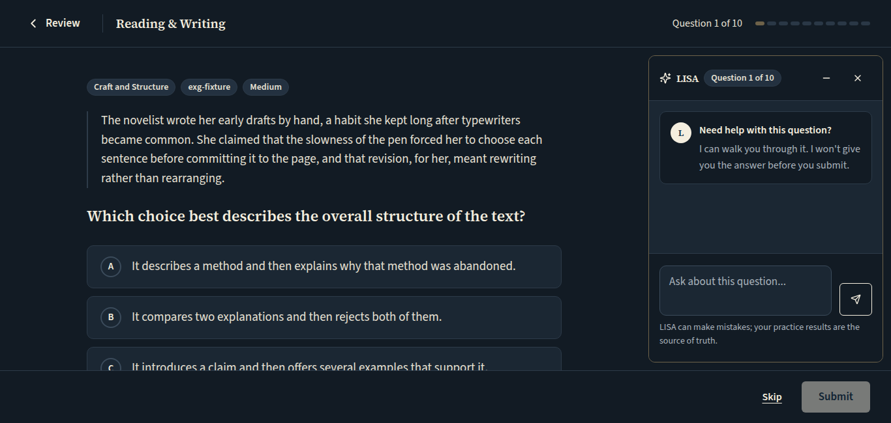 `/review/session/230cf96d-d1e6-42a9-85ca-d532f8f8708c`, 106 KB, horizontal overflow 0px | none |
| w1280 | light | 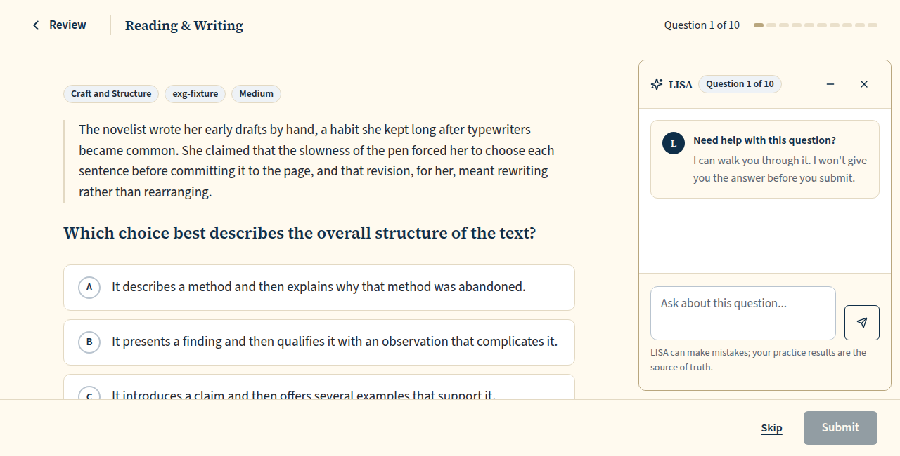 `/review/session/cd577a41-90ed-4fc0-8e71-f8b03c661175`, 102 KB, horizontal overflow 0px | none |
| w1280 | dark | 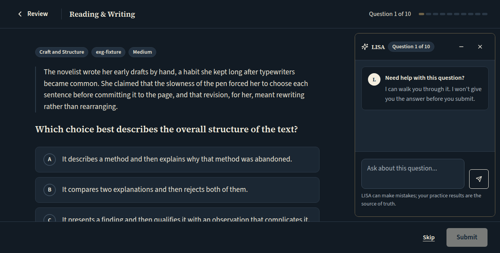 `/review/session/3641242e-3f9c-4197-bfe6-7a1f1f763e06`, 105 KB, horizontal overflow 0px | none |

## Math review runner (paid), the calculator opened: between the question and LISA, its right edge LISA's left edge (from 1338px; at 1280 it opens under the question, for the Chromebook report)

Persona: `paid`. Route: `/review/session/{session}`.
Preset localStorage: `{"lyceon_client_instance_id":"student-harness-seed"}`.
Fresh session per capture (real create route, ended after the shot): `review {"mode":"filter","filters":{"sections":["M"]},"target_count":10}`.
Step: click `{"desktop":"[data-testid=\"practice-calculator-toggle\"]","mobile":"[data-testid=\"practice-calculator-toggle\"]"}`.
Also shot at w1366 1366x650 (the desktop steps and selectors).
Also shot at w1280 1280x650 (the desktop steps and selectors).
Prototype: none. The runner prototype (Runner.dc.html) has no LISA column; this is the pre-#1300 layout restored by the owner brief of 2026-10-26 ("restore the pre-#1300 runner layout"); DESIGN.md §4 Question runner describes it.

| Viewport | Theme (as rendered) | Built | Prototype |
|---|---|---|---|
| desktop | light |  `/review/session/6eb163e9-ba29-4130-ba60-400bfae33997`, 71 KB, horizontal overflow 0px | none |
| desktop | dark | 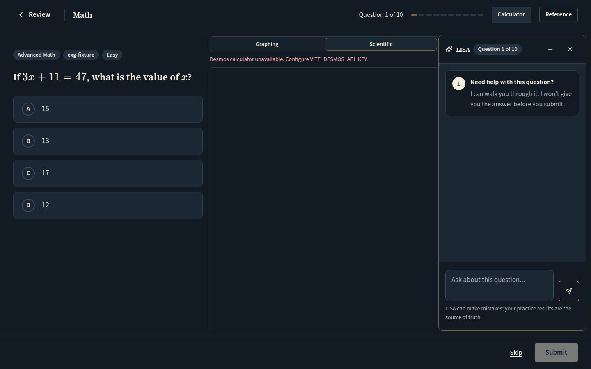 `/review/session/5b5d2bd2-caee-4dbf-8041-455550a11bbe`, 71 KB, horizontal overflow 0px | none |
| mobile | light |  `/review/session/505c194b-156c-48ab-8a1d-fc2526f164a9`, 37 KB, horizontal overflow 0px | none |
| mobile | dark | 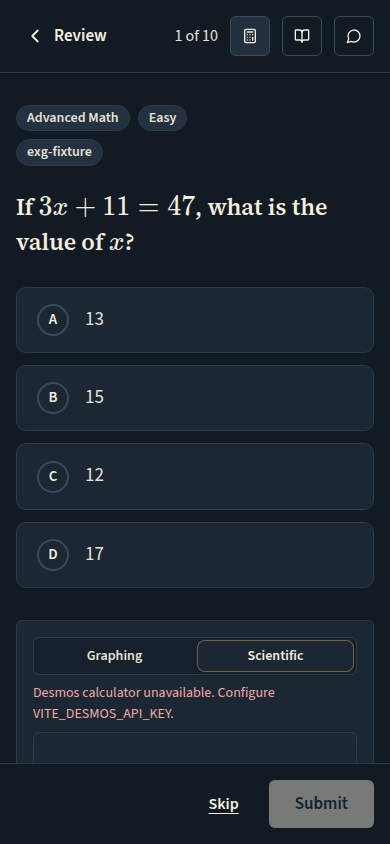 `/review/session/fb37555b-149a-427a-a667-c5d1f861f558`, 38 KB, horizontal overflow 0px | none |
| w1366 | light | 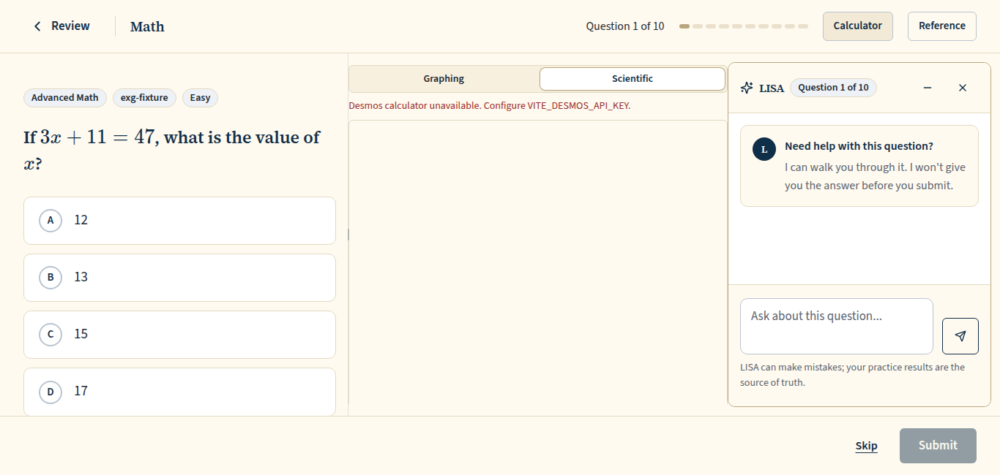 `/review/session/fde5028a-418f-40e0-9783-5da0a2a6f375`, 69 KB, horizontal overflow 0px | none |
| w1366 | dark | 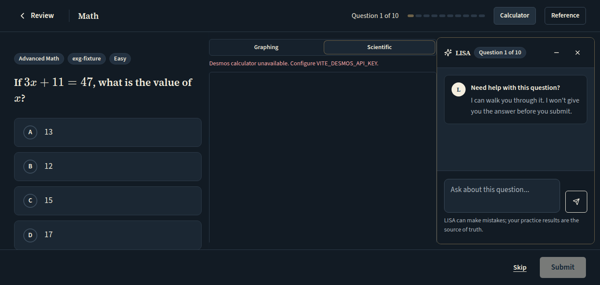 `/review/session/0b79ee9e-80ef-4b9a-b1a1-ee3a592b626e`, 69 KB, horizontal overflow 0px | none |
| w1280 | light | 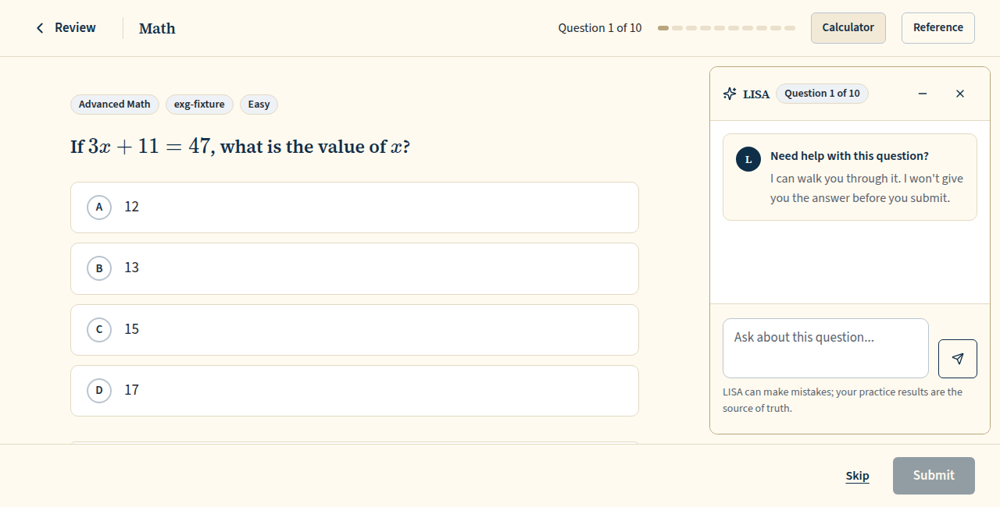 `/review/session/6d352e10-0261-4667-8af1-29e533510c8d`, 60 KB, horizontal overflow 0px | none |
| w1280 | dark | 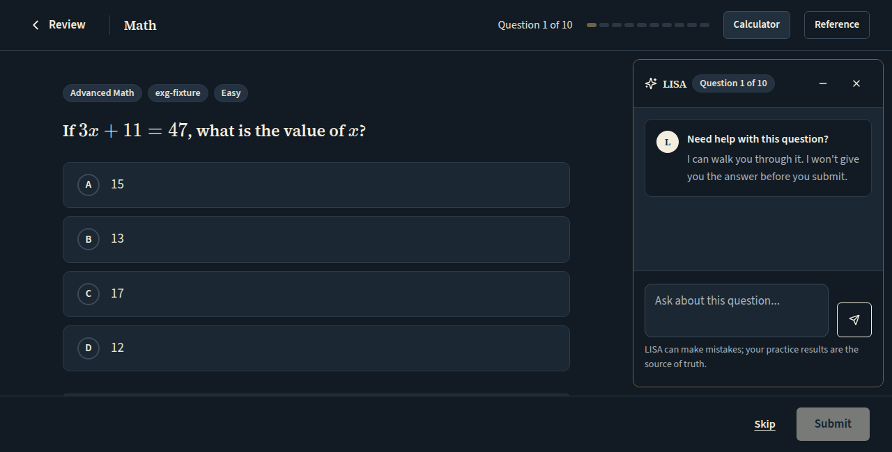 `/review/session/aa24dbae-1a11-4da9-8999-04ae88bdc287`, 60 KB, horizontal overflow 0px | none |

## Review runner (paid), LISA minimized: the column goes, the question takes the width back, and LISA is the 'Ask LISA' launcher above the footer

Persona: `paid`. Route: `/review/session/{session}`.
Preset localStorage: `{"lyceon_client_instance_id":"student-harness-seed"}`.
Fresh session per capture (real create route, ended after the shot): `review {"mode":"filter","filters":{"sections":["RW"]},"target_count":10}`.
Step: click `{"desktop":"[data-testid=\"chat-dock-minimize\"]","mobile":null}`.
Also shot at w1366 1366x650 (the desktop steps and selectors).
Also shot at w1280 1280x650 (the desktop steps and selectors).
Prototype: none. The runner prototype (Runner.dc.html) has no LISA column; this is the pre-#1300 layout restored by the owner brief of 2026-10-26 ("restore the pre-#1300 runner layout"); DESIGN.md §4 Question runner describes it.

| Viewport | Theme (as rendered) | Built | Prototype |
|---|---|---|---|
| desktop | light | 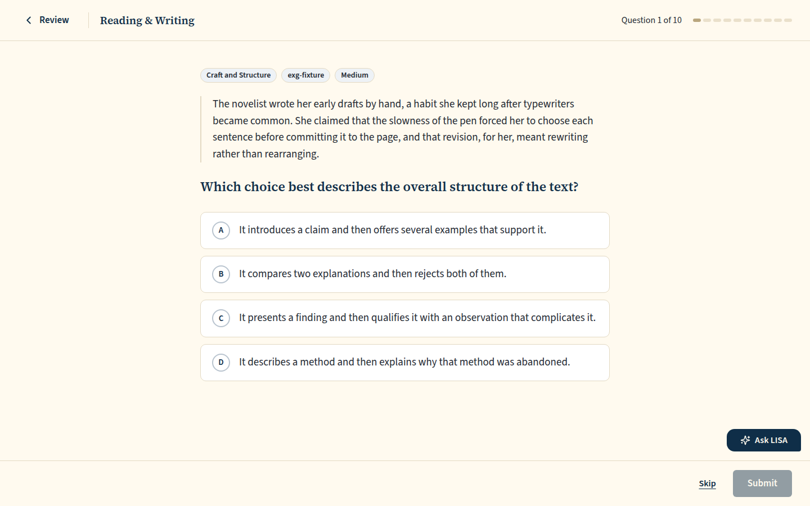 `/review/session/64ec34cb-54aa-460d-80e3-85889bde326d`, 92 KB, horizontal overflow 0px | none |
| desktop | dark | 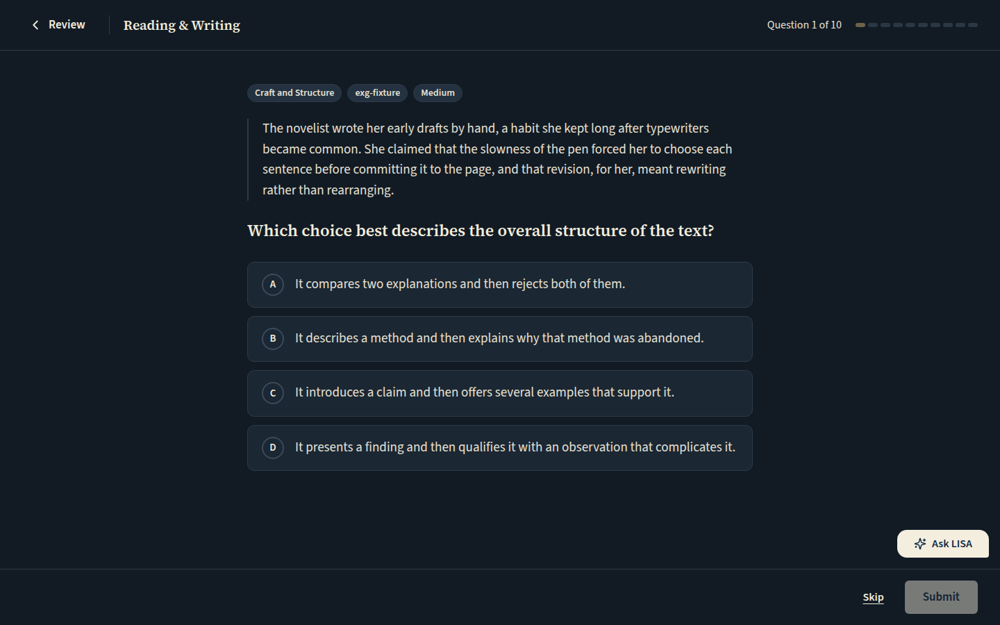 `/review/session/e1003065-eec7-4dd2-a7c7-f556462785ad`, 95 KB, horizontal overflow 0px | none |
| mobile | light | 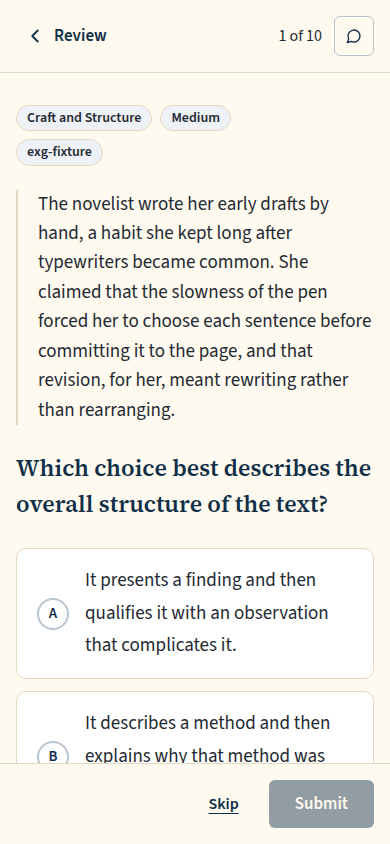 `/review/session/7349965e-0075-4b36-989b-4f29419845bc`, 74 KB, horizontal overflow 0px | none |
| mobile | dark | 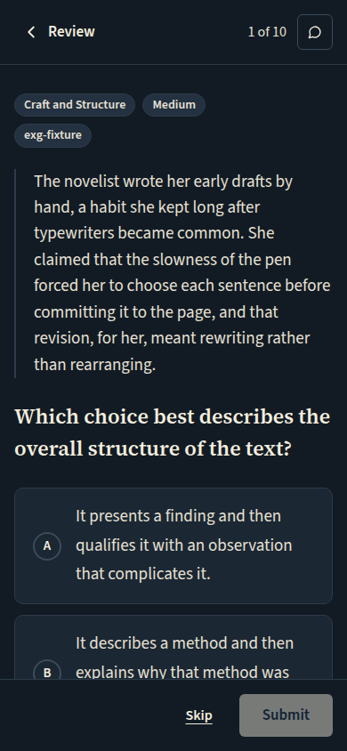 `/review/session/ee618d41-73e9-48b8-bec6-5ea001bf8672`, 77 KB, horizontal overflow 0px | none |
| w1366 | light | 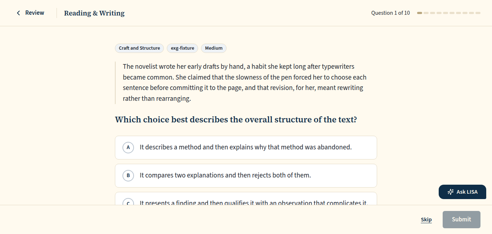 `/review/session/44bad631-9497-4bcb-8979-355a378a799a`, 79 KB, horizontal overflow 0px | none |
| w1366 | dark | 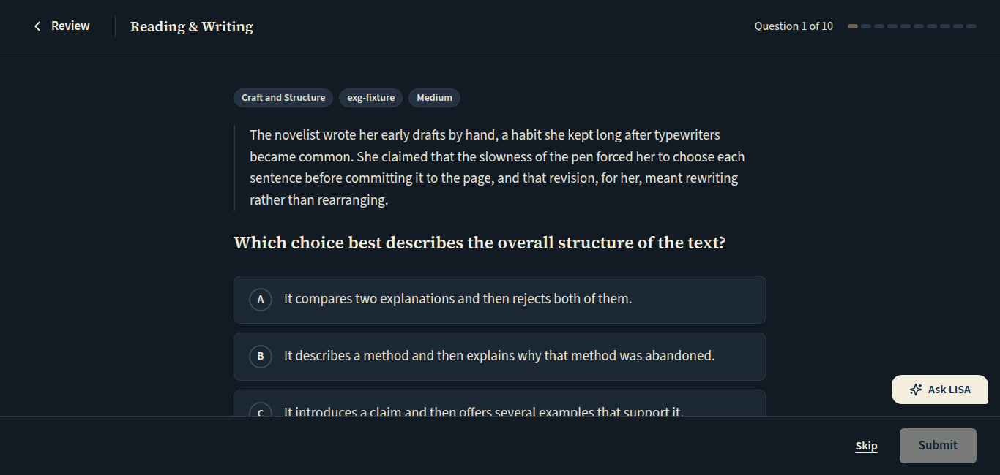 `/review/session/cae2ed86-52ee-4ce9-8697-862dd251c98a`, 82 KB, horizontal overflow 0px | none |
| w1280 | light |  `/review/session/c4b0d271-8900-4b11-b987-5092b4c8469e`, 79 KB, horizontal overflow 0px | none |
| w1280 | dark | 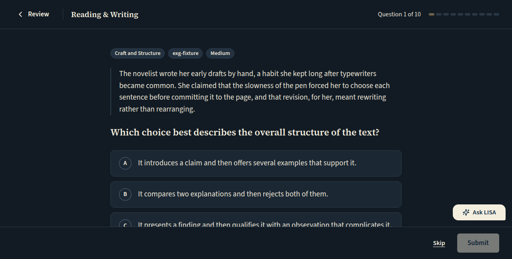 `/review/session/8a138c02-c79a-4054-9530-cd6814e79e0a`, 80 KB, horizontal overflow 0px | none |

## Run facts

- Seeded ids: `{"free":{"completedPracticeSessionId":"b309602d-3980-4050-9996-22cc98304bfd","openPracticeSessionId":"ca7eae36-92cb-4afb-b5a9-f37908882883","openReviewSessionId":"cdd6af2d-8fdd-4c8f-8598-1c77f9a5b2f4","diagnosticSessionId":null,"scoredExamSessionId":null,"inProgressExamSessionId":null,"lisaConversationId":null,"answered":39},"paid":{"completedPracticeSessionId":"39d3fe41-8132-4f1d-98f7-7eb764f90f02","openPracticeSessionId":"88f2ac11-4110-4b32-a6c9-9bfe15513695","openReviewSessionId":"c7259585-2909-44e6-9a44-a971572a7fe6","diagnosticSessionId":"8169bdaa-7a6f-4a57-aef5-b40118be7c45","scoredExamSessionId":"9c80a6e6-c77e-4665-aab5-727daee4990b","inProgressExamSessionId":"0fc7518c-232b-43cb-8263-53ac9dbbb632","lisaConversationId":"b71e3b89-091b-4a11-b71f-3476c68c40d9","answered":204}}`
- Endpoints the pages asked for that the harness does not serve (answered 404): none
- Desmos (QA2-B, opt-in `STUDENT_HARNESS_DESMOS=1`): not loaded (a local-only run; the calculator shows its unavailable line)
- External hosts blocked: none
