# The SAT-date picker (dropdown multi-select) closed and open, and two-line recent-session titles; light and dark, 1440 and 390

Generated 2026-10-12T00:33:38.145Z by `pnpm exec tsx tests/e2e/student-harness/capture.ts SAT-DATES` (see `tests/e2e/student-harness/README.md`). Built = a production build of the real client (`vite preview`, or the dev server with STUDENT_HARNESS_CLIENT=dev) against the student harness (real routers over a local Postgres built from this repo's migrations; personas seeded through the real practice routes). Prototype = the signed-off `docs/plans/student-ui/design/prototype/*.dc.html`, rendered locally.

Conditions, read before comparing:
- Viewport screenshots (not full page) unless the shot says full page: desktop 1440x900, phone 390x844, and any extra size a shot names.
- The prototypes are a fixed 1440x900 canvas with no phone layout; phone rows show the desktop prototype.
- Dark is requested through the app's own per-device setting; the theme column records what the page rendered.
- No external requests: the built app's Google Fonts (Inter, Poppins) are blocked, so legacy page bodies fall back to system faces; Source Sans 3 / Source Serif 4 are self-hosted and load for both sides.
- Prototype data is illustrative; built data is the seeded personas' real payloads.

## Onboarding, 'When's your SAT?': the picker closed on 'Not sure yet' (no list on the page)

Persona: `onboarding`. Route: `/profile/complete`.
Full page: the whole document, not just the viewport.
Prototype: none. NOT PROTOTYPED: the dropdown SAT-date picker and the two-line title rule are the owner brief of 2026-10-11 (DESIGN.md §5 UI standards); built to DESIGN.md's tokens.

| Viewport | Theme (as rendered) | Built | Prototype |
|---|---|---|---|
| desktop | light | 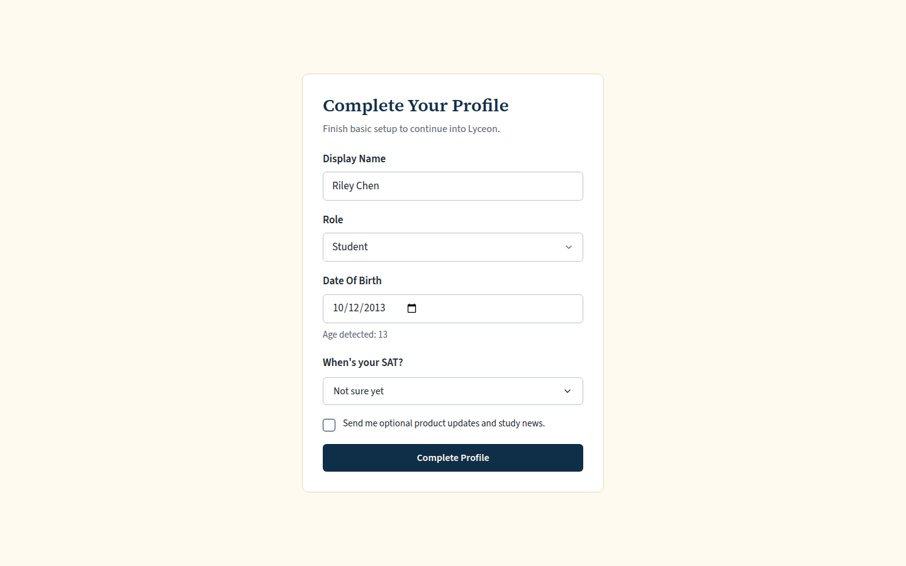 `/profile/complete`, 40 KB, horizontal overflow 0px | none |
| desktop | dark | 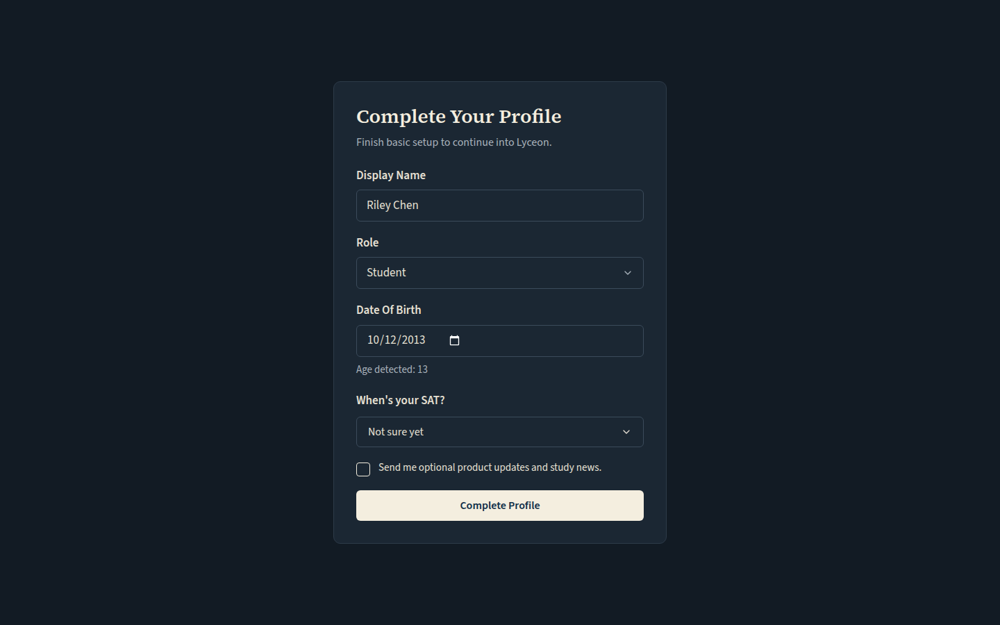 `/profile/complete`, 42 KB, horizontal overflow 0px | none |
| mobile | light | 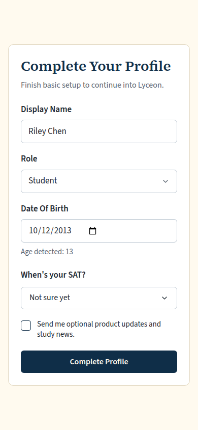 `/profile/complete`, 35 KB, horizontal overflow 0px | none |
| mobile | dark | 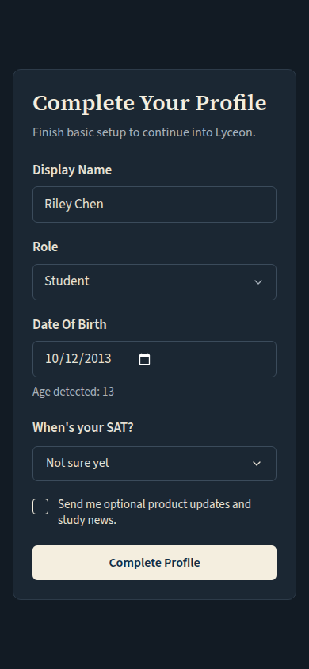 `/profile/complete`, 37 KB, horizontal overflow 0px | none |

## Onboarding: the picker open: 'Not sure yet' pinned at the top, then the future official dates with checkboxes, scrolling inside the menu

Persona: `onboarding`. Route: `/profile/complete`.
Step: click `{"desktop":"[data-testid=\"onboarding-sat-dates-trigger\"]","mobile":"[data-testid=\"onboarding-sat-dates-trigger\"]"}`.
Must then show `[data-testid="onboarding-sat-dates-menu"]` (the capture fails otherwise).
Prototype: none. NOT PROTOTYPED: the dropdown SAT-date picker and the two-line title rule are the owner brief of 2026-10-11 (DESIGN.md §5 UI standards); built to DESIGN.md's tokens.

| Viewport | Theme (as rendered) | Built | Prototype |
|---|---|---|---|
| desktop | light | 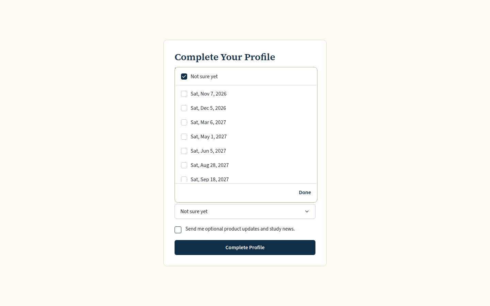 `/profile/complete`, 40 KB, horizontal overflow 0px | none |
| desktop | dark | 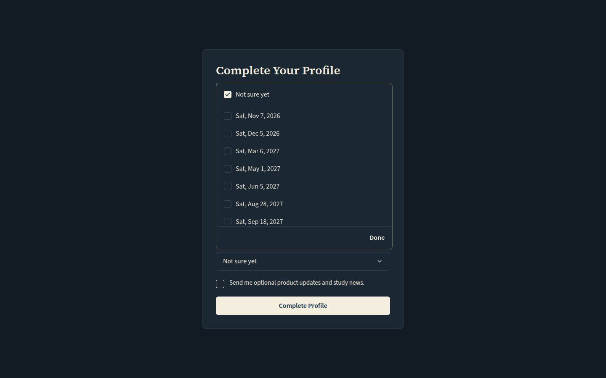 `/profile/complete`, 41 KB, horizontal overflow 0px | none |
| mobile | light | 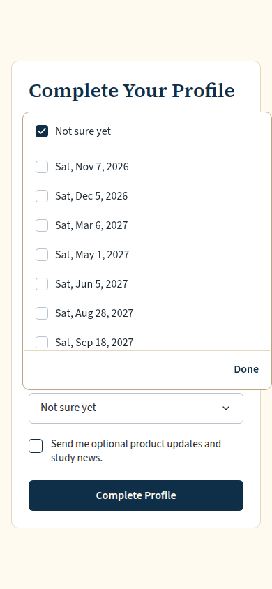 `/profile/complete`, 35 KB, horizontal overflow 0px | none |
| mobile | dark | 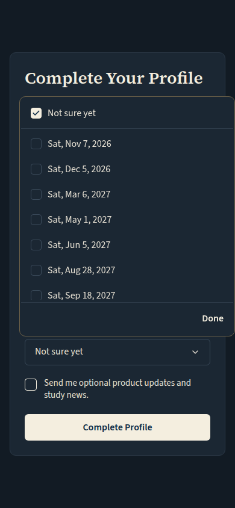 `/profile/complete`, 36 KB, horizontal overflow 0px | none |

## Onboarding: two dates chosen, then Done: the closed picker reads 'Sat, Nov 7, 2026 + 1 more'

Persona: `onboarding`. Route: `/profile/complete`.
Step: click `{"desktop":"[data-testid=\"onboarding-sat-dates-trigger\"]","mobile":"[data-testid=\"onboarding-sat-dates-trigger\"]"}`.
Step: click `{"desktop":"[data-testid=\"onboarding-sat-dates-date-2026-11-07\"]","mobile":"[data-testid=\"onboarding-sat-dates-date-2026-11-07\"]"}`.
Step: click `{"desktop":"[data-testid=\"onboarding-sat-dates-date-2026-12-05\"]","mobile":"[data-testid=\"onboarding-sat-dates-date-2026-12-05\"]"}`.
Step: click `{"desktop":"[data-testid=\"onboarding-sat-dates-done\"]","mobile":"[data-testid=\"onboarding-sat-dates-done\"]"}`.
Must then show the text `Sat, Nov 7, 2026 + 1 more` (the capture fails otherwise).
Full page: the whole document, not just the viewport.
Prototype: none. NOT PROTOTYPED: the dropdown SAT-date picker and the two-line title rule are the owner brief of 2026-10-11 (DESIGN.md §5 UI standards); built to DESIGN.md's tokens.

| Viewport | Theme (as rendered) | Built | Prototype |
|---|---|---|---|
| desktop | light | 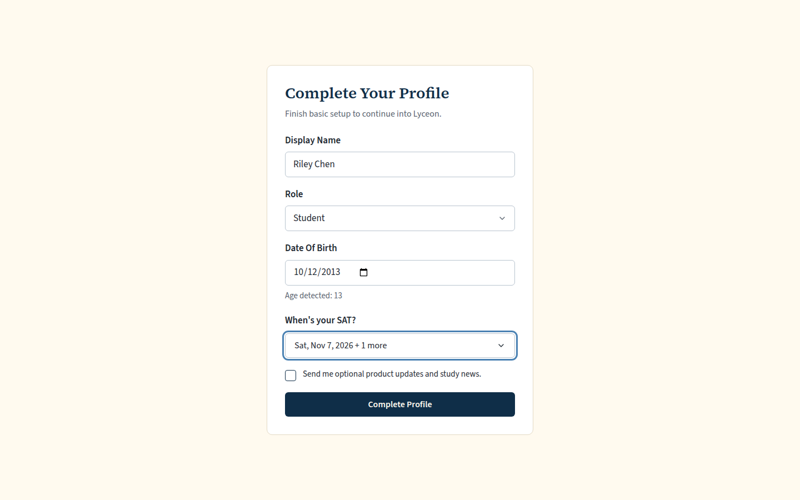 `/profile/complete`, 42 KB, horizontal overflow 0px | none |
| desktop | dark | 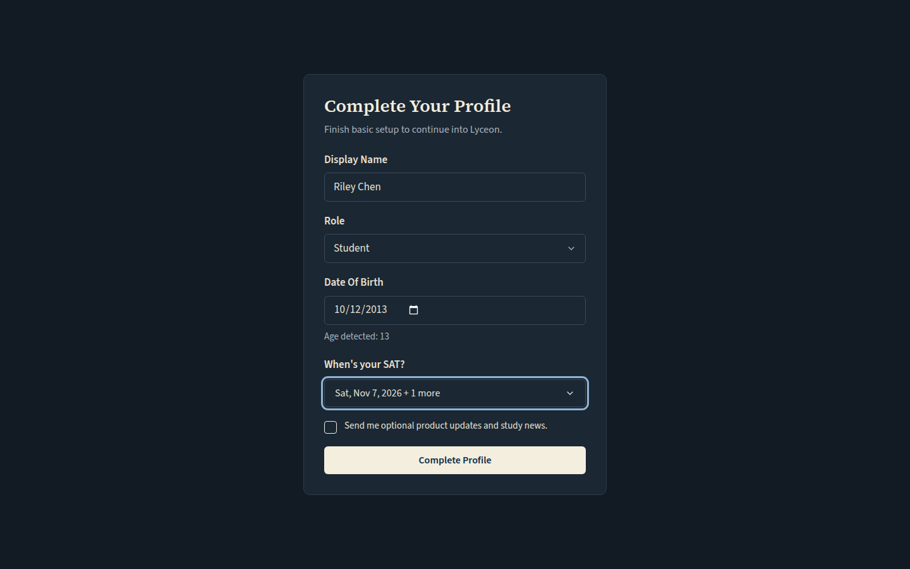 `/profile/complete`, 44 KB, horizontal overflow 0px | none |
| mobile | light | 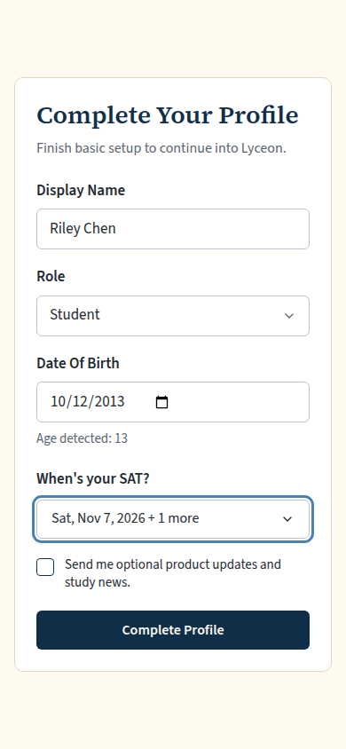 `/profile/complete`, 37 KB, horizontal overflow 0px | none |
| mobile | dark | 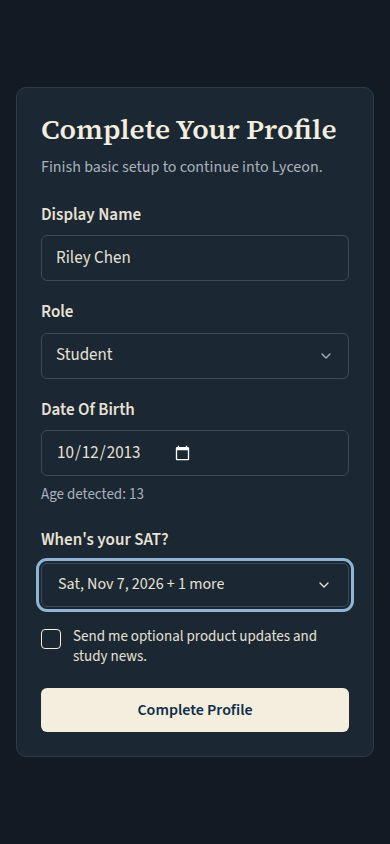 `/profile/complete`, 39 KB, horizontal overflow 0px | none |

## Onboarding: the bound read failed: the picker offers no date, says so, and offers Try again ('Not sure yet' stays available)

Persona: `onboarding`. Route: `/profile/complete`.
Step: click `{"desktop":"[data-testid=\"onboarding-sat-dates-trigger\"]","mobile":"[data-testid=\"onboarding-sat-dates-trigger\"]"}`.
Stubbed in the browser: `GET /api/calendar/profile` is answered by the browser itself and never reaches the server. Owner ruling 2026-10-11 (Karl, on #1204): the picker fails closed when the served bound (latest_test_date) cannot load. The route does not fail in the harness, so the browser answers it with a 500.
Must then show `[data-testid="onboarding-sat-dates-dates-error"]` (the capture fails otherwise).
Prototype: none. NOT PROTOTYPED: the dropdown SAT-date picker and the two-line title rule are the owner brief of 2026-10-11 (DESIGN.md §5 UI standards); built to DESIGN.md's tokens.

| Viewport | Theme (as rendered) | Built | Prototype |
|---|---|---|---|
| desktop | light | 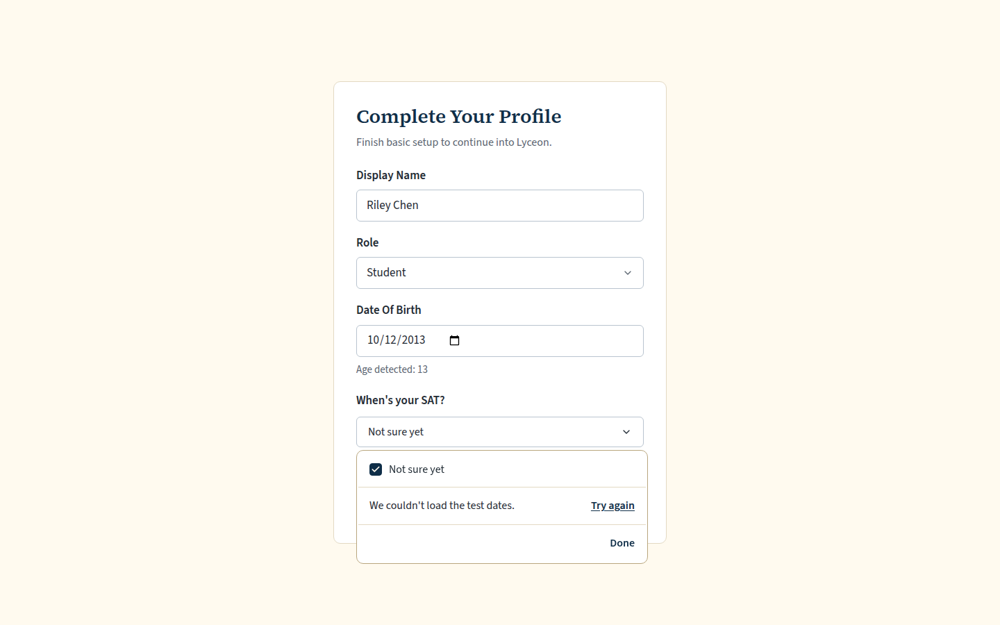 `/profile/complete`, 41 KB, horizontal overflow 0px | none |
| desktop | dark | 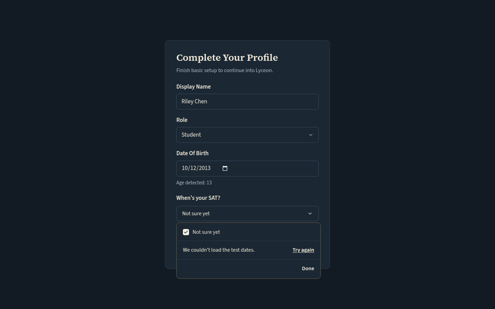 `/profile/complete`, 42 KB, horizontal overflow 0px | none |
| mobile | light | 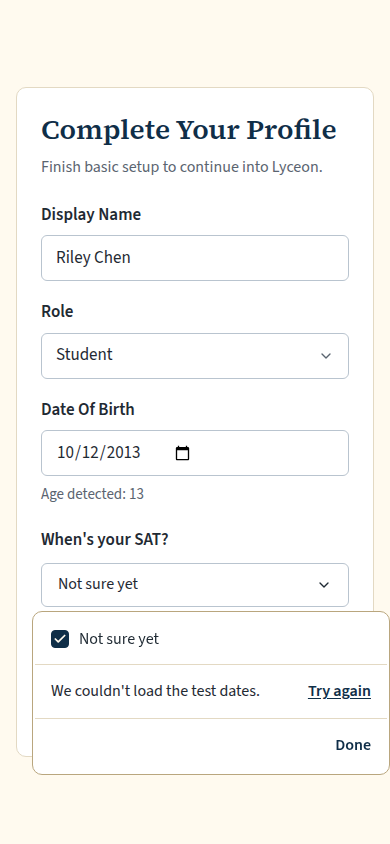 `/profile/complete`, 36 KB, horizontal overflow 0px | none |
| mobile | dark | 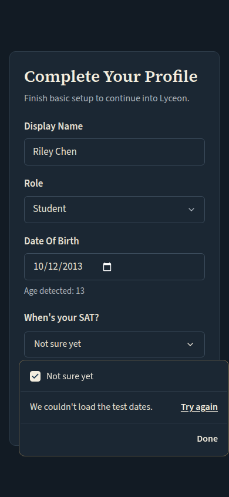 `/profile/complete`, 37 KB, horizontal overflow 0px | none |

## Settings → Profile: the same picker, open

Persona: `paid`. Route: `/profile`.
Step: click `{"desktop":"[data-testid=\"settings-test-dates-trigger\"]","mobile":"[data-testid=\"settings-test-dates-trigger\"]"}`.
Must then show `[data-testid="settings-test-dates-menu"]` (the capture fails otherwise).
Prototype: none. NOT PROTOTYPED: the dropdown SAT-date picker and the two-line title rule are the owner brief of 2026-10-11 (DESIGN.md §5 UI standards); built to DESIGN.md's tokens.

| Viewport | Theme (as rendered) | Built | Prototype |
|---|---|---|---|
| desktop | light | 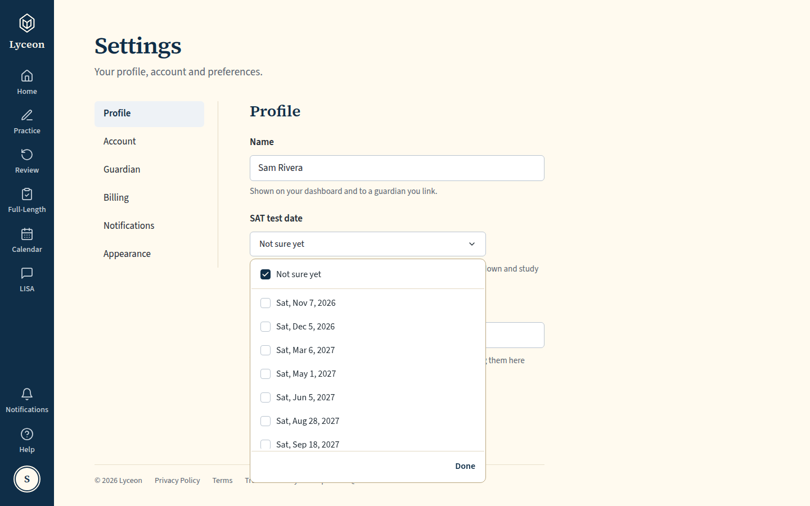 `/profile`, 76 KB, horizontal overflow 0px | none |
| desktop | dark | 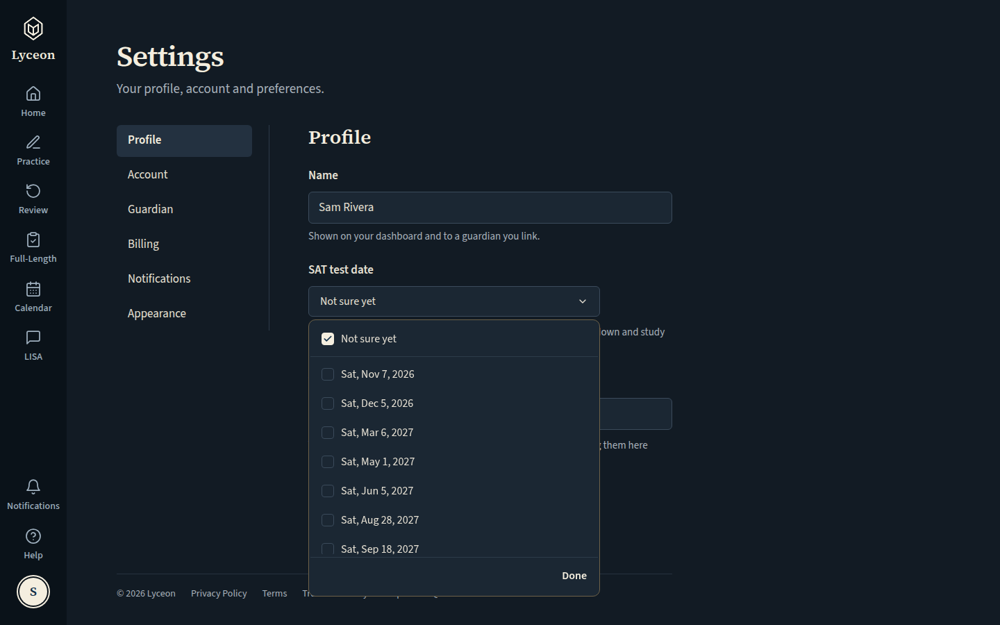 `/profile`, 77 KB, horizontal overflow 0px | none |
| mobile | light | 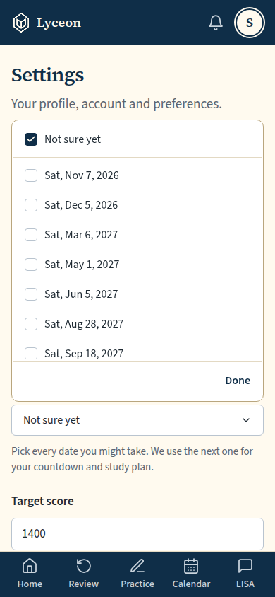 `/profile`, 48 KB, horizontal overflow 0px | none |
| mobile | dark | 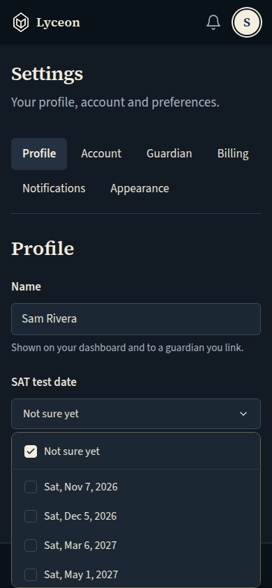 `/profile`, 49 KB, horizontal overflow 0px | none |

## Calendar → Edit schedule: the same picker in the schedule sheet, open (at 390 the sheet is opened from the '⋯' menu)

Persona: `paid`. Route: `/calendar`.
Step: click `{"desktop":"[data-testid=\"topbar-edit-schedule\"]","mobile":"[data-testid=\"calendar-more-actions\"]"}`.
Step: click `{"desktop":null,"mobile":"[data-testid=\"calendar-more-edit-schedule\"]"}`.
Step: click `{"desktop":"[data-testid=\"settings-exam-dates-trigger\"]","mobile":"[data-testid=\"settings-exam-dates-trigger\"]"}`.
Must then show `[data-testid="settings-exam-dates-menu"]` (the capture fails otherwise).
Prototype: none. NOT PROTOTYPED: the dropdown SAT-date picker and the two-line title rule are the owner brief of 2026-10-11 (DESIGN.md §5 UI standards); built to DESIGN.md's tokens.

| Viewport | Theme (as rendered) | Built | Prototype |
|---|---|---|---|
| desktop | light | 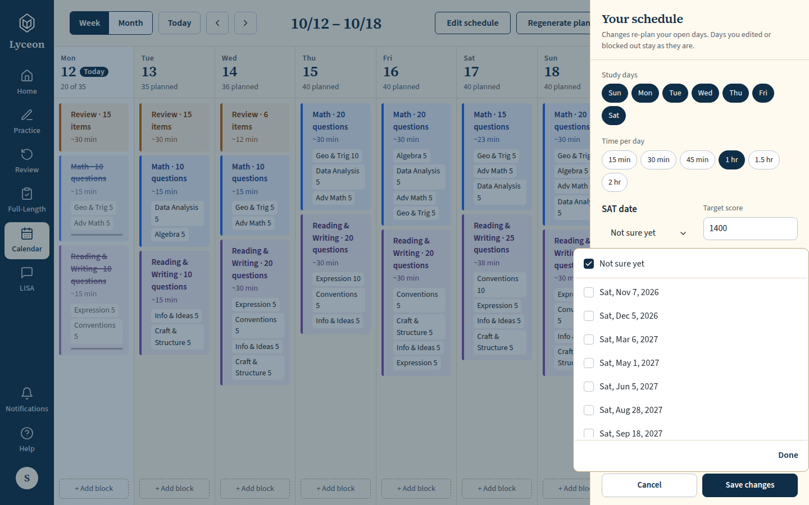 `/calendar`, 205 KB, horizontal overflow 0px | none |
| desktop | dark | 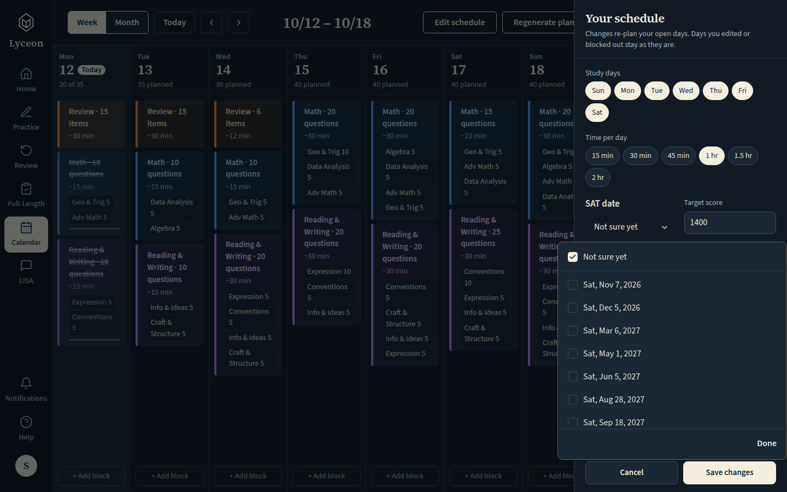 `/calendar`, 201 KB, horizontal overflow 0px | none |
| mobile | light | 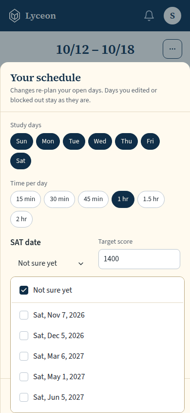 `/calendar`, 48 KB, horizontal overflow 0px | none |
| mobile | dark | 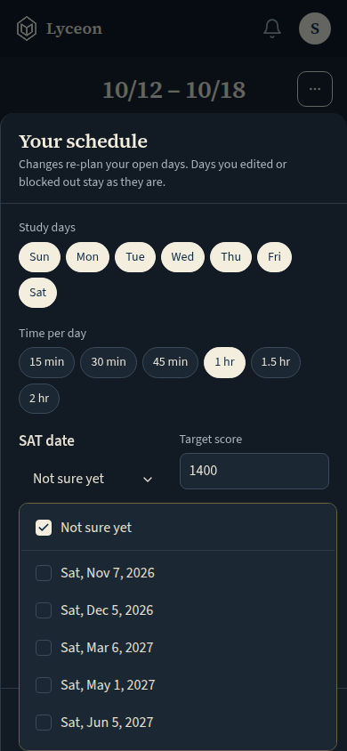 `/calendar`, 49 KB, horizontal overflow 0px | none |

## Home, paid: recent sessions with long titles (several skills or domains chosen): two lines and an ellipsis, never five; the third row's short title is untouched

Persona: `paid`. Route: `/dashboard`.
Stubbed in the browser: `GET /api/review/pool` is answered by the browser itself and never reaches the server. The seeded sessions all have short titles; production's long ones come from several skills chosen. The body is built by the shared `reviewPoolSummaryResponseSchema` with canonical skill and domain names.
Full page: the whole document, not just the viewport.
Prototype: none. NOT PROTOTYPED: the dropdown SAT-date picker and the two-line title rule are the owner brief of 2026-10-11 (DESIGN.md §5 UI standards); built to DESIGN.md's tokens.

| Viewport | Theme (as rendered) | Built | Prototype |
|---|---|---|---|
| desktop | light | 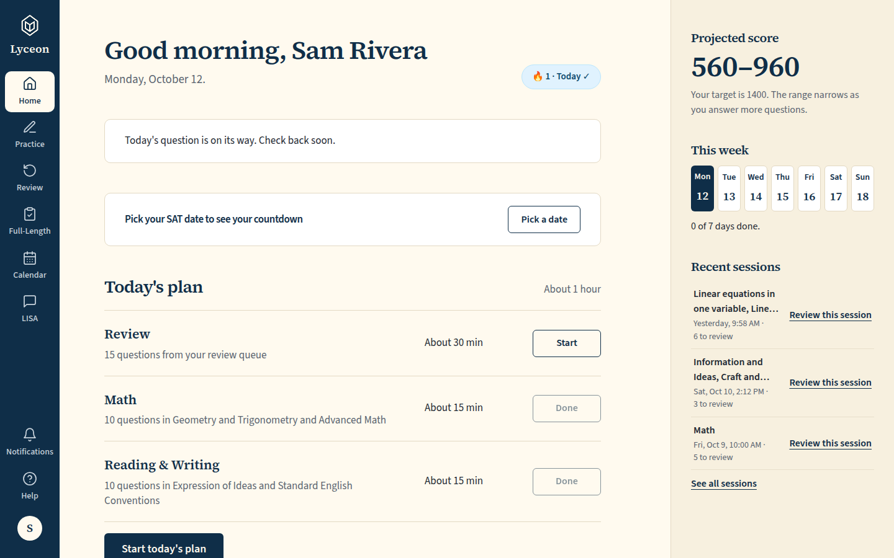 `/dashboard`, 145 KB, horizontal overflow 0px | none |
| desktop | dark | 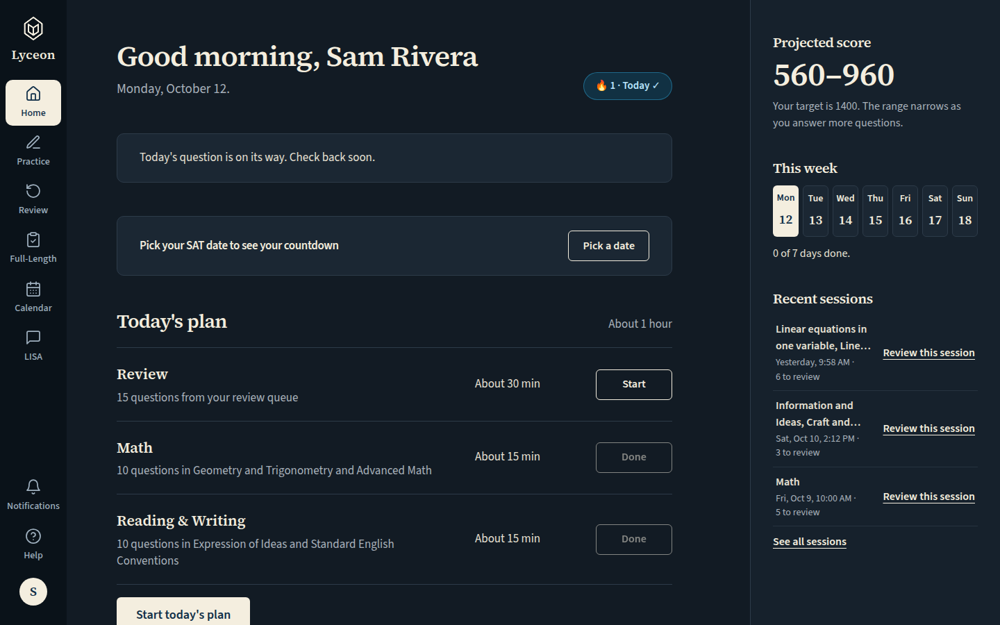 `/dashboard`, 146 KB, horizontal overflow 0px | none |
| mobile | light | 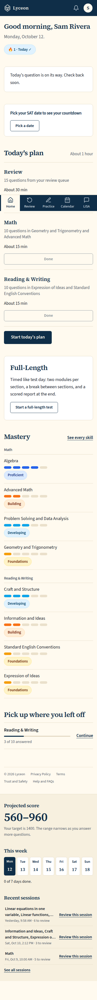 `/dashboard`, 224 KB, horizontal overflow 0px | none |
| mobile | dark | 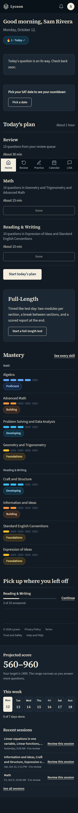 `/dashboard`, 229 KB, horizontal overflow 0px | none |

## Home, paid: 'Recent sessions', each title at most two lines with an ellipsis (full text on hover and focus)

Persona: `paid`. Route: `/dashboard`.
Full page: the whole document, not just the viewport.
Prototype: none. NOT PROTOTYPED: the dropdown SAT-date picker and the two-line title rule are the owner brief of 2026-10-11 (DESIGN.md §5 UI standards); built to DESIGN.md's tokens.

| Viewport | Theme (as rendered) | Built | Prototype |
|---|---|---|---|
| desktop | light | 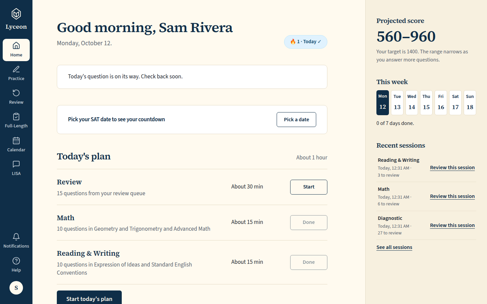 `/dashboard`, 141 KB, horizontal overflow 0px | none |
| desktop | dark | 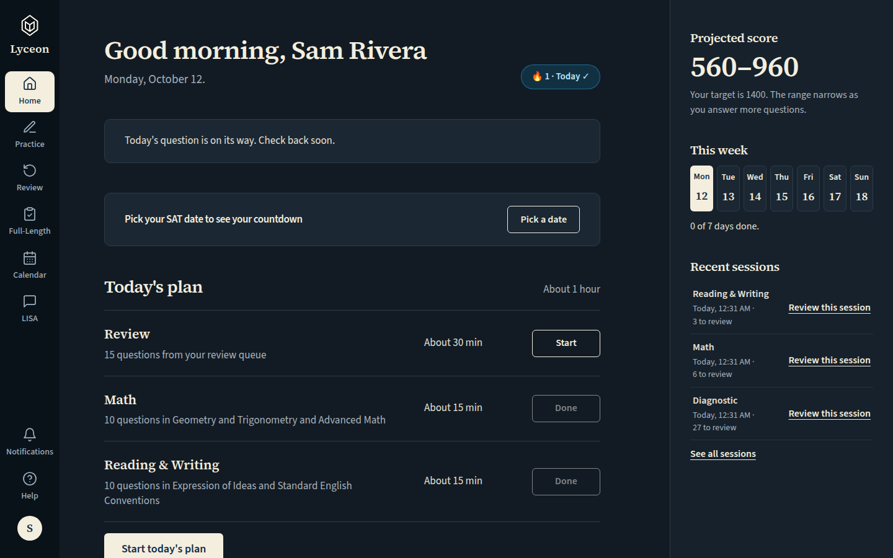 `/dashboard`, 142 KB, horizontal overflow 0px | none |
| mobile | light | 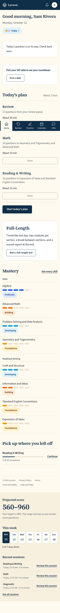 `/dashboard`, 217 KB, horizontal overflow 0px | none |
| mobile | dark | 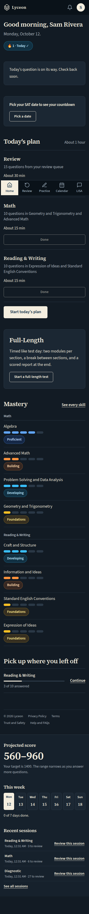 `/dashboard`, 222 KB, horizontal overflow 0px | none |

## Run facts

- Seeded ids: `{"free":{"completedPracticeSessionId":"61329ddb-ab16-4108-b793-415e9757bd70","openPracticeSessionId":"35f3d53b-3e84-4fa2-aa1a-bb423efaec5f","openReviewSessionId":null,"diagnosticSessionId":null,"scoredExamSessionId":null,"inProgressExamSessionId":null,"lisaConversationId":null,"answered":13},"paid":{"completedPracticeSessionId":"354f3b3d-baa0-4d7e-97ef-eaf4967c28a4","openPracticeSessionId":"9d095412-b0df-4e44-a731-7fbaa5ffdab1","openReviewSessionId":null,"diagnosticSessionId":"bf244bed-9c16-4ccf-845f-cca85f434886","scoredExamSessionId":null,"inProgressExamSessionId":null,"lisaConversationId":null,"answered":53}}`
- Endpoints the pages asked for that the harness does not serve (answered 404): none
- Desmos (QA2-B, opt-in `STUDENT_HARNESS_DESMOS=1`): not loaded (a local-only run; the calculator shows its unavailable line)
- External hosts blocked: none
